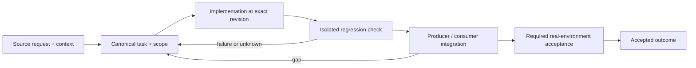

# Independent review roles, models, routes and presets

Status: recovery specification / proposed contract; not a claim of completed implementation.

Owner and acceptance coordinator: https://github.com/alex-mextner/rig-cli/issues/521

## Original requests and editorial provenance

> Очень много запросов ship-review-quorum Approve. Почему? Сколько раз объяснять: даже если доступна только одна модель, она должна уметь заполнять собой все роли в любом режиме review. Полная ортогональность. Когда мы это доделаем? Используй review brainstorm с Astra high.

Source **Q227**; compiled-memory-attribution; MEMORY.md standing lesson: One model must fill every review role, every mode; PDF page(s) 85. Cross-ticket thematic requirement; check context before applying to a narrower issue.

Original wording (before editorial correction)

> очень много таких запросов [ship-review-quorum Approve]--но какого хрена? сколько раз объяснять даже если одна модель только есть она должна уметь заполнять собой все роли для любого режима review, полная ортогональность / когда мы уже это доделаем? используй review brainstorm с astra high

> Если доступна одна модель, она должна заполнить все роли.

Source **Q058**; compiled-fragment-attribution; rig-zerobug/rig-fable session 2026-09-04..07; agent=QuorumPad, Implement433Pad; PDF page(s) 9. Cross-ticket thematic requirement; check context before applying to a narrower issue.

Original wording (before editorial correction)

> одна модель доступна она должна заполнить все роли

> В ролях — модели, а не харнесы.

Source **Q170**; compiled-fragment-attribution; rig-zerobug/rig-fable session 2026-09-04..07; agent=QuorumPad; PDF page(s) 16. Cross-ticket thematic requirement; check context before applying to a narrower issue.

Original wording (before editorial correction)

> в ролях модели а не харнесы

> Список fallback-моделей.

Source **Q168**; compiled-fragment-attribution; rig-zerobug/rig-fable session 2026-09-04..07; agent=QuorumPad, Implement433Pad; PDF page(s) 15. Cross-ticket thematic requirement; check context before applying to a narrower issue.

Original wording (before editorial correction)

> список моделей фолбеков

## Boundary and intended behavior

Model, provider, account, harness, effort and review role are distinct dimensions. Preserve requested roles through fallback, all supported modes and --pool 0. Record actual executed roles/routes, not planned seats or duplicate generic prompts.

## Realistic worked example

Only one paid model is available. It performs four separate reviews with security, performance, correctness and test-design prompts. Four roles are covered, but the report still states one underlying model; it does not invent four independent models or disable the role requirement.

## Acceptance procedure

1. Reproduce the exact operation in an isolated checkout at a named revision.
2. Capture actual and expected behavior; distinguish a product failure from a missing dependency or unsupported platform.
3. Exercise the corresponding producer/consumer boundary, failure/restart case and a negative case.
4. Attach durable output and separately record any real-machine/provider/UI acceptance.
5. Close only the accepted outcome; a merged slice does not close a larger parent.

## State-transition diagram

## Complete linked backlog

| Ticket | Scope | Provider state | Verification |
|---|---|---|---|
| [agent-tools#22](https://github.com/alex-mextner/agent-tools/issues/22) | Self-hosted security findings dashboard (copy GitHub code-scanning UI, improve it) | open | open-outcome-requires-acceptance |
| [agent-tools#242](https://github.com/alex-mextner/agent-tools/issues/242) | Guard B ship review-quorum gate authorizes on a 0/0 quorum read (latent bypass) | open | open-outcome-requires-acceptance |
| [agent-tools#332](https://github.com/alex-mextner/agent-tools/issues/332) | ROADMAP.md: fix stale permission-guard merge status + doc-drift found during PR review-quorum pass | open | open-outcome-requires-acceptance |
| [agent-tools#523](https://github.com/alex-mextner/agent-tools/issues/523) | ship: review-quorum gate accepts literal GitHub issue references as ticket codes | closed | historical-closure-not-reaccepted |
| [agent-tools#644](https://github.com/alex-mextner/agent-tools/issues/644) | ship-review-quorum: authorize on roles filled, not distinct_models | closed | historical-closure-not-reaccepted |
| [agent-tools#648](https://github.com/alex-mextner/agent-tools/issues/648) | ship-review-quorum: one live model fills every role seat | closed | historical-closure-not-reaccepted |
| [agent-tools#687](https://github.com/alex-mextner/agent-tools/issues/687) | task.agentModelOverrides / modelRoles edits to ~/.omp/agent/config.yml are not picked up by live task-tool dispatches, contradicting documented preflight reload | open | open-outcome-requires-acceptance |
| [dev-cli#10](https://github.com/alex-mextner/dev-cli/issues/10) | dev-cli: safe cleanup commands gated by rules.yaml and review quorum | closed | historical-closure-not-reaccepted |
| [review-cli#24](https://github.com/alex-mextner/review-cli/issues/24) | Make ALL board models agentic via opencode (re-investigate commandcode + GLM custom provider) | closed | historical-closure-not-reaccepted |
| [review-cli#45](https://github.com/alex-mextner/review-cli/issues/45) | dashboard: add JS unit tests for resolveModel/filteredRuns + fix lib-absent smoke exit code | closed | historical-closure-not-reaccepted |
| [review-cli#57](https://github.com/alex-mextner/review-cli/issues/57) | Add GLM 5.2 via commandcode as a read-only review board seat, priority directly under Opus | closed | historical-closure-not-reaccepted |
| [review-cli#78](https://github.com/alex-mextner/review-cli/issues/78) | board: resolve seats from the shared models.yaml manifest by CAPABILITY (rig#8 consumer-side residual) | closed | historical-closure-not-reaccepted |
| [review-cli#112](https://github.com/alex-mextner/review-cli/issues/112) | ruff: E402 in tests/test_dashboard_service.py blocks CI on every PR | closed | historical-closure-not-reaccepted |
| [review-cli#123](https://github.com/alex-mextner/review-cli/issues/123) | smoke.py: dashboard status (nothing running) returns exit 4, test expects exit 3 | open | open-outcome-requires-acceptance |
| [review-cli#124](https://github.com/alex-mextner/review-cli/issues/124) | Companion --visual (review diff/brainstorm/quorum --visual) never hard-vetoes on ANY built-in module block, only the standalone pipeline does | open | open-outcome-requires-acceptance |
| [review-cli#126](https://github.com/alex-mextner/review-cli/issues/126) | Add --effort flag: per-run reasoning effort control across backends | open | open-outcome-requires-acceptance |
| [review-cli#131](https://github.com/alex-mextner/review-cli/issues/131) | review task --quorum-check: quorum gate for self-merge authority | closed | historical-closure-not-reaccepted |
| [review-cli#134](https://github.com/alex-mextner/review-cli/issues/134) | review task: rename --quorum-check to --check (avoid collision with review quorum) | closed | historical-closure-not-reaccepted |
| [review-cli#136](https://github.com/alex-mextner/review-cli/issues/136) | quorum gate: count only PASSED review iterations, not just dispatched ones | closed | historical-closure-not-reaccepted |
| [review-cli#137](https://github.com/alex-mextner/review-cli/issues/137) | self-merge-authority quorum: should non-review modes (brainstorm/quorum/just-ask) count toward the gate at all | open | open-outcome-requires-acceptance |
| [review-cli#139](https://github.com/alex-mextner/review-cli/issues/139) | review pool: gemini-2.5-flash seat 404s (stale model) — counts as a dispatched-but-empty reviewer in quorum | open | open-outcome-requires-acceptance |
| [review-cli#142](https://github.com/alex-mextner/review-cli/issues/142) | review-cli: add model presets and Codex update hygiene | open | open-outcome-requires-acceptance |
| [review-cli#146](https://github.com/alex-mextner/review-cli/issues/146) | Add review presets and Sol seat | closed | historical-closure-not-reaccepted |
| [review-cli#156](https://github.com/alex-mextner/review-cli/issues/156) | review-cli: handler-level regression test for qa --effort boundary | open | open-outcome-requires-acceptance |
| [review-cli#162](https://github.com/alex-mextner/review-cli/issues/162) | review-cli: log/jobs dir write denied inside a sandboxed caller kills the whole seat (Fable/claude-p exit 127) | closed | historical-closure-not-reaccepted |
| [review-cli#165](https://github.com/alex-mextner/review-cli/issues/165) | Add opencode/grok (xai/grok-4.5) as a default review-cli panel seat | closed | historical-closure-not-reaccepted |
| [review-cli#171](https://github.com/alex-mextner/review-cli/issues/171) | review-cli: board failover reuses the original route's per-provider effort after a mid-review provider switch | open | open-outcome-requires-acceptance |
| [review-cli#182](https://github.com/alex-mextner/review-cli/issues/182) | Detailed per-harness token-burn stats + fix diff-cap and Fable dispatch waste | closed | historical-closure-not-reaccepted |
| [review-cli#185](https://github.com/alex-mextner/review-cli/issues/185) | review stat: per-harness token-burn report + diff cap + Fable cooldown | closed | historical-closure-not-reaccepted |
| [review-cli#189](https://github.com/alex-mextner/review-cli/issues/189) | Quorum moderator omits capped diff context | open | open-outcome-requires-acceptance |
| [review-cli#190](https://github.com/alex-mextner/review-cli/issues/190) | Keep Fable cooldown and stat attribution model-specific | open | open-outcome-requires-acceptance |
| [review-cli#192](https://github.com/alex-mextner/review-cli/issues/192) | brainstorm/quorum/just-ask silently truncate an oversized diff with no stderr warning | open | open-outcome-requires-acceptance |
| [review-cli#193](https://github.com/alex-mextner/review-cli/issues/193) | Cached-cooldown-skip sentinels display as ok in quorum/just-ask/brainstorm/review output | open | open-outcome-requires-acceptance |
| [review-cli#205](https://github.com/alex-mextner/review-cli/issues/205) | review-cli: multi-role model reuse + usage-limit exclusion for board/panel composition | closed | historical-closure-not-reaccepted |
| [review-cli#213](https://github.com/alex-mextner/review-cli/issues/213) | Bind quorum-store iterations to repo/diff identity, closing 3 real task-code pollution incidents | closed | historical-closure-not-reaccepted |
| [review-cli#221](https://github.com/alex-mextner/review-cli/issues/221) | review-quorum gate should tolerate an unavailable/flaky model instead of hard-blocking at exactly N distinct models | closed | historical-closure-not-reaccepted |
| [review-cli#229](https://github.com/alex-mextner/review-cli/issues/229) | board-deadline clamp: per-process arming, post-semaphore-wait clamp, wall-vs-idle bound, save/restore ownership | open | open-outcome-requires-acceptance |
| [review-cli#240](https://github.com/alex-mextner/review-cli/issues/240) | Review cross-file consistency of uncommitted min-roles diff | closed | historical-closure-not-reaccepted |
| [review-cli#241](https://github.com/alex-mextner/review-cli/issues/241) | Suppress min-roles hint for identity-excluded history | open | open-outcome-requires-acceptance |
| [review-cli#242](https://github.com/alex-mextner/review-cli/issues/242) | Review min-roles diff for cross-file regressions | closed | historical-closure-not-reaccepted |
| [review-cli#248](https://github.com/alex-mextner/review-cli/issues/248) | Adversarial review-rigor: neutral prompts, evidence requirement, refutation pass, adversarial role blending | open | open-outcome-requires-acceptance |
| [review-cli#251](https://github.com/alex-mextner/review-cli/issues/251) | review-cli#246 follow-up: bare --check hard-fails tasks with zero role-tagged history | closed | historical-closure-not-reaccepted |
| [review-cli#259](https://github.com/alex-mextner/review-cli/issues/259) | Cooldown key, actual dispatch, and dashboard identity can disagree for a catch-all colon-form model id | open | open-outcome-requires-acceptance |
| [review-cli#276](https://github.com/alex-mextner/review-cli/issues/276) | review diff: pool silently shrinks below requested size with zero visible notice | closed | historical-closure-not-reaccepted |
| [review-cli#277](https://github.com/alex-mextner/review-cli/issues/277) | pool-shortfall notice: surface the selector's real exclusion reason, and thread it into the review artifact itself | open | open-outcome-requires-acceptance |
| [review-cli#280](https://github.com/alex-mextner/review-cli/issues/280) | HEAVY_PRESET_BOARD dispatches claude:claude-fable-5 despite it being paywalled (100% failure) | open | open-outcome-requires-acceptance |
| [review-cli#285](https://github.com/alex-mextner/review-cli/issues/285) | test_run_stats.py: two board-failover tests already fail on main (pre-existing, unrelated to Fable work) | open | open-outcome-requires-acceptance |
| [review-cli#286](https://github.com/alex-mextner/review-cli/issues/286) | Fable seat: cooldown catches too few doomed dispatches + priority-1 wastes every review's first slot | closed | historical-closure-not-reaccepted |
| [review-cli#288](https://github.com/alex-mextner/review-cli/issues/288) | Fix Fable cooldown bounds and heavy-preset contract drift | open | open-outcome-requires-acceptance |
| [review-cli#291](https://github.com/alex-mextner/review-cli/issues/291) | Adversarial review of Fable preset configuration diff | closed | historical-closure-not-reaccepted |
| [review-cli#293](https://github.com/alex-mextner/review-cli/issues/293) | Consolidate parser.py's _CLAUDE_FABLE_MODEL into config.FABLE_SEAT | open | open-outcome-requires-acceptance |
| [review-cli#297](https://github.com/alex-mextner/review-cli/issues/297) | dashboard _fallback_seat_for ignores active preset — now shows Fable as GLM's fallback in both presets | open | open-outcome-requires-acceptance |
| [review-cli#298](https://github.com/alex-mextner/review-cli/issues/298) | Review Fable cooldown reliability diff | closed | historical-closure-not-reaccepted |
| [review-cli#299](https://github.com/alex-mextner/review-cli/issues/299) | Dashboard fallback hint must respect Fable preset exclusion | closed | historical-closure-not-reaccepted |
| [review-cli#305](https://github.com/alex-mextner/review-cli/issues/305) | review-cli: rounds default 3, brainstorm incremental diff-grounding, light preset as default | closed | historical-closure-not-reaccepted |
| [review-cli#306](https://github.com/alex-mextner/review-cli/issues/306) | preset_pool_size(None)/load_board({}) don't derive from DEFAULT_PRESET (unlike preset_board(None)) | open | open-outcome-requires-acceptance |
| [review-cli#315](https://github.com/alex-mextner/review-cli/issues/315) | Unified capability-tagged model roster: every model available in every mode (diff/quorum/just-ask/brainstorm/visual) instead of per-mode hardcoded lists | open | open-outcome-requires-acceptance |
| [review-cli#317](https://github.com/alex-mextner/review-cli/issues/317) | review stat / dashboard: full log-dir re-parse on every request is unusably slow at scale | closed | historical-closure-not-reaccepted |
| [review-cli#319](https://github.com/alex-mextner/review-cli/issues/319) | Make call-log cache safe across dashboard threads and untrusted cache rows | open | open-outcome-requires-acceptance |
| [review-cli#321](https://github.com/alex-mextner/review-cli/issues/321) | Interactive cross-account usage/cost stats dashboard (tokens, $, wasted spend on failed runs) | open | open-outcome-requires-acceptance |
| [review-cli#322](https://github.com/alex-mextner/review-cli/issues/322) | review dashboard status reports stale default port (7878) instead of the actual bound port after --port override | open | open-outcome-requires-acceptance |
| [review-cli#323](https://github.com/alex-mextner/review-cli/issues/323) | review dashboard /api/stats never returns on a large log_dir() -- reproduced: >150s, 0 bytes, on 10GB / 130,668 files | open | open-outcome-requires-acceptance |
| [review-cli#326](https://github.com/alex-mextner/review-cli/issues/326) | dashboard: loading the full ~10GB call-log directory (about 132k files) balloons the process to 32.8GB RSS and can thrash the machine | closed | historical-closure-not-reaccepted |
| [review-cli#327](https://github.com/alex-mextner/review-cli/issues/327) | dashboard session cache: concurrent different-gap requests can race and stampede the parser | open | open-outcome-requires-acceptance |
| [review-cli#328](https://github.com/alex-mextner/review-cli/issues/328) | dashboard: three low-severity gaps left from the review-cli#323 concurrency fix (SSE parse guard, cold-window 404s, get_derived single-flight) | open | open-outcome-requires-acceptance |
| [review-cli#330](https://github.com/alex-mextner/review-cli/issues/330) | dashboard: add review-diff model-breakdown/frequency stat view (by preset) | open | open-outcome-requires-acceptance |
| [review-cli#332](https://github.com/alex-mextner/review-cli/issues/332) | Fix dashboard body cap cache invalidation and stderr retention | open | open-outcome-requires-acceptance |
| [review-cli#334](https://github.com/alex-mextner/review-cli/issues/334) | Preserve dashboard classification signals when capping call-log bodies | open | open-outcome-requires-acceptance |
| [review-cli#335](https://github.com/alex-mextner/review-cli/issues/335) | dashboard: body-derived diagnostic markers (skill_md/memory_md/diff counts) can be lost to body truncation | open | open-outcome-requires-acceptance |
| [review-cli#342](https://github.com/alex-mextner/review-cli/issues/342) | Keep dashboard quota classification aligned with cooldown markers | open | open-outcome-requires-acceptance |
| [review-cli#343](https://github.com/alex-mextner/review-cli/issues/343) | Redesign dashboard Stats view: interactive timeline + per-dimension breakdown | open | open-outcome-requires-acceptance |
| [review-cli#345](https://github.com/alex-mextner/review-cli/issues/345) | Session-detail view: stderr-only rendering, missing round grouping, missing roles/prompts | open | open-outcome-requires-acceptance |
| [review-cli#347](https://github.com/alex-mextner/review-cli/issues/347) | Dashboard board-lens views ignore per-repo custom board config and rewrite history | open | open-outcome-requires-acceptance |
| [review-cli#348](https://github.com/alex-mextner/review-cli/issues/348) | Dashboard Models tab shows junk rows from malformed -m input and leaked test logs | open | open-outcome-requires-acceptance |
| [review-cli#351](https://github.com/alex-mextner/review-cli/issues/351) | Dashboard ok/error accounting undercounts paywall and empty-output calls as OK | open | open-outcome-requires-acceptance |
| [review-cli#353](https://github.com/alex-mextner/review-cli/issues/353) | Unisolated brainstorm tests leak junk into real dashboard log dir | closed | historical-closure-not-reaccepted |
| [review-cli#357](https://github.com/alex-mextner/review-cli/issues/357) | review-cli: wire CLI review-feedback annotations into the dashboard session view | open | open-outcome-requires-acceptance |
| [review-cli#362](https://github.com/alex-mextner/review-cli/issues/362) | Dashboard tabs show a false empty state during background reload; Metrics duration rounds to a bogus 60s | closed | historical-closure-not-reaccepted |
| [review-cli#364](https://github.com/alex-mextner/review-cli/issues/364) | review-cli: make harness, provider, model, effort, and review mode compose independently instead of tangled seat strings | open | open-outcome-requires-acceptance |
| [review-cli#365](https://github.com/alex-mextner/review-cli/issues/365) | review-cli: add named preset tiers so commit-time review runs medium and PR-time review runs large | open | open-outcome-requires-acceptance |
| [review-cli#369](https://github.com/alex-mextner/review-cli/issues/369) | Dashboard Metrics tab may silently under-report token cost on large reviews (unresolved high-risk review finding) | open | open-outcome-requires-acceptance |
| [review-cli#371](https://github.com/alex-mextner/review-cli/issues/371) | Dashboard Models-tab junk-row filter regex flagged as a silent full-history regression -- unresolved finding | open | open-outcome-requires-acceptance |
| [review-cli#372](https://github.com/alex-mextner/review-cli/issues/372) | test(config): cover load_board's raw board entry path keeps a configured Fable entry | open | open-outcome-requires-acceptance |
| [review-cli#373](https://github.com/alex-mextner/review-cli/issues/373) | Replace redundant bare-codex board seat with GPT 6 Astra in review-cli | closed | historical-closure-not-reaccepted |
| [review-cli#375](https://github.com/alex-mextner/review-cli/issues/375) | Adversarial review of dashboard reload diff | closed | historical-closure-not-reaccepted |
| [review-cli#376](https://github.com/alex-mextner/review-cli/issues/376) | Dashboard must distinguish cold-cache placeholder from empty data | open | open-outcome-requires-acceptance |
| [review-cli#377](https://github.com/alex-mextner/review-cli/issues/377) | review dashboard stop/disable report success while an ad-hoc run instance on the same port stays alive | closed | historical-closure-not-reaccepted |
| [review-cli#379](https://github.com/alex-mextner/review-cli/issues/379) | Review zero-role fallback diff | closed | historical-closure-not-reaccepted |
| [review-cli#382](https://github.com/alex-mextner/review-cli/issues/382) | Give under-covered review-board roles a live paid fallback (quality, performance, security, tests) | closed | historical-closure-not-reaccepted |
| [review-cli#384](https://github.com/alex-mextner/review-cli/issues/384) | Attribute Claude CLI Sonnet board calls in dashboard logs | open | open-outcome-requires-acceptance |
| [review-cli#385](https://github.com/alex-mextner/review-cli/issues/385) | Register Terra (codex:gpt-5.6-terra) in the dashboard model identity map | open | open-outcome-requires-acceptance |
| [review-cli#413](https://github.com/alex-mextner/review-cli/issues/413) | Review hard-cooldown pool padding diff | closed | historical-closure-not-reaccepted |
| [review-cli#414](https://github.com/alex-mextner/review-cli/issues/414) | Review reuse-aware pool cooldown diff | closed | historical-closure-not-reaccepted |
| [review-cli#415](https://github.com/alex-mextner/review-cli/issues/415) | Wire Grok 4.6 via xAI OAuth into review for every -m-honoring mode | closed | historical-closure-not-reaccepted |
| [review-cli#417](https://github.com/alex-mextner/review-cli/issues/417) | Review Grok 4.6 xAI seat diff | closed | historical-closure-not-reaccepted |
| [review-cli#418](https://github.com/alex-mextner/review-cli/issues/418) | Skip unavailable Grok default in just-ask | closed | historical-closure-not-reaccepted |
| [review-cli#422](https://github.com/alex-mextner/review-cli/issues/422) | Prevent duplicate generic prompts from mixed unknown-role boards | open | open-outcome-requires-acceptance |
| [review-cli#423](https://github.com/alex-mextner/review-cli/issues/423) | Review pool guard failover wiring diff | closed | historical-closure-not-reaccepted |
| [review-cli#434](https://github.com/alex-mextner/review-cli/issues/434) | Audit pool-zero role repair | open | open-outcome-requires-acceptance |
| [review-cli#435](https://github.com/alex-mextner/review-cli/issues/435) | Correct pool-zero role-repair diagnostic | open | open-outcome-requires-acceptance |
| [review-cli#437](https://github.com/alex-mextner/review-cli/issues/437) | throttle review pool by live harness 5h/7d limits | closed | historical-closure-not-reaccepted |
| [review-cli#441](https://github.com/alex-mextner/review-cli/issues/441) | Prevent false ship quorum when task panel backends degrade | open | open-outcome-requires-acceptance |
| [review-cli#442](https://github.com/alex-mextner/review-cli/issues/442) | Make default recorded panel runs meet the ship-role floor after backend loss | open | open-outcome-requires-acceptance |
| [review-cli#445](https://github.com/alex-mextner/review-cli/issues/445) | Board roles name fallback models; --show-board lists them | closed | historical-closure-not-reaccepted |
| [review-cli#447](https://github.com/alex-mextner/review-cli/issues/447) | Stop dashboard hot path scaling with the 154k-file log corpus | open | open-outcome-requires-acceptance |
| [review-cli#450](https://github.com/alex-mextner/review-cli/issues/450) | Add MiMo 2.5 as a review-cli board seat | open | open-outcome-requires-acceptance |
| [review-cli#454](https://github.com/alex-mextner/review-cli/issues/454) | Walk ROLE_FALLBACK_MODELS before different-role reserve | open | open-outcome-requires-acceptance |
| [review-cli#455](https://github.com/alex-mextner/review-cli/issues/455) | Validate pool-limited live board selection | open | open-outcome-requires-acceptance |
| [review-cli#457](https://github.com/alex-mextner/review-cli/issues/457) | Audit MiMo default board seat integration | open | open-outcome-requires-acceptance |
| [review-cli#460](https://github.com/alex-mextner/review-cli/issues/460) | review diff doesn't clearly diagnose or report WHY a seat failed (quota/credits exhausted looks identical to a real bug), and its reserve-pool fallback has a 0% success rate under a real quota-exhaustion window | open | open-outcome-requires-acceptance |
| [review-cli#469](https://github.com/alex-mextner/review-cli/issues/469) | review diff: hard-unavailable board seats vanish with no log record | open | open-outcome-requires-acceptance |
| [review-cli#487](https://github.com/alex-mextner/review-cli/issues/487) | [EPIC] Interactive entity browser: unified inventory, live health and keyboard TUI | open | open-outcome-requires-acceptance |
| [review-cli#496](https://github.com/alex-mextner/review-cli/issues/496) | Entities: keyboard TUI with drill-down, refresh and non-TTY fallback | open | open-outcome-requires-acceptance |
| [rig-cli#201](https://github.com/alex-mextner/rig-cli/issues/201) | ROADMAP.md: fix stale permission-guard merge status + doc-drift found during PR review-quorum pass | closed | historical-closure-not-reaccepted |
| [rig-cli#228](https://github.com/alex-mextner/rig-cli/issues/228) | Fast onboarding verification for a new developer or coding agent | open | open-outcome-requires-acceptance |
| [rig-cli#232](https://github.com/alex-mextner/rig-cli/issues/232) | Declarative employee/agent role profiles for permissions and development policy | open | open-outcome-requires-acceptance |
| [rig-cli#241](https://github.com/alex-mextner/rig-cli/issues/241) | Policy dashboards should distinguish enforcement, recommendation, drift and migration debt | open | open-outcome-requires-acceptance |
| [rig-cli#470](https://github.com/alex-mextner/rig-cli/issues/470) | Add MiMo 2.5 as a review-cli board seat | open | open-outcome-requires-acceptance |
| [rig-cli#495](https://github.com/alex-mextner/rig-cli/issues/495) | New zsh/spaceship 'device not configured' pty errors appear only inside tmux panes -- likely system-wide PTY pool exhaustion, not a rig.tmux.conf bug | open | open-outcome-requires-acceptance |
| [rig-cli#500](https://github.com/alex-mextner/rig-cli/issues/500) | tmux clipboard command re-resolves PATH and WAYLAND_DISPLAY per invocation, risking apply-vs-status drift on Linux | open | open-outcome-requires-acceptance |
| [tg-cli#59](https://github.com/alex-mextner/tg-cli/issues/59) | /agent shows useless duplicate text rows + no buttons — make it an inline-keyboard picker with distinct labels | closed | historical-closure-not-reaccepted |
| [tg-cli#86](https://github.com/alex-mextner/tg-cli/issues/86) | tg-ctl forum-topics increment-4 polish: recent-path buttons, clear model keyboard, re-spawn on dead pane, crash-orphan reconcile | closed | historical-closure-not-reaccepted |
| [tg-cli#342](https://github.com/alex-mextner/tg-cli/issues/342) | Telegram /agent does not match landing or rig-fable on live omp | closed | historical-closure-not-reaccepted |
