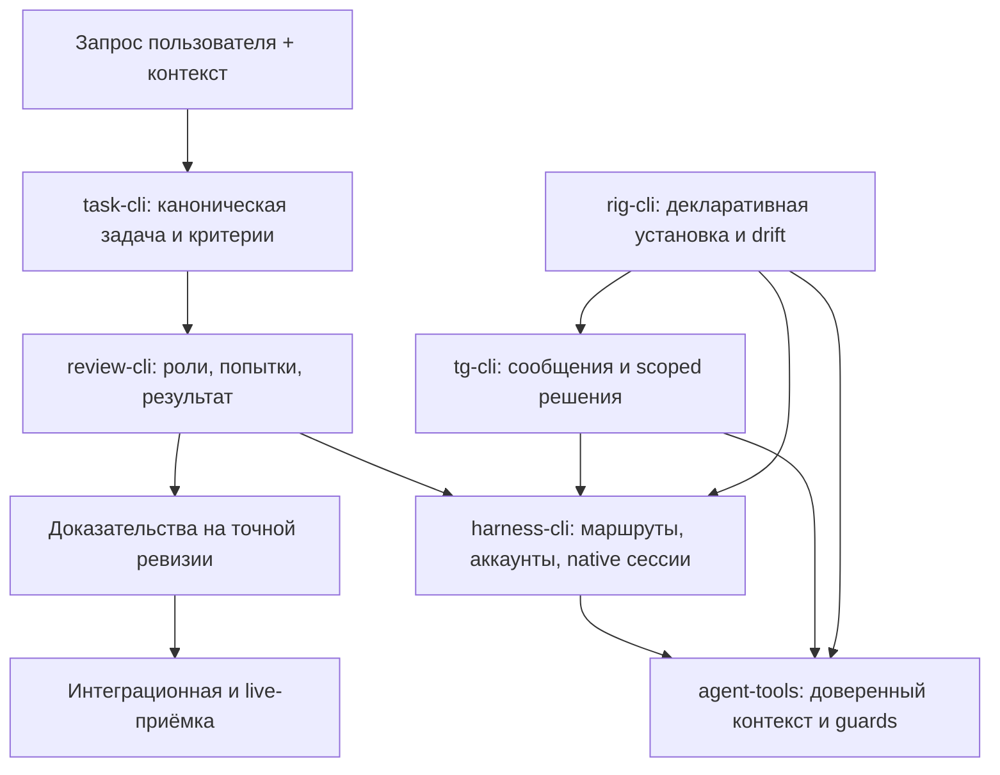

# Rig ecosystem: восстановление работоспособности и полная приёмка

**Статус:** спецификация восстановления и проверки; не утверждение, что все функции приняты.
**Эпик:** https://github.com/alex-mextner/rig-cli/issues/521
**Срез:** 10 сентября 2026. Все публичные issues и PR, без ограничения последними десятью днями; отдельный взгляд на изменения с 31 августа.

## Исходное поручение

> Выполни полный груминг всех задач: консолидацию, связи, исправление и улучшение описаний. Добавь мои исходные запросы цитатами с исправлением стилистики, орфографии и пунктуации. Всё влитое и сделанное нужно перепроверить: за последние десять дней почти ничего не заработало как надо или вообще не заработало.

Source Qcurrent-2026-09-10; current-user-message; Current ChatGPT conversation, 2026-09-10; recovery mandate, not the original feature request for every issue.. Текущее поручение на полный груминг, не исходная постановка каждой исторической функции.

Original wording

> выполни полную работу по грумингу всех тасков, консолидация, связи, исправление и улучшение описаний
> во все тикеты добавь мои исходные запросы цитатами с испоаврелеием стилистики и орфографии и пунктуации
> все влитое и сделанное надо перепроверить, там скорее всего много багов потому что почти ничего из того что делалось за 10 дней так и не заработало как надо или вообще не заработало

## Что именно проверено и что в источниках было неверно

Полный публичный реестр содержит 1519 issues и 935 PR в 11 репозиториях. Приватный harness-cli учитывается отдельно: его исходный код не переносится в публичный реестр. Загрузка всех описаний и комментариев доказывает полноту чтения реестра, но не работоспособность всех функций.

Приложенный экспорт запросов содержит 374 записи. Из них 117 — сгенерированные названия GitHub-задач, 10 — пересказы агента; их нельзя приписывать Алексу как дословные запросы. Ещё 18 сообщений относятся к стороннему клиентскому проекту и не публикуются здесь. В реестре цитат 229 относящихся к экосистеме записей плюс текущее поручение; фрагментарность и косвенная атрибуция обозначены.

Второе приложение — проверка ссылок на изображения в 715 задачах, а не функциональное тестирование. `fixed` может означать повторное добавление локального пути, который GitHub всё равно не показывает. `missing` может означать лишь слово screenshot в критерии будущей проверки. Эти признаки не являются основанием массово закрывать или переоткрывать продуктовые задачи.

Корневой `rig-cli/SPEC.md` посвящён **Evolve**, обозревателю эволюции проекта. Это не master-spec всей экосистемы. Его исходная область, draft-статус и условия интерактивной приёмки сохранены в отдельном документе; эта спецификация не подменяет Evolve другим продуктом.

## Границы компонентов

| Компонент | Владеет | Не должен дублировать |
|---|---|---|
| harness-cli | обнаружение харнесов/сессий, канонические ID, протоколы и фактические наблюдения health | Telegram-карточки и правила merge |
| agent-tools | переносимые guards, нормализация доверенного контекста, применение правил | второй инвентаризатор аккаунтов |
| review-cli | роли, выполнение ревью, fallback и доказательства попыток | собственный независимый парсер credential stores |
| tg-cli | маршрутизация Telegram, durable intent и жизненный цикл человеческого ответа | встроенный ACP-движок для каждого харнеса |
| task-cli | продуктовые задачи, связи, корректное описание и удалённо доступные доказательства | одноразовые todo ревью-агентов |
| rig-cli | декларативная установка, конфигурация и проверка drift | второй scheduler или service supervisor |
| qa/dev/draw/stt/research/pm | собственные пользовательские CLI-сценарии | ложные общие гарантии вместо своих integration checks |

## Пример 1: одна модель, несколько ролей — не несколько выдуманных моделей

> Очень много запросов ship-review-quorum Approve. Почему? Сколько раз объяснять: даже если доступна только одна модель, она должна уметь заполнять собой все роли в любом режиме review. Полная ортогональность. Когда мы это доделаем? Используй review brainstorm с Astra high.

Source Q227; compiled-memory-attribution; MEMORY.md standing lesson: One model must fill every review role, every mode. Требование применяется к каждому режиму ревью, включая деградацию пула.

Original wording

> очень много таких запросов [ship-review-quorum Approve]--но какого хрена? сколько раз объяснять даже если одна модель только есть она должна уметь заполнять собой все роли для любого режима review, полная ортогональность / когда мы уже это доделаем? используй review brainstorm с astra high

Доступен один оплаченный backend. Он последовательно или в допустимом параллелизме выполняет отдельные задания correctness, security, performance и tests с соответствующими промптами. Результат содержит четыре выполненные роли и честно одну модель. `--pool 0`, preset medium/large и повторное использование модели не должны ни убирать роли, ни создавать четыре одинаковых generic prompt. Требование независимых моделей не следует выдумывать вместо запрошенного покрытия ролей.

Связанные исходные задачи: review-cli#364 (независимость измерений), #365 (presets), #433 (pool-zero), #441/#442/#444 (сохранение покрытия), #454 (fallback модели роли); agent-tools#644/#648 (потребитель кворума). Похожесть названий не означает, что все эти интеграционные случаи — дубли.

## Пример 2: неизвестный аккаунт не здоров и не исчерпан

> harness limits --all возвращает что-то интересное, но это скорее usage, а не лимиты. Всё нечитаемо: без цветов и ASCII-графики. rig stats, например, сделан красиво; нужно что-то похожее на скриншот. Найди все мои сообщения о лимитах за всё время в OMP и Claude Code: я писал о скорости, ускорении и аналитике. Нужно показывать все аккаунты всех моделей и провайдеров во всех харнесах: z.ai/GLM, три Claude, Codex, ранее Kimi, x.ai/Grok.

Source Q231; compiled-memory-attribution; MEMORY.md standing lesson: harness limits must show real limits, all accounts, like the screenshot. Исходное требование к лимитам; описание usage не удовлетворяет ему автоматически.

Original wording

> harness limits --all сейчас чтото возвращает вроде и интересное но совершенно не про лимиты, это скорее про usage, и все это абсолютно нечитаемое, не раскрашенное и без ascii графики, rig stats красиво сделано например, должно быть чтото-то такое как на этом скриншоте, и вообще найди все мои сообщеня про лимиты за все время в omp и cc, я писал про скорость и ускорение и аналитику и нужно писать про все аккаунты всех моделей и провайдеров во всех харнесах … z.ai/glm, 3 claudes, codex, ранее было kimi, x.ai/grok

Аккаунт A использовал 100% подтверждённого окна, B — 20%, C временно недоступен для чтения. Нужно использовать B, показывать C как unknown с причиной и временем наблюдения, а не сводить все Claude-аккаунты к худшему проценту. Ошибка локальной базы или transport timeout не является доказательством исчерпания квоты. Отсутствие доказательств исчерпания не равно confirmed available.

Для `all_exhausted=true` нужен непустой полный набор реально допустимых маршрутов/аккаунтов и свежие применимые утвердительные факты по каждому. Реализация capacity producer и ship consumer проверяются вместе, с пустым пулом, устаревшими данными, чужим preset и одним рабочим альтернативным аккаунтом.

## Пример 3: доставить сообщение — не ждать завершения генерации

> Ответы в Telegram всё ещё не работают для OMP-сессий вне tmux. Я же сказал: нужно проработать все сценарии.

Source Q201; compiled-memory-attribution; MEMORY.md standing lesson: Telegram must see every live agent; every reply route must land. Запрос на полный обмен с OMP вне tmux; не только успешное обнаружение в picker.

Original wording

> и реплаи в телеге все еще не работают для omp сессий вне tmux, я ж сказал надо все сценарии проработать

Человек отвечает `landing`, пока `rig-fable` занят. Принятие сообщения сохраняется до продвижения Telegram offset. Следующие updates и другой адресат не ждут окончания полного model turn. Сбой после сохранения восстанавливает тот же operation ID, не новый дублирующий запрос. Внутри адресата порядок сохраняется. Смена PID, pane ID или native session generation не переносит сообщение другому агенту.

Поздний Approve не теряется, но применяется ровно один раз к тому же содержимому и scope. Другой command, repository, commit или origin session требует нового решения. `accepted`, `delivered`, `completed`, `denied`, `unknown` — разные состояния. Фиксированный новый таймер не является заменой правильного владения pending operation.

## Пример 4: hosted CI не запустился — локальная проверка, а не игнорирование ошибки теста

> Какого биллинга ты ждёшь и зачем? Я же сказал: если с CI проблемы, gh ship должен сам прогнать всё локально и разрешить merge, несмотря на CI.

Source Q263; telegram-export; Telegram tg#16245 2026-09-09T09:27:57+00:00. Исходный запрос на локальный путь проверки при проблемах CI.

Original wording

> Какой биллинг ты ждешь и зачем?! Я ж сказал gh ship должен если с ci проблемы сам локально все прогонять и разрешить мержить несмотря на си ай

Недоступность runner/billing инфраструктуры и отрицательный результат исполняемого теста различаются. `gh ship` запускает объявленные эквивалентные проверки локально на точном head SHA и сохраняет результат. Проверяется именно целевой `--repo`, не cwd вызывающего shell. Прошедший локальный тест не даёт права обойти другую защиту, а настоящее падение нельзя переименовать в инфраструктурный outage. Отдельно проверяется merge-time version bump при двух параллельных PR.

## Пример 5: история документа и привязки комментария

Спека изменяется дважды, причём mtime совпадает. Content hash различает наблюдённые версии; изменения между наблюдениями не обещаются восстановленными. Два одинаковых фрагмента в разных секциях дают ambiguous match, а не автоматическую новую привязку. Старый quote/revision сохраняется, переход якоря имеет причину и old/new context. Сравнение двух версий не перезаписывает текущий файл. На узком экране список комментариев и действия доступны без нативных blocking alert/confirm.

## Результаты повторных запусков

Первый изолированный прогон охватил все 11 публичных репозиториев. Для review-cli отсутствие ImageMagick было обнаружено и проверено отдельно, а не записано как 65 разных багов продукта. При ImageMagick 7.1.2-31 осталось **1 воспроизводимое падение** `test_overridden_board_flows_into_panel_jobs_once`; тот же тест падает отдельно. Его подмена одной функции availability не изолирует второй путь проверки CLI. Это требует исправления тестового контракта/изоляции и отдельной проверки реального поведения, а не заявления, что все effort overrides сломаны.

Для tg-cli файл durable question integration дал **один неуспешный и два успешных прогона**; это доказанная нестабильность теста/жизненного цикла, не доказательство постоянной потери каждого ответа. Watermark-файл прошёл 27/27 при обоих вариантах Python после установки системного Pillow. Исходное падение под PATH не названо подтверждённым продуктовым багом без такого различения.

Полные машинные результаты: [первый прогон](https://github.com/alex-mextner/rig-cli/blob/docs/full-grooming-2026-09-10/docs/grooming/full-2026-09-10/test-results.json), [уточняющий прогон](https://github.com/alex-mextner/rig-cli/blob/docs/full-grooming-2026-09-10/docs/grooming/full-2026-09-10/followup-results.json). macOS/LaunchAgent, реальные native события, аккаунты провайдеров и визуальная приёмка установленного продукта остаются отдельными клетками матрицы.

## Ревью старых спецификаций: обязательные поправки

**Harness redesign/shared-lib:** доверие к окружению launcher нельзя переносить на native siblings, разделяющих процесс; source/provider/account identity и временные health-наблюдения не являются одним enum. Существующие библиотеки и установщики сохраняются; новый слой не вводится только ради переименования.

**Telegram decomposition/control:** перенести все reply/topic/permission пути, а не только awareness nudge; сохранить прежние гарантии удержания решений, не удаляя regression tests. Дополнение `requestId` не доказывает scope, если command/repo/native generation не связаны с ним.

**Provider failover:** протокол, модель, роль, аккаунт и effort независимы. Fallback пробует допустимые альтернативы, но не выдаёт отсутствие результата за review success. В журнале остаются все попытки, actual route и terminal cause; cooldown без классификации причины не доказывает исчерпание квоты.

**QA:** mock/fixture/live — разные уровни доказательств. Пользовательский desktop и production Telegram не становятся тестовым fixture. Пропуск live-теста виден; отсутствие бинарника или обязательной зависимости не маскируется зелёным общим счётчиком.

**Rig provisioning/stack/linter/GitHub settings:** apply и status используют один declared state, учитывают provenance и disabled-состояния. Комментарий управляемого файла объясняет альтернативную команду. Установка на диск, PATH и версия живого процесса проверяются раздельно; symlink/TOCTOU и конкурентные config edits имеют отрицательные тесты.

**Evolve:** проверять squarified mosaic, клавиатурный drill-down/up, сохранение выбранного ghost snapshot, честные exact/range/inferred/unavailable symbol bindings и небольшой экран. Парсер Git и CLI smoke не заменяют этот UI-результат. Ранее отложенные/отклонённые направления не включаются обратно автоматически.

## Диаграмма границ ответственности

## Правила консолидации

Настоящий дубль объединяется только после переноса уникальных требований, находок и комментариев в каноническую задачу. `rig-cli#508 → #507` сохраняет OOM-расследование; `task-cli#170/#172/#173 → #169` — варианты и проверки taskref. Старое предложение `agent-tools#542` об исключении целых харнесов заменено требованиями native identity в #573; underlying defect не считается исправленным от закрытия устаревшего направления.

Одноразовые review/version-bump задания отмечаются процессными записями, но не удаляются вместе с находками. Разные producer/consumer с одним названием не становятся дублем. Существующий native parent не заменяется без отдельного решения; сохранённые связи и конфликты фиксируются в журнале.

## Условия завершения восстановления

- Для каждой задачи есть сохранённая исходная область, настоящая цитата или явный пробел происхождения, владелец и ссылка на контракт.
- Фактически применённые изменения tracker подтверждены read-back; concurrent changes не затёрты.
- Регрессия доказана конкретным входом/выходом и ревизией; неисследованные функции не объявлены работающими или сломанными.
- Спеки доступны для чтения, ревью относится к конкретному документу/разделу, а состояние доступа описано честно.
- Непроверенные live-сценарии и частичные внешние доступы остаются незавершёнными критериями, а не force-checked успехом.
