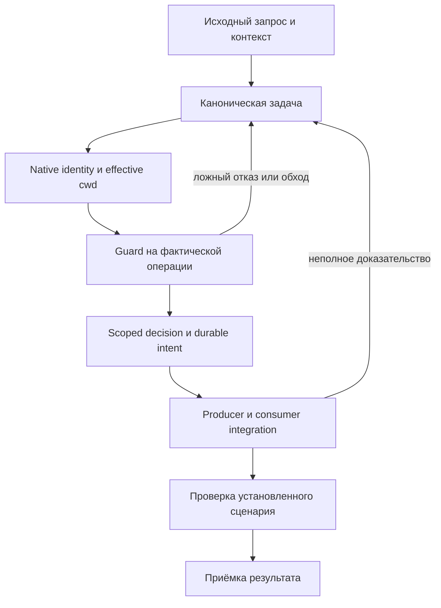
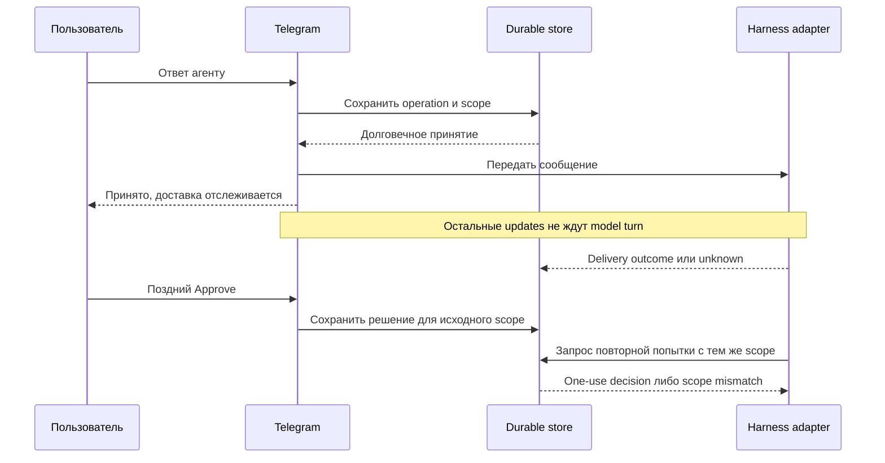

# Agent Ecosystem Retrospective — актуализация по v4, 10 сентября 2026

Эта редакция актуализирует **2026-07-01-agent-ecosystem-retrospective.md**, а не подменяет её спецификацией Evolve. Координатор: [rig-cli#521](https://github.com/alex-mextner/rig-cli/issues/521). Предыдущая стратегия была ратифицирована 12 июля; это не означало выполнения всех её пунктов или автоматического принятия семи отдельных решений. Исторические разделы и их идентификаторы сохранены в [исходной редакции](./01a-retrospective-preserved.md). Полная таблица находок и 29 правил находится в [построчном ревью](./01b-retrospective-crosswalk.md).

Статусы ниже различают: исходное утверждение; наблюдение кода на конкретной ревизии; результат изолированного теста; подтверждённую приёмку пользовательского сценария. Ни один из этих уровней не подменяет следующий.

## 1. Executive summary — что изменилось

В исходнике июля/августа описаны потеря инструкций, обходы и ложные блокировки guards, ненадёжные E2E-измерения, недовнедрённые инструменты и накопление процессных задач. Эти категории сохранены. Однако численные срезы — 300 обходов, 22 PR, пять красных workflows, размер MEMORY и доля подготовленных subagent prompts — относятся к указанным в исходнике датам и репозиториям. Это не текущая статистика двенадцати CLI.

Теперь есть полный публичный issue/PR-срез и повторные изолированные тесты. В GitHub действительно были изменены более 1500 описаний и созданы native Sub-issues; прежний ответ чата «изменений не было» неверен. Но значительная часть первого прохода добавляла общие цитаты о тематике, а не восстанавливала исходную постановку конкретного дефекта. V4 заменяет это различением точного источника, тематической связи и неизвестного происхождения.

Новая выгрузка содержит 4329 **записей**, а не 4329 независимо подтверждённых поручений человека. В ней присутствуют ответы агентов, зеркальные сообщения, инструкции субагентам и служебные уведомления. После квалификации источников опубликованы 505 уникальных записей с атрибуцией и сохранением исходных ID. Все исключённые или неоднозначные записи имеют явный результат обработки. 38 578 связей с `keyword_score` не стали автоматически зависимостями задач.

## 2. Method — основание ревью

Основной источник — `alex-requests-export-2026-09-10-v4(1).json`, SHA-256 `4662766197a716891ac2153ffa71e4ed1c1f6b49781762db20e775e366c63d53`. Оригинальный текст запроса, редакторская выдержка, source ID, источник атрибуции и доступные timestamp/line number сохраняются раздельно. Роль `user` в оригинальных native JSONL не приложена, поэтому даже запись с parent-session provenance не объявляется независимой проверкой транскрипта.

Экспорт имеет внутренние противоречия: итоговый `validation.passed=false`; проверка `under_350` не является разумным условием полноты; для agent-tools в sessions-summary нет файлов в окне, хотя общий флаг утверждает покрытие четырёх репозиториев. Эти поля сохранены как утверждения источника и не используются для ложного вывода о полном покрытии сессий.

Текущие issue bodies читаются до изменения. При конкурентном изменении запись откладывается для повторной сверки; уникальные требования и прежние результаты не удаляются. Закрытие задачи в GitHub и `done` в выгрузке — исторические состояния, а не автоматическая приёмка.

## 3. Broken-things catalog — актуальные границы

### 3.1 Provisioning and context delivery: P-1–P-12

**P-1/P-3/P-11/P-12.** Нельзя продолжать писать, что все инструкции отсутствуют и существует только Claude Code bridge: появились provisioned blocks и bridges. Но наличие файлов не доказывает, что конкретный native child действительно получил контекст и событие. Проверка включает main, child, grandchild, concurrent siblings, rotation account directories и отрицательный случай отсутствующей metadata. Связи: rig-cli#327/#337/#342/#425, agent-tools#573/#673/#712.

**P-4.** Установка dispatcher не доказывает эффективный `core.hooksPath` в продуктовой рабочей копии. Проверяются конечный hook path, локальный override, реально выполненный pre-commit/pre-push и способ установки; rig-cli#382, agent-tools#500.

**P-5/P-6/P-8.** Исходные утверждения относятся к HyperIDE/extension/E2E, а не к результатам тестов rig/review/tg. Их нельзя закрыть зелёным pytest этих CLI. Новая приёмка HyperIDE требует отдельного доступа к точной ветке и соответствующей тестовой матрицы.

**P-7/P-10.** `apply`, `status`, конфигурационный редактор и комментарии используют один declared state. Bare `rig apply` — предварительный просмотр, применение выполняется документированным `rig apply commit --yes`; `rig config set` по умолчанию применяет изменение, если не указан `--no-apply`. Disabled-состояния, глобальные слои и конкурентные правки не теряются: rig-cli#355/#357/#376/#459/#460.

**P-2/P-9.** Старый предел размера auto-memory и число interpreter spawns не переносятся на современную версию харнеса как вечные константы. Нужны замеры фактически установленной версии, бюджета контекста и стоимости события. Наличие предупреждения/таймера не равно решению причины.

### 3.2 Guards and enforcement: G-1–G-14

> «Нужно нормально описать все проблемы: реального паритета харнесов всё ещё нет; OMP ошибочно допускает правки из оркестратора; hook неверно определяет эффективную рабочую директорию; оркестратор и субагент различаются неправильно; Telegram escape hatches не работают; запреты обходятся через Eval и другие инструменты. Требовать от пользователя абсолютные пути не нужно».

Редакторская выдержка из v4-537. Полный оригинал и provenance доступны в реестре запросов. Это пользовательское описание класса проблем, не утверждение о результате каждого сегодняшнего теста.

**G-2/G-3/G-4/G-7/G-10/G-11/G-12.** Единицей защиты является фактическая операция и её доверенный контекст, а не название Bash tool. Eval, shell helpers, native task dispatch и альтернативные CLI не создают привилегированный обход. Относительный путь разрешается относительно проверенного effective cwd конкретного вызова. Подставленный `agent_id`, общий PID или свежий mtime не доказывают native child identity. Ложный запрет на read-only gh не исправляется разрешением всем харнесам обходить оркестраторскую политику.

**G-8.** Августовское «не найден overrides.log» больше не является текущим основанием создавать audit sink с нуля: в backlog есть уже выполненные hatch/statistics slices и открытая задача полноты аудита agent-tools#713. Проверяется producer → persistence → classification → rig stats → нужное уведомление. Explicit hatch, отказ, ошибка транспорта, deny, отсутствие ответа и обход из-за дефекта guard — разные события. Full command с токенами не попадает в публичный лог; хранятся redacted command, digest, scope, источник и причина.

**G-14.** Инъекция внутри реализации самого инструмента/guard остаётся отдельным классом. Это не G-9 «мертвые заготовки». Нельзя механически присоединить к G-14 любой тикет, где встречается слово secret или agent-tools: нужна проверка конкретного sink и patch.

### 3.3 Git / GitHub / CI: C-1–C-7

> «gh ship должен сам запускать проверки локально. Разберись, как это должно работать, и исправь проблемы».

Редакторская выдержка Q261, источник — Telegram, присутствующий в v4. Непосредственная политика пользователя отменяет ожидание hosted CI как универсального блокера, но не объявляет настоящее падение теста успешным. Эквивалентные локальные проверки привязаны к целевому `--repo` и точному PR head SHA; shell cwd не подменяет целевой checkout. Версия проверяется относительно актуальной base и согласованного merge-time bump, особенно при двух параллельных PR: agent-tools#518/#522/#592/#682.

Решение #4 исходника — **уже записанное отсутствие необходимости менять тариф**, а не новый вопрос к пользователю. Прежние цены, ограничения и ответы 403 не выдаются за актуальную проверку тарифов/прав. Ни изменение README, ни этот груминг не выключают защиту репозитория.

### 3.4 E2E infrastructure / 3.5 E2E portal

Изолированная матрица CLI не является результатом продуктовой E2E-матрицы. Исторический Tier-0, composition и критерии merge bracket сохраняются; решение #5 остаётся самостоятельным.

Существующий spec-dev корень отвечает, но `/spec/` возвращал 404. Это ошибка маршрута индекса, а не доказательство отсутствия всех документов: отдельная исходная ретроспектива прочитана через свой route. Альтернативный reader опубликован из точного Git commit и проверяется извне по HTTP, content hash и браузерной навигации.

GitHub OAuth и вход только по подтверждённому `@glide.vc` должны ограничивать данные **на сервере**, включая API и assets. Кнопка Login перед публичным JSON не является авторизацией. Репозиторий hyperide/hyper-ext-e2e вернул 404 через подключённый GitHub; его прежняя OTP/Resend реализация не была прочитана. Новый публичный reader честно оставляет чтение открытым и использует авторизацию GitHub для отправки замечаний. Приватные исходники и токены туда не перенесены.

### 3.6 Tools

**rig.** Оркестрация установки/конфигурации и фактического drift, а не второй scheduler или service supervisor. Installation on disk, executable in PATH и версия уже работающего процесса — три отдельных проверки.

**review-cli.** Модель, версия, провайдер подписки, вендор модели, харнес, effort, аккаунт и роль — независимые сущности. Одной моделью можно заполнить несколько ролей, но отчёт не должен заявлять несколько независимых моделей. Реально запущенные role prompts, fallback attempts, ошибки и окончательные причины доступны в журнале. Связи: #364/#365/#433/#441/#442/#444/#454/#472/#487/#495/#496.

**harness-cli.** Владеет обнаружением, native session identity, adapter capabilities и фактическими наблюдениями лимитов. Usage не называется remaining quota; один исчерпанный аккаунт не исключает другой. Неизвестный источник не становится available или exhausted. #26 — inventory; #28 — постоянный control IPC; #29 — достоверная live-generation.

**tg-cli.** Передаёт человеческое сообщение и сохраняет принятый intent, но не блокирует прочие updates до завершения model turn. Очередь записи/доставки и ожидание генерации — разные понятия. Late Approve сохраняется для того же содержания и scope; повторная попытка не получает безусловное разрешение на другую команду или сессию. #354/#356/#357/#360/#374/#377/#379/#380.

**Haft/Sverklo/Serena/native LSP/morph/rtk.** Исходные решения об интеграции, испытании или отказе не заменяются новым единоличным решением. Нельзя назвать отсутствие результата поиска доказательством отсутствия реализации. Текущий груминг не проверял чужие приватные продукты и не переписывал их код.

**Shared libraries.** Путь до sibling checkout не является воспроизводимой dependency declaration. Общие контракты устанавливаются и версионируются явно; consumer и producer тестируются вместе. Выбранная в исходнике рекомендация Option B не означает, что отдельное решение #7 уже принято.

### 3.7 Process / tickets / PRs; 3.8 Docs and memory; 3.9 Canvas

Process review/version-bump записи не становятся новыми продуктовыми результатами. Их находки и ссылки на изменения сохраняются. Дубли закрываются только после переноса уникального содержания. Тексты агента `Complete assignment`, `**agent**:` и уведомления не попадают в блок «исходная цитата пользователя».

Canvas finding IDs W-1…W-5 сохраняются как отдельная продуктовая область. Тесты CLI и публикация этой спецификации не являются их исправлением или новой приёмкой.

## 4. Root-cause synthesis — границы, а не маскировка симптомов

У наблюдаемых сбоев повторяются четыре границы: доверенная идентичность вызова; producer/consumer контракт; приём и долговечное хранение; соответствие declared/installed/running state. Общая библиотека полезна, когда устраняет две конфликтующие реализации этих границ. Перенос файлов или новый enum без принятого контракта не является архитектурным исправлением.

## 5. Strategy — актуальный порядок без выдуманных сроков

> «Максимум десять агентов. Выполняй работу по порядку: от наиболее приоритетной к наименее приоритетной».

Редакторская выдержка v4-4236. Она уточняет более раннее пожелание запускать сотни агентов. Число одновременно активных исполнителей не восстанавливается по названию старого задания или по списку созданных сессий.

Сначала — сохранность работы и правильная область guards/permissions. Затем — native identity и scoped decisions; параллельно допустимы независимые source inventory и schema fixtures. Далее — account-aware capacity, Telegram delivery и integration. После этого — UI/TUI, визуальная проверка и упрощение конфигурации. Старые «дни», «две недели» и «месяц» оставлены как исторический план, не как новые обещания.

## 6. Enforcement matrix — все 29 правил сохранены

[Построчная матрица](./01b-retrospective-crosswalk.md) содержит каждое правило исходника, исходный статус и текущий verification disposition. Исходное LIVE не автоматически означает passed сегодня; исходное ABSENT не означает отсутствия реализации сегодня. Для каждого правила проверяется producer event → нормализованный контекст → policy → отказ/разрешение → аудит; отдельно native harness и установленная конфигурация.

Старая строка «English-only docs» не должна блокировать русские исходные цитаты в этом явно заказанном ревью. Английские названия CLI, идентификаторы и оригинальные формулировки источника сохраняются, не подменяются придуманными переводами.

## 7. Tool verdicts — решения и измерения отдельно

Для выбора инструментов нужны сравнимые сценарии, корректность, стоимость, скорость и поддерживаемость. Отсутствие независимого live-теста отмечается неизвестным. Результаты одной модели или одной машины не распространяются на весь список платформ. Существующие open decisions не закрываются новыми обзорными таблицами.

## 8. Process and hygiene — доказательство консолидации

Канонические task-cli#169 и rig-cli#507 сохранили содержание дублей до закрытия #170/#172/#173 и #508. Закрытие дубликата обозначает retirement, а не завершение underlying feature. Native parent уже существующей задачи не заменяется по совпадению названий.

Новые blocked-by связи создаются только из проверенного порядка: review#494 зависит от #493; #496 от #495; agent-tools#705 от review#472; rig#517 от #516; #519 от #518. Связи с приватным harness применяются только если репозиторий доступен вызывающему token. Ошибка доступа остаётся явной, а не превращается в выдуманную связь.

## 9. CTO instructions — цитата, смысл, механизм

> «В spec-web нужно отслеживать изменение текста: показывать старый и новый якорь, их различия, версии и сравнение версий. Панель Comments должна изменяться по высоте. Агенту нужны подсказки отвечать через интерфейс. У Resolve должна быть серая галочка, у Delete — серый крестик. Пока внеси это в TodoList и тикеты».

Редакторская выдержка v4-3817, объединяющая тот же запрос с alias 4262. Последнее предложение важно: регистрация и спецификация не равны неограниченному разрешению реализовать ещё не принятую архитектуру.

Пример: в новой версии документа два одинаковых предложения. Старый comment остаётся на исходном revision и quote. Система показывает два candidate anchors как неоднозначные, а не молча выбирает ближайший. Комментарий не теряется; history/compare не перезаписывает живой документ. Закрытие review#493 без #494 не закрывает весь эпик #484.

## 10. In-flight tracks — не список живых процессов

Названия агентов в июльском и августовском исходнике — исторический журнал. Этот портал не утверждает, что они работают сейчас. Текущие PR, native links, journals и повторные тесты отображаются отдельно. Наличие ветки или созданного workflow не считается завершённой работой: нужен фактический результат run и read-back изменений.

## 11. Open decisions — статус сохранён

1. Haft/Sverklo: integration trial или native-lite — отдельно согласуемое продуктовое решение.
2. Email-provider/domain для исходного E2E-портала: историческая рекомендация Resend не означает доступного сейчас секрета или выданного разрешения прочитать чужой keychain. Публичная альтернативная публикация не требует нового решения об email.
3. Rig descoping: не делать попутное удаление модулей в рамках груминга.
4. GitHub plan: исходник помечает решение записанным, без нового действия; не спрашивать повторно.
5. E2E Tier-0/composition/bracket scope: не менять от перепроверки CLI.
6. Serena/Sverklo MCP defaults и native LSP/morph boundaries: сохранить отдельную историю решения.
7. Shared-library distribution: проверить воспроизводимость и текущую adoption, не выдавать рекомендацию за полностью выполненную миграцию.

## 12. Appendix — проверяемые источники

Все 4329 source IDs имеют disposition; все 95 заголовков исходной спецификации сохранены в source mirror; finding IDs и 29-rule matrix сохраняют связь с оригиналом. Raw export не публикуется целиком: он включает неоднозначные сообщения и потенциально приватный контекст. Опубликованный subset содержит атрибуцию, исходный текст и квалификацию; исходный SHA позволяет сверить его с приложенным файлом.

Скриншот reader доказывает reader. Текстовый mock доказывает fixture. Изолированный pytest доказывает соответствующий run. Ни один из них не доказывает автоматически macOS LaunchAgent, реальный аккаунт, delivery в личный Telegram или работающий Canvas.

## 13. Execution status — продолжение после августа

В первом полном прогоне review-cli отсутствовала ImageMagick 7. После установки зависимости осталось одно воспроизводимое падение effort/board test; оно также падает в отдельном файле. Для tg-cli один durable-question файл дал один неуспешный и два успешных изолированных повтора; watermark-тесты после установки Pillow прошли в обоих Python-окружениях. Это разные выводы: недостающая зависимость, тестовая нестабильность и подтверждённый продуктовый дефект не складываются в общий счётчик «багов».

Следующее действие по G-8 — не слепо создавать отсутствующий по августовскому поиску файл, а проверить уже существующие producer/consumer paths и полноту аудита. Следующее действие по spec-dev — исправить index route, подготовить reviewable patch и отдельно подтвердить rollout на фактически работающем сервере. До этого доступна проверенная альтернативная публикация.

**Условия закрытия восстановления:** сохранены исходные требования; исправлены подтверждённые противоречия; native связи прочитаны обратно; все оставшиеся source/live gaps видны; каждый заявленный результат имеет источник, ревизию и реальное доказательство. Документационный PR не закрывает продуктовые эпики.
