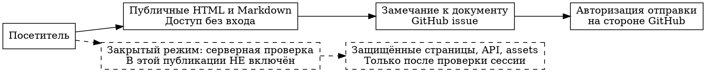

# Публикация спецификаций и граница доступа

**Статус:** публичный reader; авторизация для чтения не включена. Уточнение от 11 сентября 2026.

> «Сделай все спеки доступными для ревью на spec-dev или альтернативном сайте. По возможности нужна авторизация через GitHub или почту @glide.vc».

Редакторски исправленная выдержка из текущего поручения в ChatGPT, 10 сентября 2026. Это запрос на публикацию и желаемую защиту чтения, не разрешение показывать приватные переписки или секреты.

## Что публикуется

Обновлённая ретроспектива, тематические контракты и сохранённые исходные спецификации; отдельные страницы для всех задач, 505 квалифицированных записей запросов и фактических результатов проверки. Новый подготовленный static reader содержит полный текст без выполнения JavaScript. Фильтры и копирование контекста — дополнение к уже читаемому HTML.

Подготовка HTML, успешный локальный рендер и публикация на внешнем URL — разные этапы. До независимой проверки внешнего URL новая сборка не называется развёрнутым сайтом. Предыдущая проверенная v4-публикация и её контрольная сумма сохранены в `docs/grooming/full-2026-09-10/publication/latest.json`.

## Найденная реализация авторизации

Репозиторий `hyperide/hyper-ext-e2e` теперь прочитан через подключённый GitHub. В `e2e/portal/README.md` и `e2e/portal/src/server.ts` описаны email OTP для `@glide.vc` через Resend и дополнительный Google OAuth. Это **не GitHub OAuth**. Исследованный source ref: `3a41ab3739bd45123e8126741e3e25139d5c0faa`; README blob `d9d2895d39ea0f9c21bb6b84a8e645e7f3763fb0`, server blob `339507fc91dd34e5dcd4772180fdb020de75aee6`.

[Документация существующего портала](https://github.com/hyperide/hyper-ext-e2e/blob/3a41ab3739bd45123e8126741e3e25139d5c0faa/e2e/portal/README.md). Приватный исходный код и его конфигурация не скопированы в публичный reader. Упоминание схемы не означает развёртывания этого сервера или наличия его ключей в другом окружении. Прежнее сообщение о недоступности репозитория относится к ранней попытке и больше не описывает текущий доступ к исходникам.

## Публичное чтение и отправка ревью

Reader читает только опубликованные данные. Кнопка ревью открывает GitHub с конкретным документом, исходной ревизией и полями замечания. GitHub авторизует отправку issue; это **не** ограничивает чтение страницы. Кнопка входа перед публичным JSON или raw GitHub URL не создаёт приватный портал.

Пример: анонимный посетитель может открыть спецификацию и Markdown. Для отправки замечания через GitHub ему нужен собственный GitHub-вход. Reader не получает его токен, не выполняет GitHub API-запись от имени посетителя и не обещает авторизацию по домену.

Сплошные связи описывают публичную модель доступа; пунктир — требование к будущему закрытому режиму, а не якобы реализованная защита.

## Контракт действительно закрытого reader

При внедрении закрытого режима сервер проверяет сессию перед выдачей страниц с данными, API, исходников и вложений. Домен сравнивается с подтверждённым email, а не с введённой строкой. Нужны защищённый session secret, HttpOnly cookie, безопасное истечение и отзыв сессии, ограничения попыток OTP и отрицательные тесты. Отладочная печать OTP и development fallback secret в production не используются.

GitHub OAuth требует отдельно зарегистрированного приложения и согласованной политики допуска. Наличие аккаунта GitHub само по себе не означает членство в `ultrabricks` или принадлежность `@glide.vc`.

## Приёмка публикации

- [ ] Полный текст всех документов читается без JavaScript; ссылки между страницами и на Markdown работают во внешней публикации.
- [ ] Поиск, фильтры, клавиатурная навигация и экран шириной 393 пикселя проверены на опубликованном URL.
- [ ] Диаграммы соответствуют своим исходникам, а не заменены одной общей картинкой.
- [ ] Внешний URL проверен по HTTP, хешу контента и фактическому содержимому страницы.
- [ ] При включении закрытого режима отрицательные тесты подтверждают серверную защиту API, исходников и вложений.

Снимок reader доказывает reader; он не доказывает исправление Telegram, guards или других продуктов. Локальные проверки новой сборки не превращаются в выполненные внешние критерии выше.

Связанные задачи: [rig-cli#538](https://github.com/ultrabricks/rig-cli/issues/538), [review-cli#484](https://github.com/ultrabricks/review-cli/issues/484), [координатор rig-cli#521](https://github.com/ultrabricks/rig-cli/issues/521).
