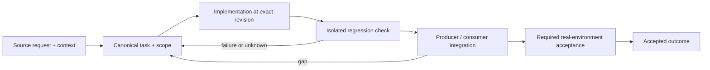

# Auxiliary CLI behavior and end-to-end user workflows

Status: recovery specification / proposed contract; not a claim of completed implementation.

Owner and acceptance coordinator: https://github.com/alex-mextner/rig-cli/issues/521

## Original requests and editorial provenance

> Нужно ещё проверить, что это работает на машине, и приложить к отчёту проверяемые доказательства.

Source **Q202**; compiled-memory-attribution; MEMORY.md standing lesson: Merge is not this machine; on disk is not PATH; PDF page(s) 74. Cross-ticket thematic requirement; check context before applying to a narrower issue.

Original wording (before editorial correction)

> надо еще проверить что это на машине работает и в отчете приложить пруфы проверяемые

> Все доказательства должны быть проверяемыми.

Source **Q028**; compiled-fragment-attribution; rig-zerobug/rig-fable session 2026-09-04..07; agent=Full175Report, ResultReport; PDF page(s) 39. Cross-ticket thematic requirement; check context before applying to a narrower issue.

Original wording (before editorial correction)

> все пруфы должны быть проверяемы

## Boundary and intended behavior

Preserve each repository's actual product boundary, documented arguments and error semantics. Do not translate a setup/review process record into a new feature or assume paid/live resources from a unit fixture.

## Realistic worked example

A CLI is invoked from outside its repository with a valid input, an invalid input and an unavailable optional backend. Successful output, nonzero failure, cancellation and cleanup are separately asserted. A mock backend passing does not establish that a live account, local model or audio device was exercised.

## Acceptance procedure

1. Reproduce the exact operation in an isolated checkout at a named revision.
2. Capture actual and expected behavior; distinguish a product failure from a missing dependency or unsupported platform.
3. Exercise the corresponding producer/consumer boundary, failure/restart case and a negative case.
4. Attach durable output and separately record any real-machine/provider/UI acceptance.
5. Close only the accepted outcome; a merged slice does not close a larger parent.

## State-transition diagram

## Complete linked backlog

| Ticket | Scope | Provider state | Verification |

|---|---|---|---|

| [agent-tools#12](https://github.com/alex-mextner/agent-tools/issues/12) | Shared-lib extraction (Python-only) — phased tracking issue | closed | historical-closure-not-reaccepted |

| [agent-tools#21](https://github.com/alex-mextner/agent-tools/issues/21) | OSS license-policy gate (fill the dependency-review license gap) | closed | historical-closure-not-reaccepted |

| [agent-tools#146](https://github.com/alex-mextner/agent-tools/issues/146) | require-review: add \|\| to CD_CARRY_SEP (cd repo \|\| exit 1 pattern) | open | open-outcome-requires-acceptance |

| [agent-tools#147](https://github.com/alex-mextner/agent-tools/issues/147) | require-review: chained relative cd resolves against prior cd_dir (cd /a && cd sub pattern) | open | open-outcome-requires-acceptance |

| [agent-tools#177](https://github.com/alex-mextner/agent-tools/issues/177) | rtk-rewrite hook rewrites 'git commit'-like text INSIDE string arguments — silent corruption | open | open-outcome-requires-acceptance |

| [agent-tools#202](https://github.com/alex-mextner/agent-tools/issues/202) | Fix chained commit skip parsing in hook gates | open | open-outcome-requires-acceptance |

| [agent-tools#207](https://github.com/alex-mextner/agent-tools/issues/207) | Add dev CLI for project-scoped development commands | closed | historical-closure-not-reaccepted |

| [agent-tools#226](https://github.com/alex-mextner/agent-tools/issues/226) | Auto-continue transient API overload stops | closed | historical-closure-not-reaccepted |

| [agent-tools#243](https://github.com/alex-mextner/agent-tools/issues/243) | cc_hook_bridge format-on-write hook reformats foreign-style repos, ballooning diffs | open | open-outcome-requires-acceptance |

| [agent-tools#263](https://github.com/alex-mextner/agent-tools/issues/263) | Recover and close two-day Alex request queue | closed | historical-closure-not-reaccepted |

| [agent-tools#270](https://github.com/alex-mextner/agent-tools/issues/270) | pm-cli: autonomous PM-agent — Milestone 1 (event-sourced core + FSM) | open | open-outcome-requires-acceptance |

| [agent-tools#271](https://github.com/alex-mextner/agent-tools/issues/271) | pm-cli: Milestone 2 — task-cli adapter (intake to WorkItem projection) | open | open-outcome-requires-acceptance |

| [agent-tools#275](https://github.com/alex-mextner/agent-tools/issues/275) | pm-cli: Milestone 4 — dependency edges and reminders | open | open-outcome-requires-acceptance |

| [agent-tools#277](https://github.com/alex-mextner/agent-tools/issues/277) | pm-cli: Milestone 6 — executor ledger and read-only model and harness routing recommendations | open | open-outcome-requires-acceptance |

| [agent-tools#288](https://github.com/alex-mextner/agent-tools/issues/288) | dep-audit.sh: script-level untrusted guard so code-executing auditors never run on PR data (defense-in-depth) | open | open-outcome-requires-acceptance |

| [agent-tools#329](https://github.com/alex-mextner/agent-tools/issues/329) | leftover-marker scanners misparse a diff line starting with ++ as a fake +++ header | open | open-outcome-requires-acceptance |

| [agent-tools#330](https://github.com/alex-mextner/agent-tools/issues/330) | leftover-grep.sh has the same self-referential false-positive bug as issue 318, unfixed | open | open-outcome-requires-acceptance |

| [agent-tools#353](https://github.com/alex-mextner/agent-tools/issues/353) | Add claude-code block-rg-pre argv hook to close quoting/tab-whitespace bypass | open | open-outcome-requires-acceptance |

| [agent-tools#401](https://github.com/alex-mextner/agent-tools/issues/401) | pkill guard (G-5): block pattern-kills of shared process names | closed | historical-closure-not-reaccepted |

| [agent-tools#405](https://github.com/alex-mextner/agent-tools/issues/405) | Review pkill-guard uncommitted diff | closed | historical-closure-not-reaccepted |

| [agent-tools#420](https://github.com/alex-mextner/agent-tools/issues/420) | Review block-rg-pre cross-file consistency | closed | historical-closure-not-reaccepted |

| [agent-tools#425](https://github.com/alex-mextner/agent-tools/issues/425) | skills-read-gate: wire the marker-writer so the gate is actually satisfiable | closed | historical-closure-not-reaccepted |

| [agent-tools#427](https://github.com/alex-mextner/agent-tools/issues/427) | skills-invoked marker: encode scoped skill names so a prefix can't collide with a nested one | open | open-outcome-requires-acceptance |

| [agent-tools#429](https://github.com/alex-mextner/agent-tools/issues/429) | skills-marker-writer: garbage-collect abandoned per-session marker directories | open | open-outcome-requires-acceptance |

| [agent-tools#442](https://github.com/alex-mextner/agent-tools/issues/442) | require-review gate is unsatisfiable for machine-generated data files | open | open-outcome-requires-acceptance |

| [agent-tools#447](https://github.com/alex-mextner/agent-tools/issues/447) | Document agent-browser concurrency and session-isolation hygiene | closed | historical-closure-not-reaccepted |

| [agent-tools#448](https://github.com/alex-mextner/agent-tools/issues/448) | Review agent-browser concurrency skill diff | closed | historical-closure-not-reaccepted |

| [agent-tools#459](https://github.com/alex-mextner/agent-tools/issues/459) | ship: hard-block a merge with zero GitHub-side PR reviews | closed | historical-closure-not-reaccepted |

| [agent-tools#462](https://github.com/alex-mextner/agent-tools/issues/462) | Review external GitHub-review ship gate diff | closed | historical-closure-not-reaccepted |

| [agent-tools#480](https://github.com/alex-mextner/agent-tools/issues/480) | Adversarial review of uncommitted diff | closed | historical-closure-not-reaccepted |

| [agent-tools#506](https://github.com/alex-mextner/agent-tools/issues/506) | require-review-before-commit: stop telling agents to touch the marker by hand | open | open-outcome-requires-acceptance |

| [agent-tools#507](https://github.com/alex-mextner/agent-tools/issues/507) | require-review-before-commit: bind the gate to the reviewed diff, not just marker mtime | open | open-outcome-requires-acceptance |

| [agent-tools#509](https://github.com/alex-mextner/agent-tools/issues/509) | Review review-gate guidance diff | closed | historical-closure-not-reaccepted |

| [agent-tools#552](https://github.com/alex-mextner/agent-tools/issues/552) | Adversarial review of chat dictionary gate | open | open-outcome-requires-acceptance |

| [agent-tools#580](https://github.com/alex-mextner/agent-tools/issues/580) | Destructive-command guards refuse benign heredoc writes they cannot parse | open | open-outcome-requires-acceptance |

| [agent-tools#583](https://github.com/alex-mextner/agent-tools/issues/583) | Review skills-read-gate argv parsing diff | closed | historical-closure-not-reaccepted |

| [agent-tools#622](https://github.com/alex-mextner/agent-tools/issues/622) | Audit default-branch write guard path resolution | open | open-outcome-requires-acceptance |

| [agent-tools#627](https://github.com/alex-mextner/agent-tools/issues/627) | Add autonomous-mode skill | closed | historical-closure-not-reaccepted |

| [agent-tools#632](https://github.com/alex-mextner/agent-tools/issues/632) | Enable live anti-slop Oxlint in a rig-managed repo | open | open-outcome-requires-acceptance |

| [agent-tools#642](https://github.com/alex-mextner/agent-tools/issues/642) | Audit raw tracker write guard | open | open-outcome-requires-acceptance |

| [agent-tools#646](https://github.com/alex-mextner/agent-tools/issues/646) | Keep autonomous-mode skill current after rig-cli 404 | closed | historical-closure-not-reaccepted |

| [agent-tools#651](https://github.com/alex-mextner/agent-tools/issues/651) | Refuse Review-uncommitted titles on raw GitHub issue create | open | open-outcome-requires-acceptance |

| [agent-tools#652](https://github.com/alex-mextner/agent-tools/issues/652) | Gate dangerous Workflow scripts without blocking ultracode or comments | closed | historical-closure-not-reaccepted |

| [agent-tools#653](https://github.com/alex-mextner/agent-tools/issues/653) | Add pre-bash screencapture-guard for retrospective G-6 | open | open-outcome-requires-acceptance |

| [agent-tools#655](https://github.com/alex-mextner/agent-tools/issues/655) | Codex Stop re-blocks every turn without a stable session id | closed | historical-closure-not-reaccepted |

| [dev-cli#1](https://github.com/alex-mextner/dev-cli/issues/1) | Extract dev into standalone dev-cli repo | closed | historical-closure-not-reaccepted |

| [dev-cli#2](https://github.com/alex-mextner/dev-cli/issues/2) | Security: command-substitution check bypassable via apostrophe inside double quotes | open | open-outcome-requires-acceptance |

| [dev-cli#6](https://github.com/alex-mextner/dev-cli/issues/6) | dev shot: blankness check defeated by gradients, and thin-border false rejects | open | open-outcome-requires-acceptance |

| [dev-cli#9](https://github.com/alex-mextner/dev-cli/issues/9) | dev shot's default scroll step produces captures its own quality gate rejects | open | open-outcome-requires-acceptance |

| [dev-cli#20](https://github.com/alex-mextner/dev-cli/issues/20) | dev stop refuses to stop the process that is actually holding the port | open | open-outcome-requires-acceptance |

| [dev-cli#21](https://github.com/alex-mextner/dev-cli/issues/21) | Adversarial review of uncommitted safe-cleanup diff | closed | historical-closure-not-reaccepted |

| [dev-cli#27](https://github.com/alex-mextner/dev-cli/issues/27) | dev stop declares success and deletes state before the OS confirms the process exited | closed | historical-closure-not-reaccepted |

| [draw-cli#5](https://github.com/alex-mextner/draw-cli/issues/5) | add `draw --version` reading the version dynamically from pyproject | closed | historical-closure-not-reaccepted |

| [draw-cli#10](https://github.com/alex-mextner/draw-cli/issues/10) | Deferred review findings from pipx packaging (PR #9) | open | open-outcome-requires-acceptance |

| [draw-cli#22](https://github.com/alex-mextner/draw-cli/issues/22) | feat: SD 3.5 APIs and local inference with native Apple Silicon/GGUF backend (PR https://github.com/alex-mextner/draw-cli/pull/14) | closed | historical-closure-not-reaccepted |

| [draw-cli#23](https://github.com/alex-mextner/draw-cli/issues/23) | feat: ChatGPT subscription images via Codex CLI (PR https://github.com/alex-mextner/draw-cli/pull/20) | closed | historical-closure-not-reaccepted |

| [pm-cli#4](https://github.com/alex-mextner/pm-cli/issues/4) | pm ingest: degraded project fetches are dropped silently — add a strict mode for automation | open | open-outcome-requires-acceptance |

| [pm-cli#9](https://github.com/alex-mextner/pm-cli/issues/9) | Aging alert: flag work items whose current-state age exceeds a threshold | closed | historical-closure-not-reaccepted |

| [pm-cli#14](https://github.com/alex-mextner/pm-cli/issues/14) | Sprint system (M4): architectural follow-ups from review (lifecycle rules, error tracking, library-level reminders API) | open | open-outcome-requires-acceptance |

| [pm-cli#16](https://github.com/alex-mextner/pm-cli/issues/16) | pm why: add --json output for tg-cli /next command | closed | historical-closure-not-reaccepted |

| [pm-cli#17](https://github.com/alex-mextner/pm-cli/issues/17) | Review pm why JSON diff | closed | historical-closure-not-reaccepted |

| [research-cli#6](https://github.com/alex-mextner/research-cli/issues/6) | transport: pass resolved provider key (incl. .env-only) into the backend subprocess | closed | historical-closure-not-reaccepted |

| [review-cli#26](https://github.com/alex-mextner/review-cli/issues/26) | Propagate canonical ecosystem one-liner to other repos' ecosystem tables | closed | historical-closure-not-reaccepted |

| [review-cli#40](https://github.com/alex-mextner/review-cli/issues/40) | Harden _ensure_opencode_readonly_agent: validate/refuse a pre-existing permissive global read-only-reviewer agent | closed | historical-closure-not-reaccepted |

| [review-cli#88](https://github.com/alex-mextner/review-cli/issues/88) | review-cli: add OpenRouter backend | closed | historical-closure-not-reaccepted |

| [review-cli#94](https://github.com/alex-mextner/review-cli/issues/94) | Add per-provider opencode auth probe in backend_available() | closed | historical-closure-not-reaccepted |

| [review-cli#96](https://github.com/alex-mextner/review-cli/issues/96) | Replace review diff --visual with visual subcommand | closed | historical-closure-not-reaccepted |

| [review-cli#97](https://github.com/alex-mextner/review-cli/issues/97) | Refresh review hook hint and harden visual fallback | open | open-outcome-requires-acceptance |

| [review-cli#107](https://github.com/alex-mextner/review-cli/issues/107) | deploy.sh: fetch --prune so a deleted/renamed upstream branch is detected | open | open-outcome-requires-acceptance |

| [review-cli#109](https://github.com/alex-mextner/review-cli/issues/109) | visual: gate Russian-language selection/highlight claims, not just English | closed | historical-closure-not-reaccepted |

| [review-cli#128](https://github.com/alex-mextner/review-cli/issues/128) | Fix review-cli model override and unpaid provider handling | closed | historical-closure-not-reaccepted |

| [review-cli#149](https://github.com/alex-mextner/review-cli/issues/149) | review-cli: prevent stuck model seats from wedging review gates | open | open-outcome-requires-acceptance |

| [review-cli#153](https://github.com/alex-mextner/review-cli/issues/153) | review diff: per-model reviewer (opencode/glm) wedges indefinitely at ~0% CPU — needs a per-backend watchdog kill | closed | historical-closure-not-reaccepted |

| [review-cli#155](https://github.com/alex-mextner/review-cli/issues/155) | review-cli: comprehensive provider failover + opus routing | closed | historical-closure-not-reaccepted |

| [review-cli#161](https://github.com/alex-mextner/review-cli/issues/161) | review-cli: close 3 P2 provider-failover coverage gaps from PR 157 | closed | historical-closure-not-reaccepted |

| [review-cli#170](https://github.com/alex-mextner/review-cli/issues/170) | review-cli: flat review path can pass and checkpoint on rc=0-but-unusable output (pre-existing) | open | open-outcome-requires-acceptance |

| [review-cli#173](https://github.com/alex-mextner/review-cli/issues/173) | review-cli: consolidate the duplicated provider-failover liveness predicate and state machine | open | open-outcome-requires-acceptance |

| [review-cli#174](https://github.com/alex-mextner/review-cli/issues/174) | Add omp (Oh My Pi) agentic backend — omp:provider/model seats | closed | historical-closure-not-reaccepted |

| [review-cli#175](https://github.com/alex-mextner/review-cli/issues/175) | Review omp backend cross-file consistency | closed | historical-closure-not-reaccepted |

| [review-cli#176](https://github.com/alex-mextner/review-cli/issues/176) | Review omp backend diff for cross-file consistency | closed | historical-closure-not-reaccepted |

| [review-cli#177](https://github.com/alex-mextner/review-cli/issues/177) | Review omp backend diff for cross-file consistency | closed | historical-closure-not-reaccepted |

| [review-cli#209](https://github.com/alex-mextner/review-cli/issues/209) | review-cli#208 delta-tolerance: stale baseline survives commits + gate-twin divergence (review follow-ups) | open | open-outcome-requires-acceptance |

| [review-cli#210](https://github.com/alex-mextner/review-cli/issues/210) | Trivial-delta gate (#208): stale companion desync, SHA-256 gitlink width, mktemp portability | open | open-outcome-requires-acceptance |

| [review-cli#214](https://github.com/alex-mextner/review-cli/issues/214) | Diff-identity gate: --require-identity flag + grace-period cutoff for unverifiable iterations | open | open-outcome-requires-acceptance |

| [review-cli#215](https://github.com/alex-mextner/review-cli/issues/215) | Diff-identity: defer repo_id/diff_files computation to post-dispatch, bundle into one struct | open | open-outcome-requires-acceptance |

| [review-cli#216](https://github.com/alex-mextner/review-cli/issues/216) | review-gate pre-commit hook mismatches _write_review_stamp's hash when diff.noprefix=true | open | open-outcome-requires-acceptance |

| [review-cli#217](https://github.com/alex-mextner/review-cli/issues/217) | Diff-identity gate: ubiquitous-file overlap loophole + local-to-remote repo_id divergence | open | open-outcome-requires-acceptance |

| [review-cli#237](https://github.com/alex-mextner/review-cli/issues/237) | Graduated mid-call wrap-up nudges at 10/20/30min, hard cutoff at 40min | open | open-outcome-requires-acceptance |

| [review-cli#250](https://github.com/alex-mextner/review-cli/issues/250) | review-cli: clean-verdict evidence requirement is a heuristic warning, not an enforced gate | open | open-outcome-requires-acceptance |

| [review-cli#253](https://github.com/alex-mextner/review-cli/issues/253) | brainstorm: auto-grounding on cwd git diff has no relevance check or provenance disclosure | open | open-outcome-requires-acceptance |

| [review-cli#261](https://github.com/alex-mextner/review-cli/issues/261) | refutation_verdict: document the decoration-separated NO residual, pin run_moderator signature, cover the unusable-moderator skip branch | open | open-outcome-requires-acceptance |

| [review-cli#271](https://github.com/alex-mextner/review-cli/issues/271) | review-cli: _agentic() doesn't case-normalize the opencode: prefix before deriving the internal seat key | open | open-outcome-requires-acceptance |

| [review-cli#296](https://github.com/alex-mextner/review-cli/issues/296) | Quality follow-up: PR #279's REVIEW_CLI_ACTIVE-clearing code could be consolidated | open | open-outcome-requires-acceptance |

| [review-cli#316](https://github.com/alex-mextner/review-cli/issues/316) | Remove gemini entirely from review-cli — dead provider still sits in code defaults (MODERATOR_CANDIDATES, VISUAL_MODELS, DEFAULT_MODELS) | open | open-outcome-requires-acceptance |

| [review-cli#350](https://github.com/alex-mextner/review-cli/issues/350) | review diff: say why a passing review did not satisfy the commit gate | open | open-outcome-requires-acceptance |

| [review-cli#358](https://github.com/alex-mextner/review-cli/issues/358) | Review commit-gate notice diff | closed | historical-closure-not-reaccepted |

| [review-cli#360](https://github.com/alex-mextner/review-cli/issues/360) | review diff wedges at zero CPU before any reviewer starts, on large diffs | open | open-outcome-requires-acceptance |

| [review-cli#381](https://github.com/alex-mextner/review-cli/issues/381) | Close delta-tolerance hook consistency and bypass gaps | open | open-outcome-requires-acceptance |

| [review-cli#390](https://github.com/alex-mextner/review-cli/issues/390) | review diff: say WHY there is no diff (clean working tree) and how to review a committed branch | open | open-outcome-requires-acceptance |

| [review-cli#396](https://github.com/alex-mextner/review-cli/issues/396) | Commit gate: single review-gate template (trivial-delta, merge skip) and review --version | open | open-outcome-requires-acceptance |

| [review-cli#399](https://github.com/alex-mextner/review-cli/issues/399) | codex review seat can run commands outside its read-only sandbox (created and closed rig-cli#384 during a review) | open | open-outcome-requires-acceptance |

| [review-cli#400](https://github.com/alex-mextner/review-cli/issues/400) | Fix valid TOML version parser escaping project scope | open | open-outcome-requires-acceptance |

| [review-cli#476](https://github.com/alex-mextner/review-cli/issues/476) | Adapter architecture: factual health, progress-aware liveness and fallback-first execution [design-gated] | open | open-outcome-requires-acceptance |

| [rig-cli#57](https://github.com/alex-mextner/rig-cli/issues/57) | rig skill conflict-backups land INSIDE the scanned skills dir → opencode loads them as duplicate skills | closed | historical-closure-not-reaccepted |

| [rig-cli#70](https://github.com/alex-mextner/rig-cli/issues/70) | rig --version is a hardcoded 0.1.0 — never bumped, make it read pyproject dynamically | closed | historical-closure-not-reaccepted |

| [rig-cli#132](https://github.com/alex-mextner/rig-cli/issues/132) | Consolidate rig-cli handoffs 250 252 254 | closed | historical-closure-not-reaccepted |

| [rig-cli#134](https://github.com/alex-mextner/rig-cli/issues/134) | GHAS action should enable advanced_security master toggle when eligible | open | open-outcome-requires-acceptance |

| [rig-cli#147](https://github.com/alex-mextner/rig-cli/issues/147) | Run requested echo command | closed | historical-closure-not-reaccepted |

| [rig-cli#154](https://github.com/alex-mextner/rig-cli/issues/154) | rig link action self-symlinks source==target, clobbering a tracked file | closed | historical-closure-not-reaccepted |

| [rig-cli#161](https://github.com/alex-mextner/rig-cli/issues/161) | Remove deprecated gemini harness support from rig-cli | closed | historical-closure-not-reaccepted |

| [rig-cli#196](https://github.com/alex-mextner/rig-cli/issues/196) | rig-cli: pi policy drift check crashes on non-UTF-8 policy file content instead of reporting modified drift | open | open-outcome-requires-acceptance |

| [rig-cli#204](https://github.com/alex-mextner/rig-cli/issues/204) | tmux: add rig-managed focus-events option | closed | historical-closure-not-reaccepted |

| [rig-cli#209](https://github.com/alex-mextner/rig-cli/issues/209) | fix(internal-dev): opt-out cleanup, merge/root-commit coverage, and quoting semantics gaps | open | open-outcome-requires-acceptance |

| [rig-cli#212](https://github.com/alex-mextner/rig-cli/issues/212) | Extend rg exec-flag scoping beyond --pre: --hostname-bin and other exec-capable flags | open | open-outcome-requires-acceptance |

| [rig-cli#223](https://github.com/alex-mextner/rig-cli/issues/223) | Shareable policy packs for team-wide Rig defaults across developers and machines | open | open-outcome-requires-acceptance |

| [rig-cli#224](https://github.com/alex-mextner/rig-cli/issues/224) | Cross-domain policy introspection: `rig rules` / explain effective development culture | open | open-outcome-requires-acceptance |

| [rig-cli#225](https://github.com/alex-mextner/rig-cli/issues/225) | Guardrail coverage model: enforce where possible, recommend/verify where enforcement is unavailable | open | open-outcome-requires-acceptance |

| [rig-cli#226](https://github.com/alex-mextner/rig-cli/issues/226) | Capability-driven provenance metadata for strict JSON managed files | open | open-outcome-requires-acceptance |

| [rig-cli#229](https://github.com/alex-mextner/rig-cli/issues/229) | Policy recommendation engine for non-blocking best-practice guidance | open | open-outcome-requires-acceptance |

| [rig-cli#230](https://github.com/alex-mextner/rig-cli/issues/230) | Policy impact preview across rule, warning, error and guardrail counts | open | open-outcome-requires-acceptance |

| [rig-cli#240](https://github.com/alex-mextner/rig-cli/issues/240) | Policy exceptions with owner, rationale, scope and expiry | open | open-outcome-requires-acceptance |

| [rig-cli#244](https://github.com/alex-mextner/rig-cli/issues/244) | Policy ownership namespaces and stable IDs across providers | open | open-outcome-requires-acceptance |

| [rig-cli#247](https://github.com/alex-mextner/rig-cli/issues/247) | Policy rollout modes: warn-first, staged enforcement and repository cohorts | open | open-outcome-requires-acceptance |

| [rig-cli#248](https://github.com/alex-mextner/rig-cli/issues/248) | Workspace-wide policy health score and actionable debt inventory | open | open-outcome-requires-acceptance |

| [rig-cli#252](https://github.com/alex-mextner/rig-cli/issues/252) | Policy recommendation quality checks: examples must compile/reflect real narrowing semantics | open | open-outcome-requires-acceptance |

| [rig-cli#278](https://github.com/alex-mextner/rig-cli/issues/278) | 4 long-running stuck codex exec --ephemeral -s read-only processes across repos (3-18 days) | open | open-outcome-requires-acceptance |

| [rig-cli#279](https://github.com/alex-mextner/rig-cli/issues/279) | rg --hostname-bin and --search-zip: undocumented sibling exec vectors alongside the rg --pre fix | open | open-outcome-requires-acceptance |

| [rig-cli#280](https://github.com/alex-mextner/rig-cli/issues/280) | rig daily — merged-PR what-shipped Slack report | closed | historical-closure-not-reaccepted |

| [rig-cli#281](https://github.com/alex-mextner/rig-cli/issues/281) | rig daily: gh pr list creation-order sort can miss an old-created, recently-merged PR | open | open-outcome-requires-acceptance |

| [rig-cli#284](https://github.com/alex-mextner/rig-cli/issues/284) | Review daily report diff for cross-file regressions | closed | historical-closure-not-reaccepted |

| [rig-cli#285](https://github.com/alex-mextner/rig-cli/issues/285) | rig daily: full-body keyword matching miscategorizes some PRs (Performance/Other false hits) | open | open-outcome-requires-acceptance |

| [rig-cli#290](https://github.com/alex-mextner/rig-cli/issues/290) | rig init / rig doctor give no actionable fix when textual/rich are missing on a PEP-668 externally-managed Python | closed | historical-closure-not-reaccepted |

| [rig-cli#293](https://github.com/alex-mextner/rig-cli/issues/293) | Share validate/build/write pipeline between TUI wizard and headless rig init | open | open-outcome-requires-acceptance |

| [rig-cli#301](https://github.com/alex-mextner/rig-cli/issues/301) | TUI wizard's atomic-backup hardening: share across all 4 backup call sites + close residual concurrent-write races | closed | historical-closure-not-reaccepted |

| [rig-cli#303](https://github.com/alex-mextner/rig-cli/issues/303) | riglib/doctor.py + cli.py: consolidate the scattered textual absent/too-old/ok classification into one function | open | open-outcome-requires-acceptance |

| [rig-cli#313](https://github.com/alex-mextner/rig-cli/issues/313) | Consolidate the three duplicated ISO-8601 timestamp parsers in riglib | open | open-outcome-requires-acceptance |

| [rig-cli#322](https://github.com/alex-mextner/rig-cli/issues/322) | Harden managed-block/file writers against symlink escape + TOCTOU races | open | open-outcome-requires-acceptance |

| [rig-cli#325](https://github.com/alex-mextner/rig-cli/issues/325) | tmux copy-mode selection/copy broken (mode-keys defaults to emacs, not vi) | closed | historical-closure-not-reaccepted |

| [rig-cli#328](https://github.com/alex-mextner/rig-cli/issues/328) | Pre-allow gh by default, add allow_gh opt-out | open | open-outcome-requires-acceptance |

| [rig-cli#359](https://github.com/alex-mextner/rig-cli/issues/359) | Review harness auto-mode diff | closed | historical-closure-not-reaccepted |

| [rig-cli#361](https://github.com/alex-mextner/rig-cli/issues/361) | Review provenance-aware drift diff | closed | historical-closure-not-reaccepted |

| [rig-cli#373](https://github.com/alex-mextner/rig-cli/issues/373) | Review global-layer known-list diff | closed | historical-closure-not-reaccepted |

| [rig-cli#394](https://github.com/alex-mextner/rig-cli/issues/394) | Review report CLI scaffold diff | closed | historical-closure-not-reaccepted |

| [rig-cli#398](https://github.com/alex-mextner/rig-cli/issues/398) | Review pi instruction-path diff adversarially | closed | historical-closure-not-reaccepted |

| [rig-cli#417](https://github.com/alex-mextner/rig-cli/issues/417) | Add rig env set/list/del for global env.vars keys | closed | historical-closure-not-reaccepted |

| [rig-cli#419](https://github.com/alex-mextner/rig-cli/issues/419) | Finish leftover work from CC session rig-zerobug: close remaining ecosys | open | open-outcome-requires-acceptance |

| [rig-cli#429](https://github.com/alex-mextner/rig-cli/issues/429) | Port HyperIDE /result-report into rig as `rig report` | closed | historical-closure-not-reaccepted |

| [rig-cli#435](https://github.com/alex-mextner/rig-cli/issues/435) | Audit 0.38.0 release metadata consistency | open | open-outcome-requires-acceptance |

| [rig-cli#442](https://github.com/alex-mextner/rig-cli/issues/442) | Gate autonomous AGENTS.md block on mode.name | open | open-outcome-requires-acceptance |

| [rig-cli#453](https://github.com/alex-mextner/rig-cli/issues/453) | Validate rig report CLI integration | closed | historical-closure-not-reaccepted |

| [rig-cli#454](https://github.com/alex-mextner/rig-cli/issues/454) | Read-only adversarial cross-file review of the current uncommitted rig-c | closed | historical-closure-not-reaccepted |

| [rig-cli#457](https://github.com/alex-mextner/rig-cli/issues/457) | bunfig managed comment must say why not to edit | closed | historical-closure-not-reaccepted |

| [rig-cli#474](https://github.com/alex-mextner/rig-cli/issues/474) | Audit review-cycle statistics classification | closed | historical-closure-not-reaccepted |

| [rig-cli#489](https://github.com/alex-mextner/rig-cli/issues/489) | osascript/System Events from bash triggers unapprovable macOS TCC prompts | closed | historical-closure-not-reaccepted |

| [rig-cli#510](https://github.com/alex-mextner/rig-cli/issues/510) | [EPIC] TCC defense in depth: verified detection, deny-only response, attribution and notification | open | open-outcome-requires-acceptance |

| [rig-cli#512](https://github.com/alex-mextner/rig-cli/issues/512) | eval guard: extend TCC deny-list beyond osascript (automator, screencapture, protected data dirs) | closed | historical-closure-not-reaccepted |

| [rig-cli#515](https://github.com/alex-mextner/rig-cli/issues/515) | TCC watcher: verify rollout and add truthful status/drift reporting | open | open-outcome-requires-acceptance |

| [rig-cli#516](https://github.com/alex-mextner/rig-cli/issues/516) | TCC watcher: distinguish consent prompts from routine checks and bound event storage | open | open-outcome-requires-acceptance |

| [rig-cli#517](https://github.com/alex-mextner/rig-cli/issues/517) | TCC response: review and implement deny-only handling with verified window identity | open | open-outcome-requires-acceptance |

| [stt-cli#1](https://github.com/alex-mextner/stt-cli/issues/1) | stt: guard the archive against two concurrent runs of the same file | open | open-outcome-requires-acceptance |

| [stt-cli#6](https://github.com/alex-mextner/stt-cli/issues/6) | stt mic: live dictation that types into the focused field | open | open-outcome-requires-acceptance |

| [stt-cli#7](https://github.com/alex-mextner/stt-cli/issues/7) | stt dict check: accept --dict-similarity so it explains the run the user actually made | open | open-outcome-requires-acceptance |

| [stt-cli#10](https://github.com/alex-mextner/stt-cli/issues/10) | Run speaker diarization end to end on a real recording | open | open-outcome-requires-acceptance |

| [stt-cli#11](https://github.com/alex-mextner/stt-cli/issues/11) | Add Ollama as a local provider for the LLM correction pass | open | open-outcome-requires-acceptance |

| [stt-cli#14](https://github.com/alex-mextner/stt-cli/issues/14) | stt mic: an always-visible indicator that the microphone is open | open | open-outcome-requires-acceptance |

| [stt-cli#16](https://github.com/alex-mextner/stt-cli/issues/16) | stt mic: correct dictated text with an LLM, the way --fix does for a file | open | open-outcome-requires-acceptance |

| [stt-cli#17](https://github.com/alex-mextner/stt-cli/issues/17) | stt mic: try Apple's own speech recognition as the fast draft model | open | open-outcome-requires-acceptance |

| [stt-cli#18](https://github.com/alex-mextner/stt-cli/issues/18) | stt: both lock files can be replaced out from under the process holding them | open | open-outcome-requires-acceptance |

| [stt-cli#23](https://github.com/alex-mextner/stt-cli/issues/23) | Sync the stt dictionary with macOS text replacement, optionally in both directions | open | open-outcome-requires-acceptance |

| [stt-cli#25](https://github.com/alex-mextner/stt-cli/issues/25) | Review live dictation uncommitted diff | closed | historical-closure-not-reaccepted |

| [stt-cli#27](https://github.com/alex-mextner/stt-cli/issues/27) | stt: transcribe the macOS Voice Memos library | open | open-outcome-requires-acceptance |

| [stt-cli#30](https://github.com/alex-mextner/stt-cli/issues/30) | mlx backend: uv run without --no-project synchronises whatever project stt was launched from | open | open-outcome-requires-acceptance |

| [stt-cli#31](https://github.com/alex-mextner/stt-cli/issues/31) | stt --help is uncoloured while subcommand help is coloured | closed | historical-closure-not-reaccepted |

| [task-cli#1](https://github.com/alex-mextner/task-cli/issues/1) | Phase 2: task dependency system + Gantt rendering | closed | historical-closure-not-reaccepted |

| [task-cli#2](https://github.com/alex-mextner/task-cli/issues/2) | Daemon service + webhooks (adapter-based trackers) | open | open-outcome-requires-acceptance |

| [task-cli#8](https://github.com/alex-mextner/task-cli/issues/8) | Add task new / task done verb aliases (CTO-requested ergonomics) + fix ruff | closed | historical-closure-not-reaccepted |

| [task-cli#16](https://github.com/alex-mextner/task-cli/issues/16) | Harden the Docker real-agent leg: force cheap model onto the `task` CLI (defeat TaskCreate/TodoWrite collision) | closed | historical-closure-not-reaccepted |

| [task-cli#22](https://github.com/alex-mextner/task-cli/issues/22) | task --version is a hardcoded 0.1.0 — never bumped, read pyproject dynamically | closed | historical-closure-not-reaccepted |

| [task-cli#24](https://github.com/alex-mextner/task-cli/issues/24) | Daemon core: polling due-date reminders (start/stop/status/run + --due + de-dupe) | closed | historical-closure-not-reaccepted |

| [task-cli#25](https://github.com/alex-mextner/task-cli/issues/25) | Daemon hardening: PID-identity check on stop + flock singleton (close the TOCTOU + reused-PID gaps) | closed | historical-closure-not-reaccepted |

| [task-cli#29](https://github.com/alex-mextner/task-cli/issues/29) | task-cli render: column alignment uses code-point count, not terminal display width (CJK/emoji shear the gantt grid) | closed | historical-closure-not-reaccepted |

| [task-cli#32](https://github.com/alex-mextner/task-cli/issues/32) | daemon: make `status`/`pid_status` identity-aware too (consistency with `stop`'s reused-pid guard) | closed | historical-closure-not-reaccepted |

| [task-cli#38](https://github.com/alex-mextner/task-cli/issues/38) | classifier: resolve model from the shared models.yaml manifest by capability (rig#8 consumer half) | closed | historical-closure-not-reaccepted |

| [task-cli#47](https://github.com/alex-mextner/task-cli/issues/47) | msgrefs: scope history lookup by bot, not bare message_id | open | open-outcome-requires-acceptance |

| [task-cli#50](https://github.com/alex-mextner/task-cli/issues/50) | Warn about forgotten session tasks | closed | historical-closure-not-reaccepted |

| [task-cli#60](https://github.com/alex-mextner/task-cli/issues/60) | task-cli: preserve caller's original PYTHONPATH exactly across daemon spawn | closed | historical-closure-not-reaccepted |

| [task-cli#61](https://github.com/alex-mextner/task-cli/issues/61) | task-cli: detect daemon bootstrap failure instead of reporting 'started' on bare Popen success | open | open-outcome-requires-acceptance |

| [task-cli#62](https://github.com/alex-mextner/task-cli/issues/62) | task-cli: scope tg-ctl history resolution by bot/chat to avoid cross-bot message_id collisions | open | open-outcome-requires-acceptance |

| [task-cli#63](https://github.com/alex-mextner/task-cli/issues/63) | task-cli: gate -P (PYTHONSAFEPATH) child flag by interpreter version, or enforce Python 3.11+ | open | open-outcome-requires-acceptance |

| [task-cli#65](https://github.com/alex-mextner/task-cli/issues/65) | task-cli: normalize path comparison when deduping repo_root from inherited PYTHONPATH | open | open-outcome-requires-acceptance |

| [task-cli#66](https://github.com/alex-mextner/task-cli/issues/66) | task-cli: harden daemon PYTHONPATH resolution edge cases (empty entry, path normalization, dedupe coverage) | open | open-outcome-requires-acceptance |

| [task-cli#73](https://github.com/alex-mextner/task-cli/issues/73) | Review ambiguous backend and duplicate guard diff | closed | historical-closure-not-reaccepted |

| [task-cli#74](https://github.com/alex-mextner/task-cli/issues/74) | Review ambiguous create handling for cross-file consistency | closed | historical-closure-not-reaccepted |

| [task-cli#75](https://github.com/alex-mextner/task-cli/issues/75) | Review ambiguous-create and dedup diff for cross-file consistency | closed | historical-closure-not-reaccepted |

| [task-cli#76](https://github.com/alex-mextner/task-cli/issues/76) | Audit duplicate gate constant cross-file consistency | open | open-outcome-requires-acceptance |

| [task-cli#77](https://github.com/alex-mextner/task-cli/issues/77) | Review ambiguous backend handling cross-file consistency | open | open-outcome-requires-acceptance |

| [task-cli#78](https://github.com/alex-mextner/task-cli/issues/78) | Review ambiguous-backend handling diff for cross-file consistency | closed | historical-closure-not-reaccepted |

| [task-cli#80](https://github.com/alex-mextner/task-cli/issues/80) | classify auto-create fallback misfires on review-request messages, spawning junk GitHub issues | closed | historical-closure-not-reaccepted |

| [task-cli#81](https://github.com/alex-mextner/task-cli/issues/81) | Fix ambiguous read-time failures and duplicate creation in task new | closed | historical-closure-not-reaccepted |

| [task-cli#82](https://github.com/alex-mextner/task-cli/issues/82) | Harden ambiguous-failure handling across other task-cli mutation paths | open | open-outcome-requires-acceptance |

| [task-cli#87](https://github.com/alex-mextner/task-cli/issues/87) | Exit code 2 is overloaded across policy-refusal, dedup-refusal, and BackendError | open | open-outcome-requires-acceptance |

| [task-cli#91](https://github.com/alex-mextner/task-cli/issues/91) | Consolidate untrusted-URL-parse hardening into one shared helper (PR #90 follow-up) | open | open-outcome-requires-acceptance |

| [task-cli#92](https://github.com/alex-mextner/task-cli/issues/92) | Add task mark-shipped: gh-ship post-merge hook entry point | closed | historical-closure-not-reaccepted |

| [task-cli#93](https://github.com/alex-mextner/task-cli/issues/93) | mark-shipped: idempotency key can be fooled by other Links writers; non-GitHub late-SHA backfill is silently lost | open | open-outcome-requires-acceptance |

| [task-cli#100](https://github.com/alex-mextner/task-cli/issues/100) | task audit: GitHub-Issues backend can miss a native auto-close (label-first state, no sort=updated), and --revert has no confirmation gate | open | open-outcome-requires-acceptance |

| [task-cli#104](https://github.com/alex-mextner/task-cli/issues/104) | mark-shipped: GitHub-Issues backend can reopen a natively-closed issue and misses its unmet-criteria warning | open | open-outcome-requires-acceptance |

| [task-cli#105](https://github.com/alex-mextner/task-cli/issues/105) | fix(attachments): trusted-host allowlist + per-machine attachment_mode override | closed | historical-closure-not-reaccepted |

| [task-cli#106](https://github.com/alex-mextner/task-cli/issues/106) | Review trusted attachment hosts diff | closed | historical-closure-not-reaccepted |

| [task-cli#108](https://github.com/alex-mextner/task-cli/issues/108) | security: trusted_attachment_hosts needs connect-time IP validation to close DNS-based SSRF | open | open-outcome-requires-acceptance |

| [task-cli#123](https://github.com/alex-mextner/task-cli/issues/123) | Review read-before-edit gate diff | closed | historical-closure-not-reaccepted |

| [task-cli#125](https://github.com/alex-mextner/task-cli/issues/125) | links gate: '48px/48px' (CSS size pair) is reported as a bare repo/path reference | open | open-outcome-requires-acceptance |

| [task-cli#132](https://github.com/alex-mextner/task-cli/issues/132) | Review OMP lineage-first model detection diff | closed | historical-closure-not-reaccepted |

| [task-cli#133](https://github.com/alex-mextner/task-cli/issues/133) | task-cli: strengthen the 'What' quality gate from presence to substance | open | open-outcome-requires-acceptance |

| [task-cli#137](https://github.com/alex-mextner/task-cli/issues/137) | Audit junk title gate consistency | open | open-outcome-requires-acceptance |

| [task-cli#138](https://github.com/alex-mextner/task-cli/issues/138) | tg-ctl: control omp (and other non-tmux-capable harnesses) without tmux via its own RPC/resume surface | open | open-outcome-requires-acceptance |

| [task-cli#139](https://github.com/alex-mextner/task-cli/issues/139) | review-cli: role-reuse pool padding never fires when a seat is hard-unavailable (session-limit cooldown), only when merely near its usage limit | open | open-outcome-requires-acceptance |

| [task-cli#144](https://github.com/alex-mextner/task-cli/issues/144) | dep-audit.sh fails CLOSED on every PR in a pyproject.toml-only repo (no requirements*.txt), regardless of vulnerabilities | open | open-outcome-requires-acceptance |

| [task-cli#145](https://github.com/alex-mextner/task-cli/issues/145) | leftover-grep.sh: LEFTOVER_BASE="" breaks the documented origin/main fallback | open | open-outcome-requires-acceptance |

| [task-cli#146](https://github.com/alex-mextner/task-cli/issues/146) | leftover-grep.sh no longer flags an orphaned '=======' merge-conflict divider | open | open-outcome-requires-acceptance |

| [task-cli#147](https://github.com/alex-mextner/task-cli/issues/147) | review-cli: --show-board preview does not reflect role-reuse padding (task-cli#139 follow-up) | open | open-outcome-requires-acceptance |

| [task-cli#148](https://github.com/alex-mextner/task-cli/issues/148) | review-cli: --commit checkpoint has a TOCTOU race against the agentic reviewer's own repo exploration | open | open-outcome-requires-acceptance |

| [task-cli#151](https://github.com/alex-mextner/task-cli/issues/151) | review-cli dashboard: cache invalidation scans+reparses the WHOLE log corpus (147K files/18GB), never bounded to recent activity | open | open-outcome-requires-acceptance |

| [task-cli#155](https://github.com/alex-mextner/task-cli/issues/155) | review dashboard status: false 'stopped' report from an untracked legacy launchd job | closed | historical-closure-not-reaccepted |

| [task-cli#156](https://github.com/alex-mextner/task-cli/issues/156) | review-cli log directory has no retention/rotation -- unbounded growth (147K files/18GB and climbing) | open | open-outcome-requires-acceptance |

| [task-cli#158](https://github.com/alex-mextner/task-cli/issues/158) | GitHubIssuesBackend.update() reopens a provider-closed issue whose managed label is stale | open | open-outcome-requires-acceptance |

| [task-cli#165](https://github.com/alex-mextner/task-cli/issues/165) | Refuse Review-uncommitted titles that omit trailing diff | closed | historical-closure-not-reaccepted |

| [task-cli#168](https://github.com/alex-mextner/task-cli/issues/168) | Show both burn and gantt as HTML charts in task web | closed | historical-closure-not-reaccepted |

| [task-cli#174](https://github.com/alex-mextner/task-cli/issues/174) | task list interactive TUI when stdout is a TTY | open | open-outcome-requires-acceptance |

| [task-cli#183](https://github.com/alex-mextner/task-cli/issues/183) | GitHub Issues backend: attach() posts a raw local path instead of a real upload | closed | historical-closure-not-reaccepted |

| [tg-cli#27](https://github.com/alex-mextner/tg-cli/issues/27) | /new command — spawn a new agent session (interactive inline-button options) | closed | historical-closure-not-reaccepted |

| [tg-cli#29](https://github.com/alex-mextner/tg-cli/issues/29) | File-excerpt attachment — quote referenced lines for path:line refs (currently broken) | closed | historical-closure-not-reaccepted |

| [tg-cli#31](https://github.com/alex-mextner/tg-cli/issues/31) | CodeQL JS/TS: fix-or-justify 8 pre-existing TS findings (surfaced by #25 rig rollout) | closed | historical-closure-not-reaccepted |

| [tg-cli#80](https://github.com/alex-mextner/tg-cli/issues/80) | tg VERSION literal (1.15.0) has DRIFTED from package.json (1.0.0) — derive it dynamically | closed | historical-closure-not-reaccepted |

| [tg-cli#95](https://github.com/alex-mextner/tg-cli/issues/95) | tg --file report.html renders RAW HTML tags in PDF instead of formatted output | closed | historical-closure-not-reaccepted |

| [tg-cli#102](https://github.com/alex-mextner/tg-cli/issues/102) | md-pdf: convertMdToPdf lacks the network-blackhole + drops embed-resources hardening that convertHtmlToPdf got in #96 | closed | historical-closure-not-reaccepted |

| [tg-cli#103](https://github.com/alex-mextner/tg-cli/issues/103) | pdf-render: Chrome still loads absolute-path / file://  subresources into the printed PDF (both md-pdf and html-report paths) | open | open-outcome-requires-acceptance |

| [tg-cli#134](https://github.com/alex-mextner/tg-cli/issues/134) | tg replies: multi-id sends (split/album) show duplicate lines in list/find | closed | historical-closure-not-reaccepted |

| [tg-cli#136](https://github.com/alex-mextner/tg-cli/issues/136) | tg replies history.jsonl: outbound writer has no RMW lock (unlike routes.json) | open | open-outcome-requires-acceptance |

| [tg-cli#138](https://github.com/alex-mextner/tg-cli/issues/138) | --title should refuse a tg#<id> reference | closed | historical-closure-not-reaccepted |

| [tg-cli#140](https://github.com/alex-mextner/tg-cli/issues/140) | pre-send-photo hook: forward outgoing caption as --intent to review visual | closed | historical-closure-not-reaccepted |

| [tg-cli#142](https://github.com/alex-mextner/tg-cli/issues/142) | pre-send-photo: _safe_intent() silently drops an unencodable caption without warn() | open | open-outcome-requires-acceptance |

| [tg-cli#160](https://github.com/alex-mextner/tg-cli/issues/160) | Fix tg voice transcript confirmation and reactions | closed | historical-closure-not-reaccepted |

| [tg-cli#163](https://github.com/alex-mextner/tg-cli/issues/163) | pre-send-photo: selection-highlight veto downgraded to WARN, not BLOCK | closed | historical-closure-not-reaccepted |

| [tg-cli#171](https://github.com/alex-mextner/tg-cli/issues/171) | Auto-continue transient API overload stops | closed | historical-closure-not-reaccepted |

| [tg-cli#188](https://github.com/alex-mextner/tg-cli/issues/188) | tg: hard-block stray CJK stuck mid-word into Latin/Cyrillic text | closed | historical-closure-not-reaccepted |

| [tg-cli#191](https://github.com/alex-mextner/tg-cli/issues/191) | tg replies: agent-scoped history (attribution + default/--agent/--all) | closed | historical-closure-not-reaccepted |

| [tg-cli#205](https://github.com/alex-mextner/tg-cli/issues/205) | tg: block mixed-script homoglyph/mojibake garbage tokens (почčesна) | closed | historical-closure-not-reaccepted |

| [tg-cli#210](https://github.com/alex-mextner/tg-cli/issues/210) | tg-cli: skip fenced code blocks when auto-converting markdown pipe tables | open | open-outcome-requires-acceptance |

| [tg-cli#215](https://github.com/alex-mextner/tg-cli/issues/215) | tg: don't hard-block Cyrillic-affixed acronyms like antiDDoS-style mixed-script tech terms | open | open-outcome-requires-acceptance |

| [tg-cli#216](https://github.com/alex-mextner/tg-cli/issues/216) | tg: make escalation-format section validation actually section-aware | open | open-outcome-requires-acceptance |

| [tg-cli#217](https://github.com/alex-mextner/tg-cli/issues/217) | tg: require a real file:line, not just a path, in the escalation-format where-to-look field | open | open-outcome-requires-acceptance |

| [tg-cli#221](https://github.com/alex-mextner/tg-cli/issues/221) | tg: harden pipe-table rendering for ragged rows and tighten the where-to-look file reference check | open | open-outcome-requires-acceptance |

| [tg-cli#223](https://github.com/alex-mextner/tg-cli/issues/223) | tg: escalation-format validator structure checks have false-positive and false-negative edge cases | open | open-outcome-requires-acceptance |

| [tg-cli#225](https://github.com/alex-mextner/tg-cli/issues/225) | tg: report the mixed-script guard's offending-token position against the authored input, not the rendered table | open | open-outcome-requires-acceptance |

| [tg-cli#226](https://github.com/alex-mextner/tg-cli/issues/226) | tg: mixed-script guard hard-blocks common Russian dev slang like zapushil, zadeployil (Cyrillic prefix plus English verb stem plus Cyrillic suffix) | open | open-outcome-requires-acceptance |

| [tg-cli#227](https://github.com/alex-mextner/tg-cli/issues/227) | tg: mixed-script guard is bypassable via invisible format characters splitting a run | open | open-outcome-requires-acceptance |

| [tg-cli#228](https://github.com/alex-mextner/tg-cli/issues/228) | transmit() preflight refusals (rich-HTML / flood-cap) leak pdfTempDirs via process.exit | open | open-outcome-requires-acceptance |

| [tg-cli#237](https://github.com/alex-mextner/tg-cli/issues/237) | Add offline dry-run validation for tg escalation-format gate | open | open-outcome-requires-acceptance |

| [tg-cli#246](https://github.com/alex-mextner/tg-cli/issues/246) | tg --detect-model misbrands omp sessions as claude (CLAUDECODE env checked before ancestry) | closed | historical-closure-not-reaccepted |

| [tg-cli#248](https://github.com/alex-mextner/tg-cli/issues/248) | Review this uncommitted git diff for bugs, regressions, security issues, | closed | historical-closure-not-reaccepted |

| [tg-cli#249](https://github.com/alex-mextner/tg-cli/issues/249) | Review OMP model-detection ordering diff | closed | historical-closure-not-reaccepted |

| [tg-cli#251](https://github.com/alex-mextner/tg-cli/issues/251) | Review omp model-detection ordering diff for cross-file consistency | closed | historical-closure-not-reaccepted |

| [tg-cli#252](https://github.com/alex-mextner/tg-cli/issues/252) | Review OMP detection ordering for cross-file consistency | closed | historical-closure-not-reaccepted |

| [tg-cli#253](https://github.com/alex-mextner/tg-cli/issues/253) | Review OMP lineage-first model detection diff | closed | historical-closure-not-reaccepted |

| [tg-cli#254](https://github.com/alex-mextner/tg-cli/issues/254) | Review OMP model-detection order diff | closed | historical-closure-not-reaccepted |

| [tg-cli#255](https://github.com/alex-mextner/tg-cli/issues/255) | Read-only review of the current uncommitted tg-cli diff for bugs, regres | closed | historical-closure-not-reaccepted |

| [tg-cli#256](https://github.com/alex-mextner/tg-cli/issues/256) | Review OMP model detection ordering | closed | historical-closure-not-reaccepted |

| [tg-cli#257](https://github.com/alex-mextner/tg-cli/issues/257) | Review OMP model-detection ordering diff | closed | historical-closure-not-reaccepted |

| [tg-cli#258](https://github.com/alex-mextner/tg-cli/issues/258) | Review OMP model-detection ordering diff | closed | historical-closure-not-reaccepted |

| [tg-cli#259](https://github.com/alex-mextner/tg-cli/issues/259) | Escalation gate hasWallOfText measures RAW line length incl. HTML markup — any single-line HTML body >350 chars is deny-by-default blocked | open | open-outcome-requires-acceptance |

| [tg-cli#263](https://github.com/alex-mextner/tg-cli/issues/263) | harness-event mislabels bare StopFailure notifications with stale tmux window name instead of live harness kind | open | open-outcome-requires-acceptance |

| [tg-cli#270](https://github.com/alex-mextner/tg-cli/issues/270) | escalation-format: withVisualLineBreaks is markup-context-blind (breaks inside <pre>/<code>) and its block-tag set is incomplete | open | open-outcome-requires-acceptance |

| [tg-cli#284](https://github.com/alex-mextner/tg-cli/issues/284) | Review last-user-target rename for cross-file consistency | open | open-outcome-requires-acceptance |

| [tg-cli#314](https://github.com/alex-mextner/tg-cli/issues/314) | Review Codex rig hook dedup diff | closed | historical-closure-not-reaccepted |

| [tg-cli#319](https://github.com/alex-mextner/tg-cli/issues/319) | Review omp non-tmux diff | closed | historical-closure-not-reaccepted |

| [tg-cli#336](https://github.com/alex-mextner/tg-cli/issues/336) | Audit ACP-backed omp routing for unsafe delivery paths | open | open-outcome-requires-acceptance |

| [tg-cli#353](https://github.com/alex-mextner/tg-cli/issues/353) | ACP session/prompt stays wedged forever after one failed prompt (post-#346) | open | open-outcome-requires-acceptance |

| [tg-cli#357](https://github.com/alex-mextner/tg-cli/issues/357) | Delivery isolation: preserve per-target ordering without waiting for another agent's response | open | open-outcome-requires-acceptance |
