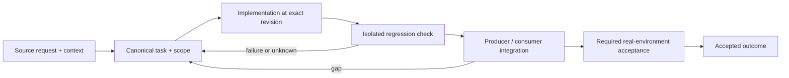

# Progress-aware execution, fallback and cancellation

Status: recovery specification / proposed contract; not a claim of completed implementation.

Owner and acceptance coordinator: https://github.com/alex-mextner/rig-cli/issues/521

## Original requests and editorial provenance

> повис на 40+ минут

Source **Q025**; compiled-fragment-attribution; rig-zerobug/rig-fable session 2026-09-04..07; agent=ThinNotSub; PDF page(s) 44. Cross-ticket thematic requirement; check context before applying to a narrower issue.

Original wording (before editorial correction)

> повис на 40+ минут

> У бота есть таймер безопасного перезапуска на восемь секунд? Никаких таких таймеров быть не должно. Объясни, что это, и проводи brainstorm заранее, чтобы не добавлять такие обходные решения. Таймеры почти всегда являются обходным решением, кроме случаев, когда пользователь сам просит таймер.

Source **Q239**; compiled-memory-attribution; MEMORY.md standing lesson: Timers are almost always a kludge - find the event-driven fix instead; PDF page(s) 90. Cross-ticket thematic requirement; check context before applying to a narrower issue.

Original wording (before editorial correction)

> у бота есть таймер безопасного перезапуска (tg-ctl:4940, 8
> секунд).--опять какая-то хуйня, никаких сука таймеров не должно быть! и
> объясни что это за хрень и делай брейншторм в будущем чтобы не затягивать
> такие костыли, запомни, и таймеры это 99% костыль всегда кроме случаев когда
> пользователь просит таймер

> Review не должен молча падать или зависать. Нужно алгоритмически анализировать ошибки, которые возвращают агенты: нужны подробные mappings. Если ошибка неизвестна, нужно показывать её в output при завершении.

Source **Q255**; telegram-export; Telegram tg#16165 2026-09-09T06:31:50+00:00; PDF page(s) 98. Cross-ticket thematic requirement; check context before applying to a narrower issue.

Original wording (before editorial correction)

> Думаю надо чтобы ревью не молча падали зависал сообщал что нужно попробовать позже в общем он должен внимательно изучать и анализировать ошибку которую агенты отправляют
> Имею в виду алгоритмически то есть нужны маппинги детальные
> А если ошибка неизвестно её нужно просто показывать в Output при завершении

> И почини, чтобы review понимал, что модель снова работает.

Source **Q265**; telegram-export; Telegram tg#16282 2026-09-09T09:56:40+00:00; PDF page(s) 101. Cross-ticket thematic requirement; check context before applying to a narrower issue.

Original wording (before editorial correction)

> И почини чтобы review могло понимать что модель ожила

## Boundary and intended behavior

Distinguish message acceptance, transport receipt, progress and completed work. Use one execution state machine. Do not solve lost delivery by inserting arbitrary sleeps; explicit user-requested schedules and bounded test-run budgets are different concepts.

## Realistic worked example

A remote reviewer emits output, then stops. Another remains silent but supplies a trustworthy progress signal. Neither low local CPU nor silence alone identifies quota exhaustion. Preserve partial output, try compatible alternatives where policy permits, and record cancellation/terminal cause without orphaning the owned child.

## Acceptance procedure

1. Reproduce the exact operation in an isolated checkout at a named revision.
2. Capture actual and expected behavior; distinguish a product failure from a missing dependency or unsupported platform.
3. Exercise the corresponding producer/consumer boundary, failure/restart case and a negative case.
4. Attach durable output and separately record any real-machine/provider/UI acceptance.
5. Close only the accepted outcome; a merged slice does not close a larger parent.

## State-transition diagram

## Complete linked backlog

| Ticket | Scope | Provider state | Verification |
|---|---|---|---|
| [agent-tools#18](https://github.com/alex-mextner/agent-tools/issues/18) | agent-hooks don't actually FIRE in Claude Code — need an agents-hooks/v1 → CC bridge runner (+ rig installs it) | closed | historical-closure-not-reaccepted |
| [agent-tools#158](https://github.com/alex-mextner/agent-tools/issues/158) | install-local-hooks: already-wired lefthook repos keep the stdin-less pre-push entry (fail-open) after a8bfc54 | open | open-outcome-requires-acceptance |
| [agent-tools#185](https://github.com/alex-mextner/agent-tools/issues/185) | pin-primary-worktree: wrapper commands (env/timeout/nice/...) bypass classification, same class as the leading-assignment bug | open | open-outcome-requires-acceptance |
| [agent-tools#186](https://github.com/alex-mextner/agent-tools/issues/186) | rig apply never runs automatically after an agent-hook PR merges to main — new/changed hooks silently don't take effect | open | open-outcome-requires-acceptance |
| [agent-tools#205](https://github.com/alex-mextner/agent-tools/issues/205) | feat(watchdog): tiered stall detection for background subagents | closed | historical-closure-not-reaccepted |
| [agent-tools#209](https://github.com/alex-mextner/agent-tools/issues/209) | Verify stall-watchdog fires under a simulated stall | closed | historical-closure-not-reaccepted |
| [agent-tools#210](https://github.com/alex-mextner/agent-tools/issues/210) | stall-watchdog: tmux nudge is not shell-safe if --tmux-target ever points at a raw shell | open | open-outcome-requires-acceptance |
| [agent-tools#252](https://github.com/alex-mextner/agent-tools/issues/252) | Codex updater must verify new binary and roll back on hang | closed | historical-closure-not-reaccepted |
| [agent-tools#267](https://github.com/alex-mextner/agent-tools/issues/267) | Investigate Claude Desktop dyld startup hang on macOS | open | open-outcome-requires-acceptance |
| [agent-tools#431](https://github.com/alex-mextner/agent-tools/issues/431) | RTK grep→ugrep rewrite has no timeout or root-path guard; orphaned child processes from agent sessions can run unbounded (28-day, ~500% CPU incident) | open | open-outcome-requires-acceptance |
| [agent-tools#467](https://github.com/alex-mextner/agent-tools/issues/467) | Add memory-pressure admission gate + periodic VS Code orphan reaper (2026-08-27/28 hang incident) | closed | historical-closure-not-reaccepted |
| [agent-tools#476](https://github.com/alex-mextner/agent-tools/issues/476) | opencode bridge: authoritative detached-subagent identity (RIG_AGENT_ID env marker) + canonical launcher | closed | historical-closure-not-reaccepted |
| [agent-tools#491](https://github.com/alex-mextner/agent-tools/issues/491) | vscode-orphan-reaper install.sh: plist replacement is not atomic -- a failed activation can leave the reaper unloaded with no rollback | open | open-outcome-requires-acceptance |
| [agent-tools#493](https://github.com/alex-mextner/agent-tools/issues/493) | Review VS Code orphan reaper installer diff | closed | historical-closure-not-reaccepted |
| [agent-tools#515](https://github.com/alex-mextner/agent-tools/issues/515) | agent-browser: the built-in idle timeout is documented as one hour but does not take effect | open | open-outcome-requires-acceptance |
| [agent-tools#520](https://github.com/alex-mextner/agent-tools/issues/520) | Block agents from editing global VS Code settings — a settings change in one agent's window pops the reload modal in every other window and hangs them | open | open-outcome-requires-acceptance |
| [agent-tools#562](https://github.com/alex-mextner/agent-tools/issues/562) | installers: write the rig provenance marker (.installed-by / installed_by) so rig status can place tool-installed skills and hooks | open | open-outcome-requires-acceptance |
| [agent-tools#592](https://github.com/alex-mextner/agent-tools/issues/592) | gh ship version-bump gate accepts a bump that main already has (feature merged without a version change) | open | open-outcome-requires-acceptance |
| [agent-tools#614](https://github.com/alex-mextner/agent-tools/issues/614) | omp hook bridge: eval and hub tool calls are invisible to every installed pre-write/pre-bash hook | open | open-outcome-requires-acceptance |
| [agent-tools#678](https://github.com/alex-mextner/agent-tools/issues/678) | Review ship external-review config change | open | open-outcome-requires-acceptance |
| [agent-tools#685](https://github.com/alex-mextner/agent-tools/issues/685) | agenttools_service status/is_installed misses a live process under an untracked legacy launchd label | closed | historical-closure-not-reaccepted |
| [agent-tools#686](https://github.com/alex-mextner/agent-tools/issues/686) | task-tool-dispatched subagents lack RIG_AGENT_ID/RIG_DETACHED_AGENT, hook bridge misclassifies them as the orchestrator | open | open-outcome-requires-acceptance |
| [agent-tools#701](https://github.com/alex-mextner/agent-tools/issues/701) | Silence opencode hook bridge WARN toast on clean allow | closed | historical-closure-not-reaccepted |
| [dev-cli#19](https://github.com/alex-mextner/dev-cli/issues/19) | dev-cli: 72 pre-existing ruff violations masked by an unpinned CI install | closed | historical-closure-not-reaccepted |
| [draw-cli#7](https://github.com/alex-mextner/draw-cli/issues/7) | `draw --version` prints "unknown" when run via the installed symlink | closed | historical-closure-not-reaccepted |
| [pm-cli#21](https://github.com/alex-mextner/pm-cli/issues/21) | pm-cli: add an install-skill command + install.sh for rig tools.items registration | open | open-outcome-requires-acceptance |
| [pm-cli#26](https://github.com/alex-mextner/pm-cli/issues/26) | Review ship external-review config change | open | open-outcome-requires-acceptance |
| [research-cli#3](https://github.com/alex-mextner/research-cli/issues/3) | Non-editable pip install breaks manifest loading (vendor/contracts/models.yaml not packaged) | open | open-outcome-requires-acceptance |
| [research-cli#4](https://github.com/alex-mextner/research-cli/issues/4) | research_cli/install.py file-mutation helpers are not unit-tested | open | open-outcome-requires-acceptance |
| [research-cli#11](https://github.com/alex-mextner/research-cli/issues/11) | research-cli: 67 pre-existing ruff violations masked by an unpinned CI install | closed | historical-closure-not-reaccepted |
| [review-cli#65](https://github.com/alex-mextner/review-cli/issues/65) | board resilience under concurrent load: per-seat timeout + slow-reserve-seat deprioritize + memory-aware concurrency cap | closed | historical-closure-not-reaccepted |
| [review-cli#75](https://github.com/alex-mextner/review-cli/issues/75) | review-qa ext harness: follow-up hardening (live-runner robustness + glue/timeout test coverage) | closed | historical-closure-not-reaccepted |
| [review-cli#101](https://github.com/alex-mextner/review-cli/issues/101) | fix(install): use `command git` in pre-commit hook template to bypass shell aliases | closed | historical-closure-not-reaccepted |
| [review-cli#118](https://github.com/alex-mextner/review-cli/issues/118) | Run 'review install-hook tg' for real once tg-cli PR #133 merges | open | open-outcome-requires-acceptance |
| [review-cli#129](https://github.com/alex-mextner/review-cli/issues/129) | review-cli can't drive fable: no board seat, -m hangs, -p swallows the answer | open | open-outcome-requires-acceptance |
| [review-cli#151](https://github.com/alex-mextner/review-cli/issues/151) | review-cli reliability: provider-failover, universal transient retry, pool-selection foolproofing | open | open-outcome-requires-acceptance |
| [review-cli#159](https://github.com/alex-mextner/review-cli/issues/159) | opencode oc:zai/glm-5.2 seat HANGS (zero output), wedging the entire diff review pool | open | open-outcome-requires-acceptance |
| [review-cli#160](https://github.com/alex-mextner/review-cli/issues/160) | review-cli leaks model child processes on kill/timeout (orphaned reviewer subprocesses survive) | open | open-outcome-requires-acceptance |
| [review-cli#163](https://github.com/alex-mextner/review-cli/issues/163) | review-cli --detach/jobs: job-id validation ordering, signal-reaper spawn race, shared-/tmp symlink hardening, cross-process job discovery | open | open-outcome-requires-acceptance |
| [review-cli#179](https://github.com/alex-mextner/review-cli/issues/179) | Restore oc:zai/glm-5.2 review seat (hangs on z.ai quota exhaustion) | open | open-outcome-requires-acceptance |
| [review-cli#180](https://github.com/alex-mextner/review-cli/issues/180) | P0: codex backend recursively re-invokes 'review diff' via unrestricted shell — unbounded process-spawn loop, machine-hanging (live-reproduced) | closed | historical-closure-not-reaccepted |
| [review-cli#181](https://github.com/alex-mextner/review-cli/issues/181) | Surface rate-limit reset time and suggest retry timer on backend usage-limit errors | open | open-outcome-requires-acceptance |
| [review-cli#198](https://github.com/alex-mextner/review-cli/issues/198) | Review in-seat retry token-tally test | open | open-outcome-requires-acceptance |
| [review-cli#199](https://github.com/alex-mextner/review-cli/issues/199) | Isolate retry logs in provider failover test | open | open-outcome-requires-acceptance |
| [review-cli#204](https://github.com/alex-mextner/review-cli/issues/204) | codex backend spawns codex exec --ephemeral processes never reaped on hang (reviewlib/backends.py:317) | open | open-outcome-requires-acceptance |
| [review-cli#206](https://github.com/alex-mextner/review-cli/issues/206) | review-cli: verify duplicate-model seats don't collide in seat_cooldown/retry bookkeeping + usage-file version check | open | open-outcome-requires-acceptance |
| [review-cli#218](https://github.com/alex-mextner/review-cli/issues/218) | Diff-identity gate: tighten --check git-probe timeouts, wrong-cwd diagnosis, remaining edge cases | open | open-outcome-requires-acceptance |
| [review-cli#223](https://github.com/alex-mextner/review-cli/issues/223) | SpecStore._guard has the same unbounded-blocking-flock hang review-cli#188 just fixed in seat_cooldown.py | open | open-outcome-requires-acceptance |
| [review-cli#227](https://github.com/alex-mextner/review-cli/issues/227) | stalled_models diagnostic misses the failover board dispatch path (review-cli#221 follow-up) | open | open-outcome-requires-acceptance |
| [review-cli#235](https://github.com/alex-mextner/review-cli/issues/235) | Extend true-silence detection beyond review_opencode to the remaining 5 backend call sites | open | open-outcome-requires-acceptance |
| [review-cli#236](https://github.com/alex-mextner/review-cli/issues/236) | Auto-summarize a timed-out/true-silenced seat's partial output using another model | open | open-outcome-requires-acceptance |
| [review-cli#238](https://github.com/alex-mextner/review-cli/issues/238) | rc 125 (true-silence) is unrecognized by the dashboard parser and collides with a real exit-code convention | open | open-outcome-requires-acceptance |
| [review-cli#239](https://github.com/alex-mextner/review-cli/issues/239) | True-silence check only covers pre-first-byte silence; Alex's example describes a talkative model going quiet MID-call | open | open-outcome-requires-acceptance |
| [review-cli#243](https://github.com/alex-mextner/review-cli/issues/243) | Review graduated true-silence timeout diff | closed | historical-closure-not-reaccepted |
| [review-cli#244](https://github.com/alex-mextner/review-cli/issues/244) | Prevent true-silence timeout from racing delayed pipe drains | open | open-outcome-requires-acceptance |
| [review-cli#245](https://github.com/alex-mextner/review-cli/issues/245) | Make REVIEW_TRUE_SILENCE_SECONDS non-positive semantics match help | open | open-outcome-requires-acceptance |
| [review-cli#254](https://github.com/alex-mextner/review-cli/issues/254) | true_silence_timeout can silently overshoot the caller's explicit per-call timeout budget | open | open-outcome-requires-acceptance |
| [review-cli#256](https://github.com/alex-mextner/review-cli/issues/256) | Board-deadline-clamped true-silence reap can falsely bench a healthy seat's cooldown | open | open-outcome-requires-acceptance |
| [review-cli#258](https://github.com/alex-mextner/review-cli/issues/258) | Poll-loop true-silence check has a narrow lock-acquisition-window race (bytes received but not yet recorded) | open | open-outcome-requires-acceptance |
| [review-cli#263](https://github.com/alex-mextner/review-cli/issues/263) | review-cli: add ReviewResult.true_silenced field instead of re-deriving true-silence from the trailing marker text | open | open-outcome-requires-acceptance |
| [review-cli#264](https://github.com/alex-mextner/review-cli/issues/264) | review-cli: should true-silence be sole authority pre-first-byte only when registry/env-tuned, or always min(true_silence, idle)? | open | open-outcome-requires-acceptance |
| [review-cli#265](https://github.com/alex-mextner/review-cli/issues/265) | review-cli: a pathologically long model id can truncate the true-silence reason out of the cooldown-skip body, misclassifying it as paywall | open | open-outcome-requires-acceptance |
| [review-cli#268](https://github.com/alex-mextner/review-cli/issues/268) | review-cli: true-silence marker/reason/skip-body strings duplicated across 3 modules with no shared source of truth | open | open-outcome-requires-acceptance |
| [review-cli#269](https://github.com/alex-mextner/review-cli/issues/269) | review-cli dashboard: distinguish a true-silence SKIP (cooldown already active) from an actual true-silence REAP | open | open-outcome-requires-acceptance |
| [review-cli#272](https://github.com/alex-mextner/review-cli/issues/272) | review-cli: idle_timeout is computed before the concurrency-slot wait, going stale for a queued seat | open | open-outcome-requires-acceptance |
| [review-cli#273](https://github.com/alex-mextner/review-cli/issues/273) | Review queued-seat timeout clamp diff | closed | historical-closure-not-reaccepted |
| [review-cli#284](https://github.com/alex-mextner/review-cli/issues/284) | tests/test_failover_pool.py (and similar) write real retry-logs into the live ~/Library/Logs/review-cli, no $REVIEW_LOG_DIR isolation | open | open-outcome-requires-acceptance |
| [review-cli#301](https://github.com/alex-mextner/review-cli/issues/301) | retry.classify_failure's seat-fatal check is text-only, unlike backends.py's new numeric _SEAT_FATAL_HTTP_STATUSES check | open | open-outcome-requires-acceptance |
| [review-cli#309](https://github.com/alex-mextner/review-cli/issues/309) | HIGH: bare (no-config) review diff can never satisfy the default self-merge quorum floor (min_roles=3) after the light-preset default change | closed | historical-closure-not-reaccepted |
| [review-cli#313](https://github.com/alex-mextner/review-cli/issues/313) | Avoid false true-silence dashboard classification for quoted skip text | open | open-outcome-requires-acceptance |
| [review-cli#314](https://github.com/alex-mextner/review-cli/issues/314) | opencode true-silence cooldown clear uses stale bare rc=0 check, diverges from claude path (backends.py _record_true_silence_if_needed) | open | open-outcome-requires-acceptance |
| [review-cli#338](https://github.com/alex-mextner/review-cli/issues/338) | dashboard: launchd-managed service can crash-loop on a dev-symlink install (PATH missing the review symlink dir) | open | open-outcome-requires-acceptance |
| [review-cli#361](https://github.com/alex-mextner/review-cli/issues/361) | Long-running seat: nudge the model at 10, 20 and 30 minutes and keep its partial output, instead of a silent hard timeout | open | open-outcome-requires-acceptance |
| [review-cli#388](https://github.com/alex-mextner/review-cli/issues/388) | review diff --staged --commit refuses with "staged diff changed" on a byte-identical index after a CLEAN review | open | open-outcome-requires-acceptance |
| [review-cli#392](https://github.com/alex-mextner/review-cli/issues/392) | Review detached-job hardening diff | closed | historical-closure-not-reaccepted |
| [review-cli#393](https://github.com/alex-mextner/review-cli/issues/393) | Treat invalid or future started_at as stale for pidless detached jobs | open | open-outcome-requires-acceptance |
| [review-cli#394](https://github.com/alex-mextner/review-cli/issues/394) | Adversarial review of detached jobs diff | closed | historical-closure-not-reaccepted |
| [review-cli#402](https://github.com/alex-mextner/review-cli/issues/402) | Make install-commit-hook rejection test verify stdout | open | open-outcome-requires-acceptance |
| [review-cli#405](https://github.com/alex-mextner/review-cli/issues/405) | Prevent heartbeat writes from blocking backend timeouts | closed | historical-closure-not-reaccepted |
| [review-cli#406](https://github.com/alex-mextner/review-cli/issues/406) | Avoid false idle wording in heartbeat status | open | open-outcome-requires-acceptance |
| [review-cli#407](https://github.com/alex-mextner/review-cli/issues/407) | Emit heartbeat status while concurrency-capped seats queue | open | open-outcome-requires-acceptance |
| [review-cli#408](https://github.com/alex-mextner/review-cli/issues/408) | Prevent heartbeat thread-start failures from aborting streamed reviews | open | open-outcome-requires-acceptance |
| [review-cli#428](https://github.com/alex-mextner/review-cli/issues/428) | opencode/omp backend seats inherit parent stdin, can hang forever misdiagnosed as quota-exhaustion stall | closed | historical-closure-not-reaccepted |
| [review-cli#459](https://github.com/alex-mextner/review-cli/issues/459) | smoke.py _smoke_env() breaks pytest import for spawned subprocess tests on local user-site-packages installs | open | open-outcome-requires-acceptance |
| [review-cli#467](https://github.com/alex-mextner/review-cli/issues/467) | opencode stall-retry loop writes no retry-log entry between its up-to-3 attempts | open | open-outcome-requires-acceptance |
| [review-cli#474](https://github.com/alex-mextner/review-cli/issues/474) | review diff hangs indefinitely: wire true_silence_timeout into review_codex, review_claude_cli, and review_omp's _run_streamed calls | closed | historical-closure-not-reaccepted |
| [review-cli#483](https://github.com/alex-mextner/review-cli/issues/483) | stats.py stalled-models diagnostic misses omp seat true-silence cooldowns (ACCESS_METHODS missing "omp") | open | open-outcome-requires-acceptance |
| [review-cli#486](https://github.com/alex-mextner/review-cli/issues/486) | review diff hangs indefinitely on 3d-cli worktree that modifies rig.yaml (possible UV_PROJECT_ENVIRONMENT env-inheritance issue) | open | open-outcome-requires-acceptance |
| [rig-cli#9](https://github.com/alex-mextner/rig-cli/issues/9) | rig must symlink installed skills into the harness discovery dir (~/.claude/skills), not just skills_target | closed | historical-closure-not-reaccepted |
| [rig-cli#66](https://github.com/alex-mextner/rig-cli/issues/66) | rig provisions the personal CLI ecosystem (tg/review/task/draw) at apply — rig owns tool installation | closed | historical-closure-not-reaccepted |
| [rig-cli#79](https://github.com/alex-mextner/rig-cli/issues/79) | rig init: bare `pip install` hint fails on PEP-668 + 124-action plan is a wall | closed | historical-closure-not-reaccepted |
| [rig-cli#83](https://github.com/alex-mextner/rig-cli/issues/83) | rig init: auto-install the [tui] extra instead of printing an install hint | closed | historical-closure-not-reaccepted |
| [rig-cli#152](https://github.com/alex-mextner/rig-cli/issues/152) | rig apply UX: 220-action plan + wall of notes, no progress, unclear finish (reads as a hang) | open | open-outcome-requires-acceptance |
| [rig-cli#180](https://github.com/alex-mextner/rig-cli/issues/180) | rig-cli CLAUDE.md documents orchestrator-stays-thin pre-write hook as never-installed, but it is now installed | open | open-outcome-requires-acceptance |
| [rig-cli#183](https://github.com/alex-mextner/rig-cli/issues/183) | rig-cli: schema rejects runtime-supported agent_hooks approval fields (approval_cmd, approval_cmd_timeout_s, tg_ctl_path) | open | open-outcome-requires-acceptance |
| [rig-cli#185](https://github.com/alex-mextner/rig-cli/issues/185) | rig-cli: hook-bridge registration never sets a Claude Code hook timeout, so a slow Telegram approval can silently fail open | open | open-outcome-requires-acceptance |
| [rig-cli#186](https://github.com/alex-mextner/rig-cli/issues/186) | rig-cli: catalog scan has no version/capability check, so an old agent-tools checkout can silently install hooks with removed bypasses | open | open-outcome-requires-acceptance |
| [rig-cli#188](https://github.com/alex-mextner/rig-cli/issues/188) | rig-cli: dev and scripts config validation is an unversioned breaking change for existing v1 configs | open | open-outcome-requires-acceptance |
| [rig-cli#198](https://github.com/alex-mextner/rig-cli/issues/198) | config: dotted script/e2e-job names collide with the dot-path splitter in config get/set | open | open-outcome-requires-acceptance |
| [rig-cli#234](https://github.com/alex-mextner/rig-cli/issues/234) | Central policy change audit: show who/what changed development culture and why | open | open-outcome-requires-acceptance |
| [rig-cli#236](https://github.com/alex-mextner/rig-cli/issues/236) | Config change transactions across multiple files/targets with preview and atomic commit intent | open | open-outcome-requires-acceptance |
| [rig-cli#239](https://github.com/alex-mextner/rig-cli/issues/239) | Human-readable policy changelog and release notes for shared development-culture updates | open | open-outcome-requires-acceptance |
| [rig-cli#243](https://github.com/alex-mextner/rig-cli/issues/243) | Safe mass rollback for policy and fleet changes | open | open-outcome-requires-acceptance |
| [rig-cli#257](https://github.com/alex-mextner/rig-cli/issues/257) | worktree: process-tree-aware timeout for 'git worktree add' (post-checkout hook descendants can survive) | open | open-outcome-requires-acceptance |
| [rig-cli#302](https://github.com/alex-mextner/rig-cli/issues/302) | rig init: genuinely-absent textual on a non-managed interpreter still only suggests pipx/uv-tool reinstall (no direct install command) | open | open-outcome-requires-acceptance |
| [rig-cli#305](https://github.com/alex-mextner/rig-cli/issues/305) | test_codex_update_cli_missing_updater_returns_127 is flaky under system load (hardcoded 0.5s probe timeout) | open | open-outcome-requires-acceptance |
| [rig-cli#339](https://github.com/alex-mextner/rig-cli/issues/339) | cc_hook_bridge settings.json matchers never set an explicit hook timeout, so CC's 600s default can race a hatch-using hook's own longer worst case | open | open-outcome-requires-acceptance |
| [rig-cli#357](https://github.com/alex-mextner/rig-cli/issues/357) | status: report tool-installed skills, user permission extras and the repo's own workflows as known items, not drift | closed | historical-closure-not-reaccepted |
| [rig-cli#363](https://github.com/alex-mextner/rig-cli/issues/363) | rig: raise omp's extensionHandlers.toolCallTimeoutMs when installing the omp hook bridge | open | open-outcome-requires-acceptance |
| [rig-cli#382](https://github.com/alex-mextner/rig-cli/issues/382) | git-hooks dispatcher: install and drift-check review-gate from the installed review-cli, not the agent-tools copy | open | open-outcome-requires-acceptance |
| [rig-cli#399](https://github.com/alex-mextner/rig-cli/issues/399) | rig: manage require_extra_approval_for_unattributed_changes on the GitHub ruleset, mode-gated | closed | historical-closure-not-reaccepted |
| [rig-cli#416](https://github.com/alex-mextner/rig-cli/issues/416) | rig apply provisions ~/.bunfig.toml isolated linker + globalStore so every bun install shares one package tree | closed | historical-closure-not-reaccepted |
| [stt-cli#28](https://github.com/alex-mextner/stt-cli/issues/28) | stt diarize: run pyannote the way mlx already runs, instead of installing into the system Python | closed | historical-closure-not-reaccepted |
| [stt-cli#34](https://github.com/alex-mextner/stt-cli/issues/34) | stt diarize install fails on the Homebrew Python 3.14 interpreter (uv pip install torch and pyannote.audio) | open | open-outcome-requires-acceptance |
| [task-cli#10](https://github.com/alex-mextner/task-cli/issues/10) | done/change/status close paths don't validate the source-state transition | closed | historical-closure-not-reaccepted |
| [task-cli#12](https://github.com/alex-mextner/task-cli/issues/12) | install-skill must also write the .blurbs/<tool>.md SessionStart blurb | closed | historical-closure-not-reaccepted |
| [task-cli#13](https://github.com/alex-mextner/task-cli/issues/13) | install-skill is a 1-layer stub: missing blurb + harness-instruction injection that all sibling CLIs do | closed | historical-closure-not-reaccepted |
| [task-cli#52](https://github.com/alex-mextner/task-cli/issues/52) | Warn after priority-changing task commands | closed | historical-closure-not-reaccepted |
| [task-cli#57](https://github.com/alex-mextner/task-cli/issues/57) | fix(daemon): detached spawn missing PYTHONPATH breaks symlink install | closed | historical-closure-not-reaccepted |
| [task-cli#64](https://github.com/alex-mextner/task-cli/issues/64) | task-cli: dont prepend site-packages to PYTHONPATH for pip and pipx package installs | open | open-outcome-requires-acceptance |
| [task-cli#67](https://github.com/alex-mextner/task-cli/issues/67) | task-cli: avoid running the msgref-quote and links-url gates twice during change --done | open | open-outcome-requires-acceptance |
| [task-cli#86](https://github.com/alex-mextner/task-cli/issues/86) | Sync SKILL.md source (install.py) with live-patched drift | closed | historical-closure-not-reaccepted |
| [task-cli#120](https://github.com/alex-mextner/task-cli/issues/120) | task change mutates the fetched ticket before policy gates run, so a refused edit can still leak into a later save | open | open-outcome-requires-acceptance |
| [task-cli#140](https://github.com/alex-mextner/task-cli/issues/140) | dependency-review CI gate audits the WHOLE dependency tree, blocking every PR regardless of what it actually changes | open | open-outcome-requires-acceptance |
| [task-cli#150](https://github.com/alex-mextner/task-cli/issues/150) | git switch/checkout --detach bypasses pin-primary-worktree entirely, and the write hook fails open on detached HEAD | open | open-outcome-requires-acceptance |
| [task-cli#181](https://github.com/alex-mextner/task-cli/issues/181) | task change --what truncates text at embedded '## ' markdown headings | closed | historical-closure-not-reaccepted |
| [tg-cli#70](https://github.com/alex-mextner/tg-cli/issues/70) | test hygiene: ctl-multi-session-forward integration leaks detached tg-ctl daemons | closed | historical-closure-not-reaccepted |
| [tg-cli#106](https://github.com/alex-mextner/tg-cli/issues/106) | Fix tg review-visual hook timeout and dirty-cwd routing | closed | historical-closure-not-reaccepted |
| [tg-cli#182](https://github.com/alex-mextner/tg-cli/issues/182) | tg-cli should not hide pending permission prompts by its own timeout | closed | historical-closure-not-reaccepted |
| [tg-cli#185](https://github.com/alex-mextner/tg-cli/issues/185) | tg-ctl /new private-topic spawn leaks an orphan forum topic and binding on each retry | open | open-outcome-requires-acceptance |
| [tg-cli#211](https://github.com/alex-mextner/tg-cli/issues/211) | tg-ctl: migrate pre-existing fully-installed hook setups to the opt-in sentinel | open | open-outcome-requires-acceptance |
| [tg-cli#244](https://github.com/alex-mextner/tg-cli/issues/244) | Review the current code changes (staged, unstaged, and untracked files)  | open | open-outcome-requires-acceptance |
| [tg-cli#295](https://github.com/alex-mextner/tg-cli/issues/295) | tg-ctl: long /daily report can exceed Telegram's message limit and be lost with no retry | open | open-outcome-requires-acceptance |
| [tg-cli#303](https://github.com/alex-mextner/tg-cli/issues/303) | tg-ctl ask: honour --timeout beyond the 115s hook cap, auto-deliver a queued decision to a re-run of the same deterministic request, and tell the truth about why the asker went away | open | open-outcome-requires-acceptance |
| [tg-cli#311](https://github.com/alex-mextner/tg-cli/issues/311) | Scheduled usage push: a send failure on the boundary day loses the report, next day's retry is a wrong-cause notice | open | open-outcome-requires-acceptance |
| [tg-cli#332](https://github.com/alex-mextner/tg-cli/issues/332) | Review ship configuration change | open | open-outcome-requires-acceptance |
| [tg-cli#355](https://github.com/alex-mextner/tg-cli/issues/355) | tg-ctl: ask-forward log line conflates timeout with daemon failure (tg-ctl:3726) | open | open-outcome-requires-acceptance |
| [tg-cli#363](https://github.com/alex-mextner/tg-cli/issues/363) | tg-ctl: active-silence nudge for tg-unaware agent sessions | closed | historical-closure-not-reaccepted |
| [tg-cli#375](https://github.com/alex-mextner/tg-cli/issues/375) | test suite: gh ship's local full-suite fallback gate is structurally flaky (4/4 runs failed on unrelated hardcoded-timeout tests) | open | open-outcome-requires-acceptance |
