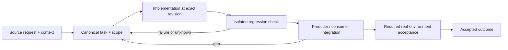

# Account-specific quota, billing and recovery signals

Status: recovery specification / proposed contract; not a claim of completed implementation.

Owner and acceptance coordinator: https://github.com/alex-mextner/rig-cli/issues/521

## Original requests and editorial provenance

> harness limits --all возвращает что-то интересное, но это скорее usage, а не лимиты. Всё нечитаемо: без цветов и ASCII-графики. rig stats, например, сделан красиво; нужно что-то похожее на скриншот. Найди все мои сообщения о лимитах за всё время в OMP и Claude Code: я писал о скорости, ускорении и аналитике. Нужно показывать все аккаунты всех моделей и провайдеров во всех харнесах: z.ai/GLM, три Claude, Codex, ранее Kimi, x.ai/Grok.

Source **Q231**; compiled-memory-attribution; MEMORY.md standing lesson: harness limits must show real limits, all accounts, like the screenshot; PDF page(s) 86. Cross-ticket thematic requirement; check context before applying to a narrower issue.

Original wording (before editorial correction)

> harness limits --all сейчас чтото возвращает вроде и интересное но совершенно не про лимиты, это скорее про usage, и все это абсолютно нечитаемое, не раскрашенное и без ascii графики, rig stats красиво сделано например, должно быть чтото-то такое как на этом скриншоте, и вообще найди все мои сообщеня про лимиты за все время в omp и cc, я писал про скорость и ускорение и аналитику и нужно писать про все аккаунты всех моделей и провайдеров во всех харнесах … z.ai/glm, 3 claudes, codex, ранее было kimi, x.ai/grok

> Review не должен молча падать или зависать. Нужно алгоритмически анализировать ошибки, которые возвращают агенты: нужны подробные mappings. Если ошибка неизвестна, нужно показывать её в output при завершении.

Source **Q255**; telegram-export; Telegram tg#16165 2026-09-09T06:31:50+00:00; PDF page(s) 98. Cross-ticket thematic requirement; check context before applying to a narrower issue.

Original wording (before editorial correction)

> Думаю надо чтобы ревью не молча падали зависал сообщал что нужно попробовать позже в общем он должен внимательно изучать и анализировать ошибку которую агенты отправляют
> Имею в виду алгоритмически то есть нужны маппинги детальные
> А если ошибка неизвестно её нужно просто показывать в Output при завершении

> Это не вина review: там просто закончились лимиты. Проблема, видимо, в том, что review-cli плохо понимает причину. Тикет нужно завести об этом, а не прежний. Но я пока посмотрел только название.

Source **Q257**; telegram-export; Telegram tg#16170 2026-09-09T06:34:25+00:00; PDF page(s) 98. Cross-ticket thematic requirement; check context before applying to a narrower issue.

**Context fragment:** do not interpret as a standalone approval.

Original wording (before editorial correction)

> Это не вина review 
> Там просто лимиты кончились. Проблема в том видимо что ревью кли плохо понимает в чем там дело. Тикет надо про это завести а не этот дуоацкий 
> Но я только название посмотрел

> В accounts-0 Claude Code сейчас есть авторизованный аккаунт. Разберись, почему он не работает, если review действительно сейчас не работает.

Source **Q262**; telegram-export; Telegram tg#16244 2026-09-09T09:27:25+00:00; PDF page(s) 100. Cross-ticket thematic requirement; check context before applying to a narrower issue.

**Context fragment:** do not interpret as a standalone approval.

Original wording (before editorial correction)

> В accounts-0 cc есть сейчас залогиненный аккаунт, разберись почему он не работает если review сейчас и правда не работает

> И почини, чтобы review понимал, что модель снова работает.

Source **Q265**; telegram-export; Telegram tg#16282 2026-09-09T09:56:40+00:00; PDF page(s) 101. Cross-ticket thematic requirement; check context before applying to a narrower issue.

Original wording (before editorial correction)

> И почини чтобы review могло понимать что модель ожила

## Boundary and intended behavior

Carry source, time, scope, coverage and unknown states. Separate quota, authentication, entitlement, transport and storage failures. Only a nonempty fully covered candidate set with applicable fresh affirmative evidence supports all_exhausted. Detect recovered routes without permanently trusting stale cooldowns.

## Realistic worked example

Claude account A has a confirmed 100% usage window, B has 20%, and C cannot be read. Prefer B. A does not exhaust B, C is not healthy, and a local database lock is not evidence that the entire provider fleet exhausted its quota. Show observation times and API-reported reset windows separately from token usage.

## Acceptance procedure

1. Reproduce the exact operation in an isolated checkout at a named revision.
2. Capture actual and expected behavior; distinguish a product failure from a missing dependency or unsupported platform.
3. Exercise the corresponding producer/consumer boundary, failure/restart case and a negative case.
4. Attach durable output and separately record any real-machine/provider/UI acceptance.
5. Close only the accepted outcome; a merged slice does not close a larger parent.

## State-transition diagram

## Complete linked backlog

| Ticket | Scope | Provider state | Verification |

|---|---|---|---|

| [agent-tools#227](https://github.com/alex-mextner/agent-tools/issues/227) | Investigate missing Codex 90 percent usage warning | closed | historical-closure-not-reaccepted |

| [agent-tools#257](https://github.com/alex-mextner/agent-tools/issues/257) | Research Haft capabilities, usage stats, and provisioning gaps | closed | historical-closure-not-reaccepted |

| [agent-tools#269](https://github.com/alex-mextner/agent-tools/issues/269) | ship: empty statusCheckRollup on billing-blocked CI must run local gate, not fall through to ungated --admin merge | closed | historical-closure-not-reaccepted |

| [agent-tools#354](https://github.com/alex-mextner/agent-tools/issues/354) | omp ARGV guard should account for RIPGREP_CONFIG_PATH env-assignment bypass | open | open-outcome-requires-acceptance |

| [agent-tools#355](https://github.com/alex-mextner/agent-tools/issues/355) | docs: record billing-block vs self-hosted-runner-outage lesson in ci-gate-suite skill | open | open-outcome-requires-acceptance |

| [agent-tools#362](https://github.com/alex-mextner/agent-tools/issues/362) | gh-ship debugging invites agents to cat live credential env files — no read-side guard | open | open-outcome-requires-acceptance |

| [agent-tools#444](https://github.com/alex-mextner/agent-tools/issues/444) | gh-ship CI-down probe misses billing-block when annotation text isn't checked directly | open | open-outcome-requires-acceptance |

| [agent-tools#529](https://github.com/alex-mextner/agent-tools/issues/529) | stop-completion-selfcheck: fix cooldown so it stops re-blocking on nearly every stop in long sessions | closed | historical-closure-not-reaccepted |

| [agent-tools#705](https://github.com/alex-mextner/agent-tools/issues/705) | Ship capacity exception: validate producer evidence and complete cross-repository acceptance | open | open-outcome-requires-acceptance |

| [review-cli#25](https://github.com/alex-mextner/review-cli/issues/25) | Fix stale flat DEFAULT_MODELS (kimi-k2p6-turbo via dead Fireworks/glide account) → manifest | closed | historical-closure-not-reaccepted |

| [review-cli#166](https://github.com/alex-mextner/review-cli/issues/166) | _oc_config_has_provider_key accepts whitespace/non-string apiKey as valid credential | open | open-outcome-requires-acceptance |

| [review-cli#187](https://github.com/alex-mextner/review-cli/issues/187) | seat_cooldown: cooldown store keyed by model only, not (model, transport) | open | open-outcome-requires-acceptance |

| [review-cli#188](https://github.com/alex-mextner/review-cli/issues/188) | seat_cooldown: read-modify-write across record_cooldown/clear_cooldown not locked (lost-update race) | closed | historical-closure-not-reaccepted |

| [review-cli#196](https://github.com/alex-mextner/review-cli/issues/196) | Review token usage diff for cross-file regressions | closed | historical-closure-not-reaccepted |

| [review-cli#197](https://github.com/alex-mextner/review-cli/issues/197) | Count REST token usage on flat review dispatches | open | open-outcome-requires-acceptance |

| [review-cli#202](https://github.com/alex-mextner/review-cli/issues/202) | Attribute opencode cooldown skips to opencode in logs | open | open-outcome-requires-acceptance |

| [review-cli#224](https://github.com/alex-mextner/review-cli/issues/224) | seat_cooldown._locked(): follow-up hardening from review-cli#188 rounds 4-5 (not blocking) | open | open-outcome-requires-acceptance |

| [review-cli#225](https://github.com/alex-mextner/review-cli/issues/225) | seat_cooldown._locked(): round-6 architecture findings (backoff, single-flock-serializer, per-store locking) | open | open-outcome-requires-acceptance |

| [review-cli#226](https://github.com/alex-mextner/review-cli/issues/226) | Extend seat-cooldown escalation (review-cli#221) to opencode/codex/commandcode/zai backends | open | open-outcome-requires-acceptance |

| [review-cli#232](https://github.com/alex-mextner/review-cli/issues/232) | Review seat cooldown locking diff | closed | historical-closure-not-reaccepted |

| [review-cli#234](https://github.com/alex-mextner/review-cli/issues/234) | seat_cooldown/_locked: architectural follow-ups from #188's review (not blockers) | open | open-outcome-requires-acceptance |

| [review-cli#257](https://github.com/alex-mextner/review-cli/issues/257) | Pre-existing tests calling _cooldown_skip_result/_emit_rest_log directly write real sidecar logs (no REVIEW_LOG_DIR isolation) | open | open-outcome-requires-acceptance |

| [review-cli#262](https://github.com/alex-mextner/review-cli/issues/262) | review-cli: centralize model-id normalization inside seat_cooldown/model_behavior stores, not at one call site | open | open-outcome-requires-acceptance |

| [review-cli#266](https://github.com/alex-mextner/review-cli/issues/266) | review-cli: give _cooldown_skip_result a caller-supplied header label instead of re-deriving per-backend header shape | open | open-outcome-requires-acceptance |

| [review-cli#267](https://github.com/alex-mextner/review-cli/issues/267) | review-cli: extract a shared _reconcile_seat_cooldown helper instead of duplicating record/clear gate logic per backend | open | open-outcome-requires-acceptance |

| [review-cli#300](https://github.com/alex-mextner/review-cli/issues/300) | seat_cooldown: chronic quota exhaustion delivered as HTTP 429 (API transport) is never cached | closed | historical-closure-not-reaccepted |

| [review-cli#302](https://github.com/alex-mextner/review-cli/issues/302) | backends.py's cooldown-classification helpers duplicate scan work and re-derive precedence in prose at every call site | open | open-outcome-requires-acceptance |

| [review-cli#312](https://github.com/alex-mextner/review-cli/issues/312) | Preserve opencode cooldown history for transient sentinel responses | open | open-outcome-requires-acceptance |

| [review-cli#339](https://github.com/alex-mextner/review-cli/issues/339) | backends.py: _CHRONIC_QUOTA_MARKERS missing 'limit exhausted' phrase, seat never cooled down | open | open-outcome-requires-acceptance |

| [review-cli#340](https://github.com/alex-mextner/review-cli/issues/340) | Review limit exhausted marker diff | closed | historical-closure-not-reaccepted |

| [review-cli#341](https://github.com/alex-mextner/review-cli/issues/341) | Avoid cooling down transient 'rate limit exhausted' responses | open | open-outcome-requires-acceptance |

| [review-cli#344](https://github.com/alex-mextner/review-cli/issues/344) | Metrics tab: real token usage + cost tracking, not a permanent empty state | open | open-outcome-requires-acceptance |

| [review-cli#367](https://github.com/alex-mextner/review-cli/issues/367) | review-cli-wt-188-cooldown-lock: stale 18-day cooldown-write-race fix with unaddressed lock-contract regression finding | closed | historical-closure-not-reaccepted |

| [review-cli#370](https://github.com/alex-mextner/review-cli/issues/370) | Quota limit-exhausted marker fix may be a no-op -- unresolved finding in review-cli-wt-limit-exhausted-marker | open | open-outcome-requires-acceptance |

| [review-cli#439](https://github.com/alex-mextner/review-cli/issues/439) | Gate review_codex spawn on harness session and weekly limits like review_claude | open | open-outcome-requires-acceptance |

| [review-cli#465](https://github.com/alex-mextner/review-cli/issues/465) | omp/claude multi-account seats: log carries no account/credential identity | open | open-outcome-requires-acceptance |

| [review-cli#472](https://github.com/alex-mextner/review-cli/issues/472) | Capacity check: distinguish confirmed quota exhaustion from cooldowns, unknown health and unusable routes | open | open-outcome-requires-acceptance |

| [review-cli#479](https://github.com/alex-mextner/review-cli/issues/479) | One exhausted Claude account blocks every claude:* seat regardless of which account is active | open | open-outcome-requires-acceptance |

| [review-cli#492](https://github.com/alex-mextner/review-cli/issues/492) | [EPIC] Reliable review fleet: account-aware capacity, adapter liveness, fallback and durable evidence | open | open-outcome-requires-acceptance |

| [rig-cli#312](https://github.com/alex-mextner/rig-cli/issues/312) | Add 'rig usage' command: cross-account Claude token/cost usage stats | closed | historical-closure-not-reaccepted |

| [rig-cli#317](https://github.com/alex-mextner/rig-cli/issues/317) | rig usage: price 1-hour cache writes at their real tier, not the flat 1.25x | open | open-outcome-requires-acceptance |

| [rig-cli#344](https://github.com/alex-mextner/rig-cli/issues/344) | Review Codex usage-hook diff | closed | historical-closure-not-reaccepted |

| [rig-cli#351](https://github.com/alex-mextner/rig-cli/issues/351) | Review nullable tg_ctl Codex usage-hook schema diff | closed | historical-closure-not-reaccepted |

| [rig-cli#368](https://github.com/alex-mextner/rig-cli/issues/368) | harness: rig-provisioned Claude Code hooks never fire for claude-rotate sessions (account dirs have no hooks) | open | open-outcome-requires-acceptance |

| [rig-cli#449](https://github.com/alex-mextner/rig-cli/issues/449) | `rig stats show` reports no hatch usage despite today's Telegram hatch flood | closed | historical-closure-not-reaccepted |

| [rig-cli#501](https://github.com/alex-mextner/rig-cli/issues/501) | docs: full harness x account x model inventory | closed | historical-closure-not-reaccepted |

| [rig-cli#507](https://github.com/alex-mextner/rig-cli/issues/507) | Prevent recurrence of fleet-driven memory pressure: verify admission limits and safe recovery | open | open-outcome-requires-acceptance |

| [tg-cli#113](https://github.com/alex-mextner/tg-cli/issues/113) | Notify Telegram when the harness hits a session limit or API error; inline button schedules auto-continue at reset time | closed | historical-closure-not-reaccepted |

| [tg-cli#114](https://github.com/alex-mextner/tg-cli/issues/114) | Reaction lifecycle on inbound tg messages: sleeping-mark on limit-stop, eyes on resume, done-mark on answer or filed task | open | open-outcome-requires-acceptance |

| [tg-cli#124](https://github.com/alex-mextner/tg-cli/issues/124) | tg: auto-split messages exceeding Telegram's 4096-char limit | open | open-outcome-requires-acceptance |

| [tg-cli#128](https://github.com/alex-mextner/tg-cli/issues/128) | tg: ✍️ reaction doesn't flip to 👀 after limit-blocker is cleared, reply not delivered to agent | closed | historical-closure-not-reaccepted |

| [tg-cli#132](https://github.com/alex-mextner/tg-cli/issues/132) | Report agent usage limits at 90 percent | open | open-outcome-requires-acceptance |

| [tg-cli#172](https://github.com/alex-mextner/tg-cli/issues/172) | Investigate missing Codex 90 percent usage warning | closed | historical-closure-not-reaccepted |

| [tg-cli#176](https://github.com/alex-mextner/tg-cli/issues/176) | Add automatic Codex usage telemetry collector for 90 percent warnings | closed | historical-closure-not-reaccepted |

| [tg-cli#230](https://github.com/alex-mextner/tg-cli/issues/230) | tg-ctl: usage-limit notification can't detect staleness when resetAt is null (claude/pi context-window) | closed | historical-closure-not-reaccepted |

| [tg-cli#265](https://github.com/alex-mextner/tg-cli/issues/265) | limit-continue arm/fire guard recovers agent from windowName, same drift weakness as the harness-event bug | open | open-outcome-requires-acceptance |

| [tg-cli#290](https://github.com/alex-mextner/tg-cli/issues/290) | feat(tg-ctl): /usage bot command + scheduled weekly/monthly push | open | open-outcome-requires-acceptance |

| [tg-cli#293](https://github.com/alex-mextner/tg-cli/issues/293) | tg-ctl: scheduled usage report silently lost if machine asleep or off across the weekly/monthly boundary | open | open-outcome-requires-acceptance |

| [tg-cli#294](https://github.com/alex-mextner/tg-cli/issues/294) | tg-ctl: malformed rig usage --json can crash the /spend report formatter | open | open-outcome-requires-acceptance |

| [tg-cli#296](https://github.com/alex-mextner/tg-cli/issues/296) | tg-ctl: /spend shows a misleading $0.00 for models rig usage marks unpriced | open | open-outcome-requires-acceptance |

| [tg-cli#297](https://github.com/alex-mextner/tg-cli/issues/297) | tg-ctl: scheduled usage HTML send does not escape report body content | open | open-outcome-requires-acceptance |

| [tg-cli#307](https://github.com/alex-mextner/tg-cli/issues/307) | Review usage schedule uncommitted diff | closed | historical-closure-not-reaccepted |
