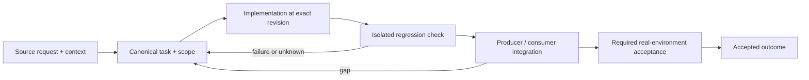

# Native agent identity and cross-harness guard parity

Status: recovery specification / proposed contract; not a claim of completed implementation.

Owner and acceptance coordinator: https://github.com/alex-mextner/rig-cli/issues/521

## Original requests and editorial provenance

> OMP, похоже, не подчиняется хуку оркестратора.

Source **Q020**; compiled-fragment-attribution; rig-zerobug/rig-fable session 2026-09-04..07; agent=ThinNotSub; PDF page(s) 1. Cross-ticket thematic requirement; check context before applying to a narrower issue.

Original wording (before editorial correction)

> omp похоже не подчинается хуку оркестратора

> Не применяется к сессиям внутри review-cli.

Source **Q122**; compiled-fragment-attribution; rig-zerobug/rig-fable session 2026-09-04..07; agent=ThinNotSub; PDF page(s) 13. Cross-ticket thematic requirement; check context before applying to a narrower issue.

**Context fragment:** do not interpret as a standalone approval.

Original wording (before editorial correction)

> не примеряется к сессиям внутри review-cli

> Сам не делай: ты координатор.

Source **Q159**; compiled-fragment-attribution; rig-zerobug/rig-fable session 2026-09-04..07; agent=ImplementHarnessTask, Implement433Pad, ThinNotSub; PDF page(s) 30. Cross-ticket thematic requirement; check context before applying to a narrower issue.

Original wording (before editorial correction)

> сам не делай, ты координатор

> Зачем исключён?

Source **Q193**; compiled-fragment-attribution; rig-zerobug/rig-fable session 2026-09-04..07; agent=ThinNotSub; PDF page(s) 73. Cross-ticket thematic requirement; check context before applying to a narrower issue.

**Context fragment:** do not interpret as a standalone approval.

Original wording (before editorial correction)

> зачем исключен

## Boundary and intended behavior

Normalize trusted native and launcher contexts through one carrier contract. Preserve main/child/grandchild/sibling isolation. Missing metadata is explicit unsupported/unknown, not a global harness exemption. Keep read-only diagnostic commands available according to the latest user instructions.

## Realistic worked example

A main OMP session and two native task children share an OS process. The children have distinct invocation/session identity, while the main call remains the orchestrator. A path suffix, recent transcript mtime, caller-supplied agent_id or process-global flag cannot prove which child made the call.

## Acceptance procedure

1. Reproduce the exact operation in an isolated checkout at a named revision.
2. Capture actual and expected behavior; distinguish a product failure from a missing dependency or unsupported platform.
3. Exercise the corresponding producer/consumer boundary, failure/restart case and a negative case.
4. Attach durable output and separately record any real-machine/provider/UI acceptance.
5. Close only the accepted outcome; a merged slice does not close a larger parent.

## State-transition diagram

## Complete linked backlog

| Ticket | Scope | Provider state | Verification |

|---|---|---|---|

| [agent-tools#80](https://github.com/alex-mextner/agent-tools/issues/80) | orchestrator-stays-thin over-blocks fully read-only shell pipes (3+ segments) | closed | historical-closure-not-reaccepted |

| [agent-tools#81](https://github.com/alex-mextner/agent-tools/issues/81) | Codify the orchestrator-only / all-work-in-swarms doctrine in AGENTS.md | closed | historical-closure-not-reaccepted |

| [agent-tools#101](https://github.com/alex-mextner/agent-tools/issues/101) | require-ticket: -F - (stdin) message is unreadable by a PreToolUse hook, false-blocks ticketed commits | closed | historical-closure-not-reaccepted |

| [agent-tools#112](https://github.com/alex-mextner/agent-tools/issues/112) | skills-read-gate: does NOT exempt dispatched subagents → false BLOCK demanding delegate-work-to-subagents + visual-proof-cycle on subagent commits | closed | historical-closure-not-reaccepted |

| [agent-tools#115](https://github.com/alex-mextner/agent-tools/issues/115) | orchestrator-stays-thin: narrow _is_subagent to read only args.agent_id (drop the unsanitized top-level event.agent_id relax-surface) | closed | historical-closure-not-reaccepted |

| [agent-tools#159](https://github.com/alex-mextner/agent-tools/issues/159) | orchestrator-stays-thin: whitelist `gh ship` release chains for the orchestrator (gated-ship deadlock) | open | open-outcome-requires-acceptance |

| [agent-tools#168](https://github.com/alex-mextner/agent-tools/issues/168) | agent-hooks: subagent-no-bg-longproc misses Monitor-based timer rests | open | open-outcome-requires-acceptance |

| [agent-tools#220](https://github.com/alex-mextner/agent-tools/issues/220) | Add first Codex hook bridge | closed | historical-closure-not-reaccepted |

| [agent-tools#265](https://github.com/alex-mextner/agent-tools/issues/265) | Capture Codex subagent hook payload before pre-agent enforcement | open | open-outcome-requires-acceptance |

| [agent-tools#287](https://github.com/alex-mextner/agent-tools/issues/287) | opencode hook bridge skipped: plugin.js source became a self-referential symlink (agent-tools ships it fine) | open | open-outcome-requires-acceptance |

| [agent-tools#307](https://github.com/alex-mextner/agent-tools/issues/307) | orchestrator-stays-thin: false-positive block on tg heredoc-argument report idiom | open | open-outcome-requires-acceptance |

| [agent-tools#310](https://github.com/alex-mextner/agent-tools/issues/310) | orchestrator-stays-thin heredoc carve-out: cross-file/interop follow-ups (deferred from issue 307) | open | open-outcome-requires-acceptance |

| [agent-tools#346](https://github.com/alex-mextner/agent-tools/issues/346) | background-subagent-gate blocks all foreground Agent dispatches: run_in_background is not a real CC field | closed | historical-closure-not-reaccepted |

| [agent-tools#347](https://github.com/alex-mextner/agent-tools/issues/347) | orchestrator-stays-thin falsely blocks read-only find+git-grep Bash chains | open | open-outcome-requires-acceptance |

| [agent-tools#360](https://github.com/alex-mextner/agent-tools/issues/360) | background-subagent-gate: unverified CC/opencode boundary assumptions + no contract test | open | open-outcome-requires-acceptance |

| [agent-tools#364](https://github.com/alex-mextner/agent-tools/issues/364) | Shorten background-subagent-gate REMINDER text | closed | historical-closure-not-reaccepted |

| [agent-tools#370](https://github.com/alex-mextner/agent-tools/issues/370) | orchestrator-stays-thin: ORCH_ALLOW word-boundary quirk matches hyphen-suffixed lookalikes | open | open-outcome-requires-acceptance |

| [agent-tools#374](https://github.com/alex-mextner/agent-tools/issues/374) | orchestrator-stays-thin: same 2-segment unrecognized-companion gap exists for tg/review (pre-existing, out of scope for #363) | open | open-outcome-requires-acceptance |

| [agent-tools#394](https://github.com/alex-mextner/agent-tools/issues/394) | gh pr merge PreToolUse block printed refusal but merge executed anyway (rig-cli#269) | closed | historical-closure-not-reaccepted |

| [agent-tools#432](https://github.com/alex-mextner/agent-tools/issues/432) | Subagent guidance: unique filenames for one-shot scratch artifacts (PR bodies etc.), verify after gh pr create/edit --body-file | open | open-outcome-requires-acceptance |

| [agent-tools#438](https://github.com/alex-mextner/agent-tools/issues/438) | Monitor tool's shell command bypasses all pre-bash agent-hook guards | open | open-outcome-requires-acceptance |

| [agent-tools#495](https://github.com/alex-mextner/agent-tools/issues/495) | agent-hooks deadlock opencode orchestrator: background-subagent-gate demands CC-only fields (fork/background), orchestrator-stays-thin blocks every fallback | closed | historical-closure-not-reaccepted |

| [agent-tools#504](https://github.com/alex-mextner/agent-tools/issues/504) | Provision orchestrator-stays-thin / background-subagent-gate policy proactively via SessionStart blurb | open | open-outcome-requires-acceptance |

| [agent-tools#519](https://github.com/alex-mextner/agent-tools/issues/519) | Memory guard for agent fan-out: refuse to dispatch new subagents or review runs when the machine is already swapping | open | open-outcome-requires-acceptance |

| [agent-tools#526](https://github.com/alex-mextner/agent-tools/issues/526) | claude-rotate and the Stop hook bridge: warn or wrap when a harness starts outside tmux, and serve the tg-ctl inbox fallback | open | open-outcome-requires-acceptance |

| [agent-tools#533](https://github.com/alex-mextner/agent-tools/issues/533) | orchestrator-stays-thin misclassifies review-cli's spawned codex/opencode reviewer processes as the orchestrator | closed | historical-closure-not-reaccepted |

| [agent-tools#541](https://github.com/alex-mextner/agent-tools/issues/541) | orchestrator-stays-thin: sed -n (read-only) is not in READ_ONLY_BASH, forces chain-length fallback | closed | historical-closure-not-reaccepted |

| [agent-tools#542](https://github.com/alex-mextner/agent-tools/issues/542) | Extend the harness-exempt signal to background-subagent-gate and no-long-inline-process (same misclassification class as orchestrator-stays-thin) | open | open-outcome-requires-acceptance |

| [agent-tools#543](https://github.com/alex-mextner/agent-tools/issues/543) | Block a dispatched subagent from calling the Monitor tool (subagent-no-monitor hook) | open | open-outcome-requires-acceptance |

| [agent-tools#545](https://github.com/alex-mextner/agent-tools/issues/545) | Review subagent Monitor hook diff | closed | historical-closure-not-reaccepted |

| [agent-tools#546](https://github.com/alex-mextner/agent-tools/issues/546) | subagent-no-bg-longproc's stated rationale is factually wrong for general run_in_background | closed | historical-closure-not-reaccepted |

| [agent-tools#551](https://github.com/alex-mextner/agent-tools/issues/551) | Review monitor registration documentation diff | closed | historical-closure-not-reaccepted |

| [agent-tools#553](https://github.com/alex-mextner/agent-tools/issues/553) | Review omp hook bridge exemption diff | closed | historical-closure-not-reaccepted |

| [agent-tools#559](https://github.com/alex-mextner/agent-tools/issues/559) | subagent-no-bg-longproc: decide whether a BOUNDED labeled long process under run_in_background:true should stay blocked | open | open-outcome-requires-acceptance |

| [agent-tools#568](https://github.com/alex-mextner/agent-tools/issues/568) | opencode hook bridge: plugin.js still spawns the dispatcher synchronously, blocking the opencode server | open | open-outcome-requires-acceptance |

| [agent-tools#573](https://github.com/alex-mextner/agent-tools/issues/573) | Native subagent identity across harnesses: complete Codex/OMP coverage without global exemptions | open | open-outcome-requires-acceptance |

| [agent-tools#584](https://github.com/alex-mextner/agent-tools/issues/584) | no-long-inline-process: gate the module-runner and launcher forms of a test suite (python -m pytest, uv run pytest, npx vitest) | closed | historical-closure-not-reaccepted |

| [agent-tools#585](https://github.com/alex-mextner/agent-tools/issues/585) | Review asynchronous omp hook bridge diff | closed | historical-closure-not-reaccepted |

| [agent-tools#586](https://github.com/alex-mextner/agent-tools/issues/586) | Review no-long-inline-process launcher parsing diff | closed | historical-closure-not-reaccepted |

| [agent-tools#623](https://github.com/alex-mextner/agent-tools/issues/623) | omp hook bridge eval secret-scanning: replace regex text-scrape with a real AST walk | open | open-outcome-requires-acceptance |

| [agent-tools#626](https://github.com/alex-mextner/agent-tools/issues/626) | no-long-inline-process: allow omp/codex/opencode like orchestrator-stays-thin | closed | historical-closure-not-reaccepted |

| [agent-tools#630](https://github.com/alex-mextner/agent-tools/issues/630) | orchestrator-stays-thin blocks a second-level nested subagent with no delegation path at all | open | open-outcome-requires-acceptance |

| [agent-tools#634](https://github.com/alex-mextner/agent-tools/issues/634) | orchestrator-stays-thin gates subagents as the orchestrator | closed | historical-closure-not-reaccepted |

| [agent-tools#647](https://github.com/alex-mextner/agent-tools/issues/647) | omp hook process never sees nested PI_SESSION_FILE so subagent bash still blocks | closed | historical-closure-not-reaccepted |

| [agent-tools#649](https://github.com/alex-mextner/agent-tools/issues/649) | orchestrator-stays-thin must not gate review-cli inner sessions | open | open-outcome-requires-acceptance |

| [agent-tools#659](https://github.com/alex-mextner/agent-tools/issues/659) | Splice rig-managed orchestrator and autonomous-mode blocks into AGENTS.md | closed | historical-closure-not-reaccepted |

| [agent-tools#673](https://github.com/alex-mextner/agent-tools/issues/673) | Codex native spawn_agent children still look like the orchestrator | open | open-outcome-requires-acceptance |

| [agent-tools#676](https://github.com/alex-mextner/agent-tools/issues/676) | fix(orchestrator-stays-thin): nested omp task-tool subagent under claude-code harness still gated as orchestrator | closed | historical-closure-not-reaccepted |

| [agent-tools#699](https://github.com/alex-mextner/agent-tools/issues/699) | orchestrator-stays-thin: data-only cat-heredoc substitution false-positives the tg/review exemption | closed | historical-closure-not-reaccepted |

| [agent-tools#703](https://github.com/alex-mextner/agent-tools/issues/703) | orchestrator-stays-thin misclassifies a doubly-nested subagent-of-a-subagent as the orchestrator (session-file path depth gap) | open | open-outcome-requires-acceptance |

| [agent-tools#717](https://github.com/alex-mextner/agent-tools/issues/717) | feat(orchestrator-stays-thin): task-cli orchestrator carve-out | open | open-outcome-requires-acceptance |

| [rig-cli#75](https://github.com/alex-mextner/rig-cli/issues/75) | docs(spec): correct false 'CC ships no built-in agents' claim in rig-subagents-provisioning spec | closed | historical-closure-not-reaccepted |

| [rig-cli#77](https://github.com/alex-mextner/rig-cli/issues/77) | docs: mark rig-subagents-provisioning spec as SKIPPED (not planned work) | closed | historical-closure-not-reaccepted |

| [rig-cli#119](https://github.com/alex-mextner/rig-cli/issues/119) | Wire Claude Code Agent Task hook bridge matcher | closed | historical-closure-not-reaccepted |

| [rig-cli#121](https://github.com/alex-mextner/rig-cli/issues/121) | Provision Codex hook bridge in rig apply | closed | historical-closure-not-reaccepted |

| [rig-cli#127](https://github.com/alex-mextner/rig-cli/issues/127) | Fix opencode hook bridge PR blockers | closed | historical-closure-not-reaccepted |

| [rig-cli#213](https://github.com/alex-mextner/rig-cli/issues/213) | orchestrator-stays-thin false-blocks tg calls describing git commands as prose | open | open-outcome-requires-acceptance |

| [rig-cli#340](https://github.com/alex-mextner/rig-cli/issues/340) | Review Monitor hook bridge matcher diff | closed | historical-closure-not-reaccepted |

| [rig-cli#341](https://github.com/alex-mextner/rig-cli/issues/341) | Fold tg-ctl's Codex Stop usage-telemetry hook into rig's codex hook bridge | closed | historical-closure-not-reaccepted |

| [rig-cli#346](https://github.com/alex-mextner/rig-cli/issues/346) | Deduplicate opencode/omp hook-bridge register+drift logic in rig-cli | open | open-outcome-requires-acceptance |

| [rig-cli#348](https://github.com/alex-mextner/rig-cli/issues/348) | Review omp hook bridge uncommitted diff | closed | historical-closure-not-reaccepted |

| [rig-cli#403](https://github.com/alex-mextner/rig-cli/issues/403) | Add RIG_CLEANROOM_E2E omp leg to prove harness parity for orchestrator-stays-thin | open | open-outcome-requires-acceptance |

| [rig-cli#423](https://github.com/alex-mextner/rig-cli/issues/423) | Splice always-on orchestrator block into repo AGENTS.md | closed | historical-closure-not-reaccepted |

| [rig-cli#425](https://github.com/alex-mextner/rig-cli/issues/425) | Cleanroom: all harnesses see the same orchestrator AGENTS.md block after apply | closed | historical-closure-not-reaccepted |

| [rig-cli#443](https://github.com/alex-mextner/rig-cli/issues/443) | Honor orchestrator_only false when planning the AGENTS.md block | open | open-outcome-requires-acceptance |

| [rig-cli#444](https://github.com/alex-mextner/rig-cli/issues/444) | Remove gh ship exception from orchestrator AGENTS.md block | open | open-outcome-requires-acceptance |

| [rig-cli#445](https://github.com/alex-mextner/rig-cli/issues/445) | Provision omp task.agentIdleTtlMs=0 so yielded helpers stay on the live roster | closed | historical-closure-not-reaccepted |

| [rig-cli#463](https://github.com/alex-mextner/rig-cli/issues/463) | Document the subagent Monitor ban via rig (reasons + replacement tools) | closed | historical-closure-not-reaccepted |

| [rig-cli#464](https://github.com/alex-mextner/rig-cli/issues/464) | Live omp sessions keep parking after task.agentIdleTtlMs: 0 (spawn-time settings cache) | closed | historical-closure-not-reaccepted |

| [rig-cli#479](https://github.com/alex-mextner/rig-cli/issues/479) | Register a Workflow PreToolUse matcher in hook_bridge_entries so workflow-danger-gate (agent-tools#652/#671) actually fires under Claude Code | open | open-outcome-requires-acceptance |

| [rig-cli#481](https://github.com/alex-mextner/rig-cli/issues/481) | rig-cli: register Workflow PreToolUse matcher for pre-workflow / workflow-danger-gate | closed | historical-closure-not-reaccepted |

| [tg-cli#159](https://github.com/alex-mextner/tg-cli/issues/159) | Fix tg-cli subagent sender label detection | closed | historical-closure-not-reaccepted |

| [tg-cli#308](https://github.com/alex-mextner/tg-cli/issues/308) | Codex loads hook config from both hooks.json and config.toml — tg-ctl's usage telemetry and rig's hook bridge need one shared representation | open | open-outcome-requires-acceptance |

| [tg-cli#373](https://github.com/alex-mextner/tg-cli/issues/373) | tg-ctl ask: a request raised from a codex session has no pane/window/subagent to route an answer back to | open | open-outcome-requires-acceptance |
