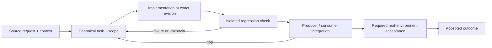

# Task intake, canonical references and acceptance evidence

Status: recovery specification / proposed contract; not a claim of completed implementation.

Owner and acceptance coordinator: https://github.com/alex-mextner/rig-cli/issues/521

## Original requests and editorial provenance

> Почему процессные задачи всё ещё заводятся в продуктовый трекер через task-cli? … Ты помнишь, как давно я просил это починить? … Что с harness-cli, в частности с harness task для процессных задач? Пример: https://github.com/conloca/landing/issues/263.

Source **Q222**; compiled-memory-attribution; MEMORY.md standing lesson: Process tasks must not land in the product tracker; PDF page(s) 82. Cross-ticket thematic requirement; check context before applying to a narrower issue.

Original wording (before editorial correction)

> https://github.com/conloca/landing/issues/263--почему процессные таски все еще заводятся в продуктовый тасктрекер через task-cli?! … ты помнишь насколько давно я просил это починить? … что с harnesses-cli? в частности harnesses task для процессных тасков

> Если вопрос вырван из контекста, нужно прикладывать выдержки из предыдущих сообщений.

Source **Q214**; compiled-memory-attribution; MEMORY.md standing lesson: Don't quote a question without the lines before it; PDF page(s) 79. Cross-ticket thematic requirement; check context before applying to a narrower issue.

Original wording (before editorial correction)

> нужно прикладывать выдержки из дополнительных сообщений которые были до если вопрос вырван из контекста

> Это дублирование: все цитаты об одном и том же нужно группировать и отвечать на них вместе.

Source **Q215**; compiled-memory-attribution; MEMORY.md standing lesson: Group quotes on the same topic; answer once; PDF page(s) 80. Cross-ticket thematic requirement; check context before applying to a narrower issue.

Original wording (before editorial correction)

> это дублирование, все цитаты про одно и тоже надо группировать и отвечать разом

> Закрыт superseded PR #321. Перед любым удалением нужно проверить, нет ли там полезной работы, которую нужно сохранить, и отчитаться об этой проверке.

Source **Q238**; compiled-memory-attribution; MEMORY.md standing lesson: Before deleting/closing anything, verify nothing salvageable is lost, and report the check; PDF page(s) 89. Cross-ticket thematic requirement; check context before applying to a narrower issue.

Original wording (before editorial correction)

> закрыт 1 superseded PR (#321).--всегда когда чтото удаляется надо
> делать перед удалением проверку точно ли оттуда нечего спасать полезного и отчитывать
> об этом

## Boundary and intended behavior

Preserve original requirements; distinguish product work, process records, verification gaps and duplicates. Validate repository-aware issue identity before writes. Preserve complete Markdown, including embedded headings. Uploaded evidence must resolve from another machine and identify the tested revision.

## Realistic worked example

A review of an uncommitted diff is process work, not a new product feature. A concrete bug found during that review is linked to its canonical product issue, original request, exact diff and reproducible failure. A local /tmp/proof.png path is retained as a historical reference, not presented as a remotely viewable attachment.

## Acceptance procedure

1. Reproduce the exact operation in an isolated checkout at a named revision.
2. Capture actual and expected behavior; distinguish a product failure from a missing dependency or unsupported platform.
3. Exercise the corresponding producer/consumer boundary, failure/restart case and a negative case.
4. Attach durable output and separately record any real-machine/provider/UI acceptance.
5. Close only the accepted outcome; a merged slice does not close a larger parent.

## State-transition diagram

## Complete linked backlog

| Ticket | Scope | Provider state | Verification |
|---|---|---|---|
| [agent-tools#14](https://github.com/alex-mextner/agent-tools/issues/14) | Harvest skills from rollout reports + strict-ticket-discipline | open | open-outcome-requires-acceptance |
| [agent-tools#92](https://github.com/alex-mextner/agent-tools/issues/92) | Make require-ticket-before-commit STRICT by default + rig-provisioned in every repo | closed | historical-closure-not-reaccepted |
| [agent-tools#94](https://github.com/alex-mextner/agent-tools/issues/94) | test(cli): Docker harness — real-agent proof that task-cli is advertised AND enforced, wired into CI test-cli | open | open-outcome-requires-acceptance |
| [agent-tools#97](https://github.com/alex-mextner/agent-tools/issues/97) | require-ticket hook: subcommand detector over-matches read-only inspection commands | closed | historical-closure-not-reaccepted |
| [agent-tools#104](https://github.com/alex-mextner/agent-tools/issues/104) | require-ticket: flip -F - (stdin) from fail-open to fail-closed-with-hint | closed | historical-closure-not-reaccepted |
| [agent-tools#114](https://github.com/alex-mextner/agent-tools/issues/114) | require-ticket parser: untreated value-bearing flags (--author/--date/…) + is_skip_commit asymmetry (post-#111 follow-up) | closed | historical-closure-not-reaccepted |
| [agent-tools#120](https://github.com/alex-mextner/agent-tools/issues/120) | require-ticket parser: value-consuming long flags matched by exact string, not git's unambiguous abbreviation (residual ticket-gate divergence) | closed | historical-closure-not-reaccepted |
| [agent-tools#172](https://github.com/alex-mextner/agent-tools/issues/172) | fix(agent-hooks): visual-proof-gate effective_cwd() mishandles tilde-expanded cd targets | closed | historical-closure-not-reaccepted |
| [agent-tools#173](https://github.com/alex-mextner/agent-tools/issues/173) | chore(agent-hooks): port punctuation_chars tokenizer to visual-proof-gate + skills-read-gate (glued-separator under-split) | open | open-outcome-requires-acceptance |
| [agent-tools#174](https://github.com/alex-mextner/agent-tools/issues/174) | fix(agent-hooks): skills-read-gate is_skip_commit still exempts a chain on its FIRST commit segment (out of sync with visual-proof-gate) | closed | historical-closure-not-reaccepted |
| [agent-tools#175](https://github.com/alex-mextner/agent-tools/issues/175) | feat(agent-hooks): visual-proof-gate should evaluate EVERY commit segment in a multi-commit chain, not fall back to session_cwd | open | open-outcome-requires-acceptance |
| [agent-tools#201](https://github.com/alex-mextner/agent-tools/issues/201) | fix(agent-hooks): visual-proof-gate effective_cwd() cd-detection misses parenthesized subshell form | open | open-outcome-requires-acceptance |
| [agent-tools#203](https://github.com/alex-mextner/agent-tools/issues/203) | skills-read-gate / visual-proof-gate: is_skip_commit allowlist misses other value-consuming git-commit flags (post-#197 --trailer fix) | open | open-outcome-requires-acceptance |
| [agent-tools#273](https://github.com/alex-mextner/agent-tools/issues/273) | pm-cli: manual record intake task-ref does not dedupe against ingest qualified refs | open | open-outcome-requires-acceptance |
| [agent-tools#313](https://github.com/alex-mextner/agent-tools/issues/313) | Adversarial review loops need an explicit scope boundary — new out-of-scope findings should become separate tickets, not more rounds on the same PR | open | open-outcome-requires-acceptance |
| [agent-tools#348](https://github.com/alex-mextner/agent-tools/issues/348) | strict-ticket-discipline links gate false-positives on bare command-name mentions | open | open-outcome-requires-acceptance |
| [agent-tools#375](https://github.com/alex-mextner/agent-tools/issues/375) | docs(skills): unescaped apostrophe breaks YAML frontmatter in model-fallback and strict-ticket-discipline SKILL.md | open | open-outcome-requires-acceptance |
| [agent-tools#434](https://github.com/alex-mextner/agent-tools/issues/434) | visual-proof-gate: verify a binding, not just a fresh mtime | open | open-outcome-requires-acceptance |
| [agent-tools#436](https://github.com/alex-mextner/agent-tools/issues/436) | visual-proof gate: FIFO record fails open, and repo identity breaks subdirectory commits | open | open-outcome-requires-acceptance |
| [agent-tools#452](https://github.com/alex-mextner/agent-tools/issues/452) | Review ship task-code title-priority diff | closed | historical-closure-not-reaccepted |
| [agent-tools#472](https://github.com/alex-mextner/agent-tools/issues/472) | visual-proof-gate & skills-read-gate: a multi-line command silently bypasses both gates (newline is not treated as a command separator) | open | open-outcome-requires-acceptance |
| [agent-tools#475](https://github.com/alex-mextner/agent-tools/issues/475) | visual-proof-gate: the proof marker is machine-global and content-blind, so any agent's screenshot satisfies every other agent's gate | open | open-outcome-requires-acceptance |
| [agent-tools#478](https://github.com/alex-mextner/agent-tools/issues/478) | visual-proof-gate & skills-read-gate: residual shell-parser divergences from bash in the heredoc path | open | open-outcome-requires-acceptance |
| [agent-tools#483](https://github.com/alex-mextner/agent-tools/issues/483) | Review visual-proof marker scope diff | closed | historical-closure-not-reaccepted |
| [agent-tools#596](https://github.com/alex-mextner/agent-tools/issues/596) | Add require-task-cli-for-tickets agent-hook | open | open-outcome-requires-acceptance |
| [agent-tools#601](https://github.com/alex-mextner/agent-tools/issues/601) | require-ticket-before-commit: heredoc neutralizer misreads arithmetic << and fd-prefixed chained heredocs | open | open-outcome-requires-acceptance |
| [agent-tools#707](https://github.com/alex-mextner/agent-tools/issues/707) | _strip_line_comment() mishandles POSIX escaped-quote idiom, causing false ticket-gate blocks | open | open-outcome-requires-acceptance |
| [dev-cli#4](https://github.com/alex-mextner/dev-cli/issues/4) | dev shot: capture-measure-attest visual proof that cannot be faked | closed | historical-closure-not-reaccepted |
| [pm-cli#3](https://github.com/alex-mextner/pm-cli/issues/3) | pm ingest: refresh state of already-tracked tickets (stale reminders) | open | open-outcome-requires-acceptance |
| [review-cli#82](https://github.com/alex-mextner/review-cli/issues/82) | review-qa ext Tier-2: window-screenshot visual diffing + more assertion types (deferred from #75) | open | open-outcome-requires-acceptance |
| [review-cli#121](https://github.com/alex-mextner/review-cli/issues/121) | visual: vision-judge check for visible error/exception/fail text anywhere in a screenshot | closed | historical-closure-not-reaccepted |
| [rig-cli#65](https://github.com/alex-mextner/rig-cli/issues/65) | Test: assert rig provisions require-ticket-before-commit (strict ticket enforcement) | closed | historical-closure-not-reaccepted |
| [rig-cli#215](https://github.com/alex-mextner/rig-cli/issues/215) | Add task.code_prefix config, reconciled into .ship-config | open | open-outcome-requires-acceptance |
| [rig-cli#216](https://github.com/alex-mextner/rig-cli/issues/216) | task.code_prefix: line-ending normalization + dup-line dedup + test gaps | open | open-outcome-requires-acceptance |
| [task-cli#4](https://github.com/alex-mextner/task-cli/issues/4) | Integrations: tg classify hook, agent-tools ticket-discipline skill, rig provisioning | open | open-outcome-requires-acceptance |
| [task-cli#19](https://github.com/alex-mextner/task-cli/issues/19) | Docker test-cli: assert require-ticket enforcement end-to-end in the deterministic leg | closed | historical-closure-not-reaccepted |
| [task-cli#20](https://github.com/alex-mextner/task-cli/issues/20) | Docker test-cli: guard the vendored require-ticket hook against drift from agent-tools source | closed | historical-closure-not-reaccepted |
| [task-cli#27](https://github.com/alex-mextner/task-cli/issues/27) | task gantt — read-only due-date timeline (Gantt) view | closed | historical-closure-not-reaccepted |
| [task-cli#36](https://github.com/alex-mextner/task-cli/issues/36) | Re-sync vendored require-ticket hook to canonical -am de-cluster fix (agent-tools #111) | closed | historical-closure-not-reaccepted |
| [task-cli#42](https://github.com/alex-mextner/task-cli/issues/42) | vendored require-ticket hook has drifted from agent-tools canonical | open | open-outcome-requires-acceptance |
| [task-cli#45](https://github.com/alex-mextner/task-cli/issues/45) | tg#<id> references need a title guard + auto-quote in ticket bodies | closed | historical-closure-not-reaccepted |
| [task-cli#54](https://github.com/alex-mextner/task-cli/issues/54) | ticket links field must not carry the session tag | closed | historical-closure-not-reaccepted |
| [task-cli#59](https://github.com/alex-mextner/task-cli/issues/59) | task-cli should surface stale/stuck tickets on normal usage, without needing pm-cli | closed | historical-closure-not-reaccepted |
| [task-cli#70](https://github.com/alex-mextner/task-cli/issues/70) | Global stale-ticket nudge (#59): known scope-limits to close later | open | open-outcome-requires-acceptance |
| [task-cli#83](https://github.com/alex-mextner/task-cli/issues/83) | recent-tickets block leaks tickets across repos sharing a session id | closed | historical-closure-not-reaccepted |
| [task-cli#88](https://github.com/alex-mextner/task-cli/issues/88) | Recent-tickets footer breaks TTY-aware scripting convention | open | open-outcome-requires-acceptance |
| [task-cli#97](https://github.com/alex-mextner/task-cli/issues/97) | Session-attention notice can't see a same-team Linear ticket routed through a different project-pinned registry entry | open | open-outcome-requires-acceptance |
| [task-cli#98](https://github.com/alex-mextner/task-cli/issues/98) | mark-shipped: a prefixed task code like AGENTTOOLS-412 raises a raw 404 instead of resolving or explaining | open | open-outcome-requires-acceptance |
| [task-cli#102](https://github.com/alex-mextner/task-cli/issues/102) | mark-shipped: warn when a Done ticket still has unchecked acceptance criteria | open | open-outcome-requires-acceptance |
| [task-cli#110](https://github.com/alex-mextner/task-cli/issues/110) | task-cli: native Linear proof URLs are unauthenticated and 401 on direct fetch | open | open-outcome-requires-acceptance |
| [task-cli#114](https://github.com/alex-mextner/task-cli/issues/114) | task-cli should warn about stale and overdue tickets on its own, without pm-cli | open | open-outcome-requires-acceptance |
| [task-cli#115](https://github.com/alex-mextner/task-cli/issues/115) | No merge without accepted criteria: a ship-time acceptance gate plus convenient commands to check criteria with proofs | closed | historical-closure-not-reaccepted |
| [task-cli#116](https://github.com/alex-mextner/task-cli/issues/116) | task gate: require a written verification plan before a ticket enters In Review, not just checked proofs | open | open-outcome-requires-acceptance |
| [task-cli#117](https://github.com/alex-mextner/task-cli/issues/117) | Registry projects: entries have no way to carry an enforce: override, so a registry-routed ticket always inherits the caller's own gates | open | open-outcome-requires-acceptance |
| [task-cli#119](https://github.com/alex-mextner/task-cli/issues/119) | Refuse to overwrite a ticket's What (description) without a recent read | closed | historical-closure-not-reaccepted |
| [task-cli#122](https://github.com/alex-mextner/task-cli/issues/122) | task read displays the re-rendered body, not the verbatim backend content, weakening the new read-before-edit gate for legacy tickets | open | open-outcome-requires-acceptance |
| [task-cli#124](https://github.com/alex-mextner/task-cli/issues/124) | task gate: reject a non-id code with a clear message instead of a raw GitHub 404 | open | open-outcome-requires-acceptance |
| [task-cli#126](https://github.com/alex-mextner/task-cli/issues/126) | The links gate refuses tickets over hex colours, commit shas in prose and ordinary slashes | closed | historical-closure-not-reaccepted |
| [task-cli#127](https://github.com/alex-mextner/task-cli/issues/127) | Reading back a ticket by its code fails with a raw 404 or "Entity not found" | open | open-outcome-requires-acceptance |
| [task-cli#130](https://github.com/alex-mextner/task-cli/issues/130) | Add todo-vs-ticket, duplicate, and multi-ask intake gates to task-cli | open | open-outcome-requires-acceptance |
| [task-cli#131](https://github.com/alex-mextner/task-cli/issues/131) | Adversarial cross-file review of ticket intake gates diff | closed | historical-closure-not-reaccepted |
| [task-cli#134](https://github.com/alex-mextner/task-cli/issues/134) | task-cli: reduce reliance on the forced acceptance escape hatch with no proof | open | open-outcome-requires-acceptance |
| [task-cli#152](https://github.com/alex-mextner/task-cli/issues/152) | task daemon: unused MVP (no auto-start, tickets never set due dates, not tracked in rig stats) | open | open-outcome-requires-acceptance |
| [task-cli#154](https://github.com/alex-mextner/task-cli/issues/154) | task-cli should nudge agents to link related tickets, and add a task link command | closed | historical-closure-not-reaccepted |
| [task-cli#157](https://github.com/alex-mextner/task-cli/issues/157) | give agents a real non-ticket place for ephemeral findings, not just a block on filing them as GitHub issues | open | open-outcome-requires-acceptance |
| [task-cli#160](https://github.com/alex-mextner/task-cli/issues/160) | Add task burn chart and task web lifecycle | closed | historical-closure-not-reaccepted |
| [task-cli#162](https://github.com/alex-mextner/task-cli/issues/162) | Refuse process tickets against a product GitHub tracker | open | open-outcome-requires-acceptance |
| [task-cli#166](https://github.com/alex-mextner/task-cli/issues/166) | Block ticket create that mentions screenshot/скриншот without an attached image | closed | historical-closure-not-reaccepted |
| [task-cli#167](https://github.com/alex-mextner/task-cli/issues/167) | Add task attach for easy screenshot proof on tickets | closed | historical-closure-not-reaccepted |
| [task-cli#169](https://github.com/alex-mextner/task-cli/issues/169) | Reject invented task codes; add repo-aware taskref library | open | open-outcome-requires-acceptance |
| [task-cli#170](https://github.com/alex-mextner/task-cli/issues/170) | Reject invented task codes; add repo-aware taskref library | open | open-outcome-requires-acceptance |
| [task-cli#172](https://github.com/alex-mextner/task-cli/issues/172) | Reject invented task codes; add repo-aware taskref library | open | open-outcome-requires-acceptance |
| [task-cli#173](https://github.com/alex-mextner/task-cli/issues/173) | Reject invented task codes; add repo-aware taskref library | open | open-outcome-requires-acceptance |
| [task-cli#175](https://github.com/alex-mextner/task-cli/issues/175) | Map a current ticket to the session or working directory | open | open-outcome-requires-acceptance |
| [tg-cli#117](https://github.com/alex-mextner/tg-cli/issues/117) | /tasks v2: full lifecycle depth — tg-origin linkage, acceptance-criteria progress, review cycles, done-vs-accepted | open | open-outcome-requires-acceptance |
| [tg-cli#214](https://github.com/alex-mextner/tg-cli/issues/214) | tg-cli: reconcile the autolink-tasks spec doc with the title guard and exact ticket-code grammar | open | open-outcome-requires-acceptance |
| [tg-cli#288](https://github.com/alex-mextner/tg-cli/issues/288) | /next <ticket-id> bot command: live pm-cli lifecycle card, replacing dead /state and /next runbooks | open | open-outcome-requires-acceptance |
| [tg-cli#337](https://github.com/alex-mextner/tg-cli/issues/337) | Block outbound tg send that mentions screenshot/скриншот without an attached image | closed | historical-closure-not-reaccepted |
