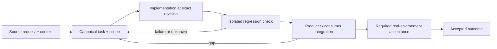

# Legacy process records and salvageable review findings

Status: recovery specification / proposed contract; not a claim of completed implementation.

Owner and acceptance coordinator: https://github.com/alex-mextner/rig-cli/issues/521

## Original requests and editorial provenance

> Почему процессные задачи всё ещё заводятся в продуктовый трекер через task-cli? … Ты помнишь, как давно я просил это починить? … Что с harness-cli, в частности с harness task для процессных задач? Пример: https://github.com/conloca/landing/issues/263.

Source **Q222**; compiled-memory-attribution; MEMORY.md standing lesson: Process tasks must not land in the product tracker; PDF page(s) 82. Cross-ticket thematic requirement; check context before applying to a narrower issue.

Original wording (before editorial correction)

> https://github.com/conloca/landing/issues/263--почему процессные таски все еще заводятся в продуктовый тасктрекер через task-cli?! … ты помнишь насколько давно я просил это починить? … что с harnesses-cli? в частности harnesses task для процессных тасков

> Закрыт superseded PR #321. Перед любым удалением нужно проверить, нет ли там полезной работы, которую нужно сохранить, и отчитаться об этой проверке.

Source **Q238**; compiled-memory-attribution; MEMORY.md standing lesson: Before deleting/closing anything, verify nothing salvageable is lost, and report the check; PDF page(s) 89. Cross-ticket thematic requirement; check context before applying to a narrower issue.

Original wording (before editorial correction)

> закрыт 1 superseded PR (#321).--всегда когда чтото удаляется надо
> делать перед удалением проверку точно ли оттуда нечего спасать полезного и отчитывать
> об этом

## Boundary and intended behavior

Separate ephemeral agent work from the product tracker. Never discard comments, unique acceptance, branches or evidence when consolidating. Similar titles across repositories may be separate integration slices and are not automatic duplicates.

## Realistic worked example

A ticket says Review uncommitted version bump. Its review findings and linked commit/PR are retained. Any actionable product bug is linked to a canonical issue before retiring the process record. A cancelled review task is not counted as a newly delivered product feature.

## Acceptance procedure

1. Reproduce the exact operation in an isolated checkout at a named revision.
2. Capture actual and expected behavior; distinguish a product failure from a missing dependency or unsupported platform.
3. Exercise the corresponding producer/consumer boundary, failure/restart case and a negative case.
4. Attach durable output and separately record any real-machine/provider/UI acceptance.
5. Close only the accepted outcome; a merged slice does not close a larger parent.

## State-transition diagram

## Complete linked backlog

| Ticket | Scope | Provider state | Verification |

|---|---|---|---|

| [agent-tools#379](https://github.com/alex-mextner/agent-tools/issues/379) | Review uncommitted roadmap diff for cross-file contract drift | closed | historical-closure-not-reaccepted |

| [agent-tools#428](https://github.com/alex-mextner/agent-tools/issues/428) | Review the uncommitted session-scoped skills marker diff for cross-file  | closed | historical-closure-not-reaccepted |

| [agent-tools#461](https://github.com/alex-mextner/agent-tools/issues/461) | Audit foreign worktree guard diff | closed | historical-closure-not-reaccepted |

| [agent-tools#479](https://github.com/alex-mextner/agent-tools/issues/479) | Review uncommitted cross-file diff | closed | historical-closure-not-reaccepted |

| [agent-tools#482](https://github.com/alex-mextner/agent-tools/issues/482) | Review uncommitted heavy-operation and VS Code reaper diff | closed | historical-closure-not-reaccepted |

| [agent-tools#494](https://github.com/alex-mextner/agent-tools/issues/494) | Review uncommitted memory-safety tooling diff | closed | historical-closure-not-reaccepted |

| [agent-tools#508](https://github.com/alex-mextner/agent-tools/issues/508) | Review uncommitted review-gate guidance diff | closed | historical-closure-not-reaccepted |

| [agent-tools#531](https://github.com/alex-mextner/agent-tools/issues/531) | Review uncommitted ship notification diff | closed | historical-closure-not-reaccepted |

| [agent-tools#539](https://github.com/alex-mextner/agent-tools/issues/539) | Review uncommitted port-liveness diff | closed | historical-closure-not-reaccepted |

| [agent-tools#557](https://github.com/alex-mextner/agent-tools/issues/557) | Review uncommitted omp hook bridge diff | closed | historical-closure-not-reaccepted |

| [agent-tools#561](https://github.com/alex-mextner/agent-tools/issues/561) | Review uncommitted hook doctrine diff | closed | historical-closure-not-reaccepted |

| [agent-tools#574](https://github.com/alex-mextner/agent-tools/issues/574) | Review the uncommitted ship-taskcode robustness diff for bugs, regressio | closed | historical-closure-not-reaccepted |

| [agent-tools#575](https://github.com/alex-mextner/agent-tools/issues/575) | Review uncommitted subagent identity diff | closed | historical-closure-not-reaccepted |

| [agent-tools#582](https://github.com/alex-mextner/agent-tools/issues/582) | Review the current uncommitted git diff for bugs, regressions, security  | closed | historical-closure-not-reaccepted |

| [agent-tools#593](https://github.com/alex-mextner/agent-tools/issues/593) | Review uncommitted hook diff | closed | historical-closure-not-reaccepted |

| [dev-cli#7](https://github.com/alex-mextner/dev-cli/issues/7) | Review uncommitted visual-proof diff | closed | historical-closure-not-reaccepted |

| [dev-cli#11](https://github.com/alex-mextner/dev-cli/issues/11) | Review uncommitted cleanup command diff | closed | historical-closure-not-reaccepted |

| [dev-cli#14](https://github.com/alex-mextner/dev-cli/issues/14) | Review staged Ruff version-pinning diff | closed | historical-closure-not-reaccepted |

| [dev-cli#16](https://github.com/alex-mextner/dev-cli/issues/16) | Review uncommitted README ecosystem diff | closed | historical-closure-not-reaccepted |

| [dev-cli#22](https://github.com/alex-mextner/dev-cli/issues/22) | Review uncommitted cleanup safety diff | closed | historical-closure-not-reaccepted |

| [dev-cli#23](https://github.com/alex-mextner/dev-cli/issues/23) | Review uncommitted rig configuration diff | closed | historical-closure-not-reaccepted |

| [draw-cli#15](https://github.com/alex-mextner/draw-cli/issues/15) | Review uncommitted worktree-only guard diff | closed | historical-closure-not-reaccepted |

| [pm-cli#19](https://github.com/alex-mextner/pm-cli/issues/19) | Review uncommitted sprint-system diff | closed | historical-closure-not-reaccepted |

| [qa-cli#3](https://github.com/alex-mextner/qa-cli/issues/3) | Audit QR wait login change | closed | historical-closure-not-reaccepted |

| [qa-cli#5](https://github.com/alex-mextner/qa-cli/issues/5) | Assess release version diff | closed | historical-closure-not-reaccepted |

| [qa-cli#9](https://github.com/alex-mextner/qa-cli/issues/9) | Audit ship external-review configuration change | closed | historical-closure-not-reaccepted |

| [research-cli#12](https://github.com/alex-mextner/research-cli/issues/12) | Review uncommitted CI lint-tool pin | closed | historical-closure-not-reaccepted |

| [review-cli#183](https://github.com/alex-mextner/review-cli/issues/183) | Review uncommitted stat-tooling diff | closed | historical-closure-not-reaccepted |

| [review-cli#191](https://github.com/alex-mextner/review-cli/issues/191) | Review uncommitted cross-file consistency | closed | historical-closure-not-reaccepted |

| [review-cli#201](https://github.com/alex-mextner/review-cli/issues/201) | Review uncommitted diff for cross-file consistency | closed | historical-closure-not-reaccepted |

| [review-cli#231](https://github.com/alex-mextner/review-cli/issues/231) | Review uncommitted 0.29.0 version bump | closed | historical-closure-not-reaccepted |

| [review-cli#255](https://github.com/alex-mextner/review-cli/issues/255) | Review uncommitted graduated timeout diff | closed | historical-closure-not-reaccepted |

| [review-cli#282](https://github.com/alex-mextner/review-cli/issues/282) | Review the uncommitted timeout-clamp diff for bugs, regressions, securit | closed | historical-closure-not-reaccepted |

| [review-cli#283](https://github.com/alex-mextner/review-cli/issues/283) | Review uncommitted service reentrancy diff | closed | historical-closure-not-reaccepted |

| [review-cli#287](https://github.com/alex-mextner/review-cli/issues/287) | Review uncommitted Fable cooldown and board-priority diff | closed | historical-closure-not-reaccepted |

| [review-cli#295](https://github.com/alex-mextner/review-cli/issues/295) | Review uncommitted Fable preset exclusion diff | closed | historical-closure-not-reaccepted |

| [review-cli#304](https://github.com/alex-mextner/review-cli/issues/304) | Review uncommitted version bump | closed | historical-closure-not-reaccepted |

| [review-cli#307](https://github.com/alex-mextner/review-cli/issues/307) | Review uncommitted default-preset and brainstorm diff changes | closed | historical-closure-not-reaccepted |

| [review-cli#311](https://github.com/alex-mextner/review-cli/issues/311) | Review uncommitted pool-visibility diff | closed | historical-closure-not-reaccepted |

| [review-cli#331](https://github.com/alex-mextner/review-cli/issues/331) | Review uncommitted lazy dashboard body-load diff | closed | historical-closure-not-reaccepted |

| [review-cli#337](https://github.com/alex-mextner/review-cli/issues/337) | Review version bump diff | closed | historical-closure-not-reaccepted |

| [review-cli#349](https://github.com/alex-mextner/review-cli/issues/349) | Review uncommitted stats timeline diff | closed | historical-closure-not-reaccepted |

| [review-cli#354](https://github.com/alex-mextner/review-cli/issues/354) | Review uncommitted test log isolation diff | closed | historical-closure-not-reaccepted |

| [review-cli#380](https://github.com/alex-mextner/review-cli/issues/380) | Review uncommitted delta-tolerance diff | closed | historical-closure-not-reaccepted |

| [review-cli#383](https://github.com/alex-mextner/review-cli/issues/383) | Review uncommitted board fallback diff | closed | historical-closure-not-reaccepted |

| [review-cli#391](https://github.com/alex-mextner/review-cli/issues/391) | Review uncommitted Grok board-seat diff | closed | historical-closure-not-reaccepted |

| [review-cli#397](https://github.com/alex-mextner/review-cli/issues/397) | Review uncommitted gate/version diff | closed | historical-closure-not-reaccepted |

| [review-cli#404](https://github.com/alex-mextner/review-cli/issues/404) | Review uncommitted heartbeat diff | closed | historical-closure-not-reaccepted |

| [review-cli#421](https://github.com/alex-mextner/review-cli/issues/421) | Review uncommitted pool-reuse diff | closed | historical-closure-not-reaccepted |

| [review-cli#425](https://github.com/alex-mextner/review-cli/issues/425) | Audit bounded dashboard log scan diff | closed | historical-closure-not-reaccepted |

| [rig-cli#254](https://github.com/alex-mextner/rig-cli/issues/254) | Review the current uncommitted diff for actionable cross-file consistenc | closed | historical-closure-not-reaccepted |

| [rig-cli#259](https://github.com/alex-mextner/rig-cli/issues/259) | Review the uncommitted git diff for bugs, regressions, security issues,  | closed | historical-closure-not-reaccepted |

| [rig-cli#262](https://github.com/alex-mextner/rig-cli/issues/262) | Review the uncommitted git diff for actionable cross-file consistency bu | closed | historical-closure-not-reaccepted |

| [rig-cli#282](https://github.com/alex-mextner/rig-cli/issues/282) | Review uncommitted rig daily diff | closed | historical-closure-not-reaccepted |

| [rig-cli#287](https://github.com/alex-mextner/rig-cli/issues/287) | Review the uncommitted rig-cli diff for cross-file consistency, bugs, re | closed | historical-closure-not-reaccepted |

| [rig-cli#289](https://github.com/alex-mextner/rig-cli/issues/289) | Review uncommitted hook Skill matcher diff | closed | historical-closure-not-reaccepted |

| [rig-cli#295](https://github.com/alex-mextner/rig-cli/issues/295) | Review the uncommitted monitor hook bridge matcher diff for bugs, regres | closed | historical-closure-not-reaccepted |

| [rig-cli#300](https://github.com/alex-mextner/rig-cli/issues/300) | Review uncommitted TUI UX diff | closed | historical-closure-not-reaccepted |

| [rig-cli#314](https://github.com/alex-mextner/rig-cli/issues/314) | Review uncommitted rig usage diff | closed | historical-closure-not-reaccepted |

| [rig-cli#319](https://github.com/alex-mextner/rig-cli/issues/319) | Review uncommitted action tag copy changes | closed | historical-closure-not-reaccepted |

| [rig-cli#343](https://github.com/alex-mextner/rig-cli/issues/343) | Review uncommitted Codex hook fold-in diff | closed | historical-closure-not-reaccepted |

| [rig-cli#345](https://github.com/alex-mextner/rig-cli/issues/345) | Review uncommitted omp hook bridge diff | closed | historical-closure-not-reaccepted |

| [rig-cli#358](https://github.com/alex-mextner/rig-cli/issues/358) | Review uncommitted version bump | closed | historical-closure-not-reaccepted |

| [rig-cli#366](https://github.com/alex-mextner/rig-cli/issues/366) | Review uncommitted CI catalog synchronization diff | closed | historical-closure-not-reaccepted |

| [rig-cli#380](https://github.com/alex-mextner/rig-cli/issues/380) | Review uncommitted known-list shadow warning diff | closed | historical-closure-not-reaccepted |

| [rig-cli#384](https://github.com/alex-mextner/rig-cli/issues/384) | Review version bump to 0.35.1 | closed | historical-closure-not-reaccepted |

| [rig-cli#385](https://github.com/alex-mextner/rig-cli/issues/385) | Review uncommitted review-gate source diff | closed | historical-closure-not-reaccepted |

| [rig-cli#391](https://github.com/alex-mextner/rig-cli/issues/391) | Review uncommitted version bump | closed | historical-closure-not-reaccepted |

| [rig-cli#392](https://github.com/alex-mextner/rig-cli/issues/392) | Review staged rig report scaffold | closed | historical-closure-not-reaccepted |

| [rig-cli#393](https://github.com/alex-mextner/rig-cli/issues/393) | Review version bump to 0.37.0 | open | open-outcome-requires-acceptance |

| [rig-cli#395](https://github.com/alex-mextner/rig-cli/issues/395) | Review uncommitted PR171 diff | closed | historical-closure-not-reaccepted |

| [rig-cli#396](https://github.com/alex-mextner/rig-cli/issues/396) | Review the current uncommitted diff for bugs, regressions, security issu | closed | historical-closure-not-reaccepted |

| [rig-cli#401](https://github.com/alex-mextner/rig-cli/issues/401) | Review uncommitted GitHub ruleset diff | closed | historical-closure-not-reaccepted |

| [rig-cli#405](https://github.com/alex-mextner/rig-cli/issues/405) | Review uncommitted permissions gh default diff | closed | historical-closure-not-reaccepted |

| [rig-cli#407](https://github.com/alex-mextner/rig-cli/issues/407) | Review 0.36.0 version-bump diff | closed | historical-closure-not-reaccepted |

| [rig-cli#409](https://github.com/alex-mextner/rig-cli/issues/409) | Review uncommitted 0.36.0 version bump | closed | historical-closure-not-reaccepted |

| [rig-cli#410](https://github.com/alex-mextner/rig-cli/issues/410) | Review uncommitted pi permission extension diff | closed | historical-closure-not-reaccepted |

| [rig-cli#411](https://github.com/alex-mextner/rig-cli/issues/411) | Review uncommitted 0.35.2 version bump | closed | historical-closure-not-reaccepted |

| [rig-cli#413](https://github.com/alex-mextner/rig-cli/issues/413) | Review release version bump | open | open-outcome-requires-acceptance |

| [rig-cli#414](https://github.com/alex-mextner/rig-cli/issues/414) | Review uncommitted 0.36.0 version bump | closed | historical-closure-not-reaccepted |

| [rig-cli#415](https://github.com/alex-mextner/rig-cli/issues/415) | Review uncommitted version bump diff | closed | historical-closure-not-reaccepted |

| [rig-cli#424](https://github.com/alex-mextner/rig-cli/issues/424) | Review version bump from 0.35.1 to 0.37.0 | open | open-outcome-requires-acceptance |

| [rig-cli#431](https://github.com/alex-mextner/rig-cli/issues/431) | Review uncommitted version bump for correctness | closed | historical-closure-not-reaccepted |

| [rig-cli#432](https://github.com/alex-mextner/rig-cli/issues/432) | Review 0.38.0 version bump performance | closed | historical-closure-not-reaccepted |

| [rig-cli#434](https://github.com/alex-mextner/rig-cli/issues/434) | Review the uncommitted pyproject.toml version bump from 0.37.0 to 0.38.0 | closed | historical-closure-not-reaccepted |

| [rig-cli#436](https://github.com/alex-mextner/rig-cli/issues/436) | Review uncommitted raw-ticket guard test | closed | historical-closure-not-reaccepted |

| [rig-cli#455](https://github.com/alex-mextner/rig-cli/issues/455) | Audit container matrix change | closed | historical-closure-not-reaccepted |

| [rig-cli#473](https://github.com/alex-mextner/rig-cli/issues/473) | Audit stats review-cycles category change | closed | historical-closure-not-reaccepted |

| [stt-cli#3](https://github.com/alex-mextner/stt-cli/issues/3) | Review uncommitted terminology, auth, and context diff | closed | historical-closure-not-reaccepted |

| [stt-cli#4](https://github.com/alex-mextner/stt-cli/issues/4) | Review uncommitted diff for cross-file regressions | closed | historical-closure-not-reaccepted |

| [stt-cli#12](https://github.com/alex-mextner/stt-cli/issues/12) | Review uncommitted JSON file handling diff | closed | historical-closure-not-reaccepted |

| [stt-cli#20](https://github.com/alex-mextner/stt-cli/issues/20) | Review uncommitted live dictation diff | closed | historical-closure-not-reaccepted |

| [stt-cli#35](https://github.com/alex-mextner/stt-cli/issues/35) | Review uncommitted worktree-only hook policy diff | closed | historical-closure-not-reaccepted |

| [task-cli#79](https://github.com/alex-mextner/task-cli/issues/79) | Review uncommitted cross-file consistency changes | closed | historical-closure-not-reaccepted |

| [task-cli#99](https://github.com/alex-mextner/task-cli/issues/99) | Review uncommitted audit reconciliation diff | closed | historical-closure-not-reaccepted |

| [task-cli#128](https://github.com/alex-mextner/task-cli/issues/128) | Review uncommitted links gate context diff | closed | historical-closure-not-reaccepted |

| [tg-cli#250](https://github.com/alex-mextner/tg-cli/issues/250) | Review the uncommitted tg-cli diff for cross-file consistency bugs, regr | closed | historical-closure-not-reaccepted |

| [tg-cli#282](https://github.com/alex-mextner/tg-cli/issues/282) | Review uncommitted permission retention diff | closed | historical-closure-not-reaccepted |

| [tg-cli#289](https://github.com/alex-mextner/tg-cli/issues/289) | Review uncommitted /next lifecycle command diff | closed | historical-closure-not-reaccepted |

| [tg-cli#291](https://github.com/alex-mextner/tg-cli/issues/291) | Review uncommitted /spend command rename | closed | historical-closure-not-reaccepted |

| [tg-cli#310](https://github.com/alex-mextner/tg-cli/issues/310) | Review uncommitted tg-cli diff | closed | historical-closure-not-reaccepted |

| [tg-cli#312](https://github.com/alex-mextner/tg-cli/issues/312) | Review uncommitted tg-cli diff | closed | historical-closure-not-reaccepted |

| [tg-cli#318](https://github.com/alex-mextner/tg-cli/issues/318) | Review uncommitted rig worktree guard configuration | closed | historical-closure-not-reaccepted |

| [tg-cli#347](https://github.com/alex-mextner/tg-cli/issues/347) | Audit dictionary-gate diff correctness | open | open-outcome-requires-acceptance |
