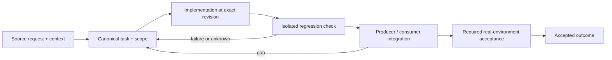

# Declarative provisioning, reproducible installation and honest drift

Status: recovery specification / proposed contract; not a claim of completed implementation.

Owner and acceptance coordinator: https://github.com/alex-mextner/rig-cli/issues/521

## Original requests and editorial provenance

> Чтобы rig сам делал всё, что нужно.

Source **Q019**; compiled-fragment-attribution; rig-zerobug/rig-fable session 2026-09-04..07; agent=нет; PDF page(s) 44. Cross-ticket thematic requirement; check context before applying to a narrower issue.

**Context fragment:** do not interpret as a standalone approval.

Original wording (before editorial correction)

> риг сам делал все что нужно

> В белых списках всех агентов.

Source **Q018**; compiled-fragment-attribution; rig-zerobug/rig-fable session 2026-09-04..07; agent=нет; PDF page(s) 43. Cross-ticket thematic requirement; check context before applying to a narrower issue.

**Context fragment:** do not interpret as a standalone approval.

Original wording (before editorial correction)

> в белых списках всех агентов

> Нужно писать не просто «do not edit», а подсказывать, что делать вместо этого: например, дать команду rig config set. … И проверить, выполняет ли она apply автоматически по умолчанию.

Source **Q221**; compiled-memory-attribution; MEMORY.md standing lesson: Managed-file comments must name the command, not only "do not edit"; PDF page(s) 82. Cross-ticket thematic requirement; check context before applying to a narrower issue.

Original wording (before editorial correction)

> Нужно писать не просто do not edit, а подсказывать что делать вместо этого, например дать rig config set команду … и проверить выполняет ли она apply сразу сама по умолчанию

> Раскатывать и проверять на этой машине.

Source **Q143**; compiled-fragment-attribution; rig-zerobug/rig-fable session 2026-09-04..07; agent=ThinNotSub, Full175Report; PDF page(s) 40. Cross-ticket thematic requirement; check context before applying to a narrower issue.

Original wording (before editorial correction)

> на этой машине раскатывать и проверять

## Boundary and intended behavior

One source of truth for schema, planning, writing and drift. Installation on disk is distinct from PATH resolution and from the running process revision. Unsupported platform/configuration states are explicit, and existing disabled choices are not silently re-enabled.

## Realistic worked example

The operator disables a managed integration and runs reconciliation. Only owned artifacts are removed; manual files are preserved. The same declared state drives apply and status. A managed-file comment names the supported configuration command rather than merely saying do not edit.

## Acceptance procedure

1. Reproduce the exact operation in an isolated checkout at a named revision.
2. Capture actual and expected behavior; distinguish a product failure from a missing dependency or unsupported platform.
3. Exercise the corresponding producer/consumer boundary, failure/restart case and a negative case.
4. Attach durable output and separately record any real-machine/provider/UI acceptance.
5. Close only the accepted outcome; a merged slice does not close a larger parent.

## State-transition diagram

## Complete linked backlog

| Ticket | Scope | Provider state | Verification |

|---|---|---|---|

| [agent-tools#15](https://github.com/alex-mextner/agent-tools/issues/15) | Slim ~/.claude/CLAUDE.md to PERSONAL-ONLY (move tool/process docs into skills) | open | open-outcome-requires-acceptance |

| [agent-tools#86](https://github.com/alex-mextner/agent-tools/issues/86) | model-freshness checker: adopt shared agenttools_errors (what/why/how + structured exit codes) | closed | historical-closure-not-reaccepted |

| [agent-tools#89](https://github.com/alex-mextner/agent-tools/issues/89) | model-freshness checker: adopt shared agenttools_errors (structured WHAT/WHY/HOW + stable exit codes) | closed | historical-closure-not-reaccepted |

| [agent-tools#155](https://github.com/alex-mextner/agent-tools/issues/155) | fix(review-gate): use `command git` to bypass shell aliases/wrappers in hash computation | closed | historical-closure-not-reaccepted |

| [agent-tools#219](https://github.com/alex-mextner/agent-tools/issues/219) | Fix non-Claude harness hook provisioning | closed | historical-closure-not-reaccepted |

| [agent-tools#250](https://github.com/alex-mextner/agent-tools/issues/250) | Investigate weak non-Claude harness provisioning | closed | historical-closure-not-reaccepted |

| [agent-tools#251](https://github.com/alex-mextner/agent-tools/issues/251) | Investigate harness provisioning gaps | closed | historical-closure-not-reaccepted |

| [agent-tools#254](https://github.com/alex-mextner/agent-tools/issues/254) | Fix Codex orchestration context switching via rig provisioning | closed | historical-closure-not-reaccepted |

| [agent-tools#293](https://github.com/alex-mextner/agent-tools/issues/293) | Finish pi-permission-guard extension module (salvaged WIP) | open | open-outcome-requires-acceptance |

| [agent-tools#296](https://github.com/alex-mextner/agent-tools/issues/296) | Remove lib/agenttools_dev — dev extracted to standalone dev-cli | closed | historical-closure-not-reaccepted |

| [agent-tools#325](https://github.com/alex-mextner/agent-tools/issues/325) | fix(pi): close 5 permission-guard bypasses found in review of agent-tools#294 | closed | historical-closure-not-reaccepted |

| [agent-tools#500](https://github.com/alex-mextner/agent-tools/issues/500) | agent-tools commits bypass review-gate (secret-scan only, no review-before-commit) | open | open-outcome-requires-acceptance |

| [agent-tools#502](https://github.com/alex-mextner/agent-tools/issues/502) | stop-completion-selfcheck: classify the turn instead of firing a static checklist | open | open-outcome-requires-acceptance |

| [agent-tools#613](https://github.com/alex-mextner/agent-tools/issues/613) | Hooks said no; the agent still wrote files and ran review through other tools | closed | historical-closure-not-reaccepted |

| [agent-tools#631](https://github.com/alex-mextner/agent-tools/issues/631) | Block raw gh issue and Linear when task-cli is configured | closed | historical-closure-not-reaccepted |

| [agent-tools#640](https://github.com/alex-mextner/agent-tools/issues/640) | Map omp tool_call+yield to v1 stop so session-end hooks can block a premature yield | closed | historical-closure-not-reaccepted |

| [agent-tools#661](https://github.com/alex-mextner/agent-tools/issues/661) | Map opencode skill tool to pre-skill so skills-marker-writer fires | closed | historical-closure-not-reaccepted |

| [agent-tools#665](https://github.com/alex-mextner/agent-tools/issues/665) | Wire generated zsh tab-completion into each ecosystem CLI | open | open-outcome-requires-acceptance |

| [draw-cli#11](https://github.com/alex-mextner/draw-cli/issues/11) | chore: add scripts/deploy.sh so rig apply keeps this tool fresh | closed | historical-closure-not-reaccepted |

| [draw-cli#13](https://github.com/alex-mextner/draw-cli/issues/13) | deploy.sh: resolve configured @{upstream} instead of hard-coded refs/remotes/origin/<branch> | open | open-outcome-requires-acceptance |

| [pm-cli#5](https://github.com/alex-mextner/pm-cli/issues/5) | pm reminders --digest: move digest formatting and schema knowledge out of the bash wrapper into pm | open | open-outcome-requires-acceptance |

| [review-cli#105](https://github.com/alex-mextner/review-cli/issues/105) | chore: add scripts/deploy.sh so rig apply keeps this tool fresh | closed | historical-closure-not-reaccepted |

| [review-cli#387](https://github.com/alex-mextner/review-cli/issues/387) | review-gate hook in agent-tools lacks the whole-file NUL check that review-cli PR 211 added to _PRECOMMIT | closed | historical-closure-not-reaccepted |

| [review-cli#403](https://github.com/alex-mextner/review-cli/issues/403) | Review gate's rebase-apply/ skip is ambiguous with a mid-conflict git am | open | open-outcome-requires-acceptance |

| [review-cli#495](https://github.com/alex-mextner/review-cli/issues/495) | Entities: join review configuration and live harness inventory in one truthful read model | open | open-outcome-requires-acceptance |

| [rig-cli#5](https://github.com/alex-mextner/rig-cli/issues/5) | Enable repo security settings at init/apply (Dependency Graph + vuln-alerts + secret-scanning) | closed | historical-closure-not-reaccepted |

| [rig-cli#6](https://github.com/alex-mextner/rig-cli/issues/6) | Auto-mode is LOCAL — gitignore .claude/settings.json on apply (un-commit the one in d87257a) | closed | historical-closure-not-reaccepted |

| [rig-cli#7](https://github.com/alex-mextner/rig-cli/issues/7) | Rollout wave-2 — bots + review-cli/rig-cli/agent-tools themselves | open | open-outcome-requires-acceptance |

| [rig-cli#8](https://github.com/alex-mextner/rig-cli/issues/8) | Model-currency follow-ups — finish models.yaml manifest + cron checker (rig-provisioned) | open | open-outcome-requires-acceptance |

| [rig-cli#59](https://github.com/alex-mextner/rig-cli/issues/59) | rig.yaml template ships a dead `mcp.items.review` slot → `rig status` on the repo's OWN config exits 4 | closed | historical-closure-not-reaccepted |

| [rig-cli#63](https://github.com/alex-mextner/rig-cli/issues/63) | missing-target scan ignores configured settings_path / harness kind (hardcoded ~/.claude/settings.json) | closed | historical-closure-not-reaccepted |

| [rig-cli#81](https://github.com/alex-mextner/rig-cli/issues/81) | rig init: scaffold+preview by default, stop presumptuously applying with no user signal | closed | historical-closure-not-reaccepted |

| [rig-cli#100](https://github.com/alex-mextner/rig-cli/issues/100) | rig must own Claude Code permissions (deny/ask/allow) — outer belt, not hand-edits | closed | historical-closure-not-reaccepted |

| [rig-cli#105](https://github.com/alex-mextner/rig-cli/issues/105) | rig apply: keep provisioned tools fresh via their scripts/deploy.sh | open | open-outcome-requires-acceptance |

| [rig-cli#117](https://github.com/alex-mextner/rig-cli/issues/117) | Add dev CLI permission and rig scripts support | closed | historical-closure-not-reaccepted |

| [rig-cli#118](https://github.com/alex-mextner/rig-cli/issues/118) | Provision dev CLI allowlist and configuration | closed | historical-closure-not-reaccepted |

| [rig-cli#130](https://github.com/alex-mextner/rig-cli/issues/130) | Add rig autonomous mode provisioning | closed | historical-closure-not-reaccepted |

| [rig-cli#142](https://github.com/alex-mextner/rig-cli/issues/142) | rig: provision auto-mode self-merge classifier carve-out (harness.self_merge) | closed | historical-closure-not-reaccepted |

| [rig-cli#145](https://github.com/alex-mextner/rig-cli/issues/145) | Run requested shell echo command | closed | historical-closure-not-reaccepted |

| [rig-cli#146](https://github.com/alex-mextner/rig-cli/issues/146) | Run requested shell echo command | closed | historical-closure-not-reaccepted |

| [rig-cli#168](https://github.com/alex-mextner/rig-cli/issues/168) | rig status: detect hand-reordered opencode permission.bash keys (deny before catch-all) | open | open-outcome-requires-acceptance |

| [rig-cli#177](https://github.com/alex-mextner/rig-cli/issues/177) | fix(config): sorted(set(...)) crashes on mixed str/int mapping keys | open | open-outcome-requires-acceptance |

| [rig-cli#187](https://github.com/alex-mextner/rig-cli/issues/187) | rig-cli: default rg permission allowlist grants ripgrep --pre, enabling arbitrary subprocess execution | closed | historical-closure-not-reaccepted |

| [rig-cli#189](https://github.com/alex-mextner/rig-cli/issues/189) | rig-cli: dev-server schema fields (ready_url, process_matchers, requires_server) are documented but not consumed by dev-cli | closed | historical-closure-not-reaccepted |

| [rig-cli#192](https://github.com/alex-mextner/rig-cli/issues/192) | rig-cli: pi permission-guard extension is silently dropped when settings_path triggers multi-harness fan-out narrowing | open | open-outcome-requires-acceptance |

| [rig-cli#193](https://github.com/alex-mextner/rig-cli/issues/193) | rig-cli: pi permissions.deny, ask, and settings_path config values are accepted but silently discarded | open | open-outcome-requires-acceptance |

| [rig-cli#195](https://github.com/alex-mextner/rig-cli/issues/195) | rig-cli: pi extension apply can lose the extension backup path when the policy write fails after it | open | open-outcome-requires-acceptance |

| [rig-cli#199](https://github.com/alex-mextner/rig-cli/issues/199) | dev config schema: ready_url / process_matchers / requires_server are advertised but not consumed by dev-cli yet | open | open-outcome-requires-acceptance |

| [rig-cli#200](https://github.com/alex-mextner/rig-cli/issues/200) | config: rig hand-maintains a copy of dev-cli's scripts/dev config contract — will drift again | open | open-outcome-requires-acceptance |

| [rig-cli#206](https://github.com/alex-mextner/rig-cli/issues/206) | env: add rig-managed shell environment variables (COLORTERM=truecolor) | closed | historical-closure-not-reaccepted |

| [rig-cli#219](https://github.com/alex-mextner/rig-cli/issues/219) | tmux.focus_events.enabled missing from rig setup / rig config-web discoverability registry | open | open-outcome-requires-acceptance |

| [rig-cli#227](https://github.com/alex-mextner/rig-cli/issues/227) | Stack/profile-targeted policy mutation across registered repositories | open | open-outcome-requires-acceptance |

| [rig-cli#235](https://github.com/alex-mextner/rig-cli/issues/235) | First-class toolchain migration plans (ESLint/Biome/Prettier → Oxc) with semantic preservation | open | open-outcome-requires-acceptance |

| [rig-cli#237](https://github.com/alex-mextner/rig-cli/issues/237) | Policy packs should bundle rationale/examples/docs alongside enforceable settings | open | open-outcome-requires-acceptance |

| [rig-cli#238](https://github.com/alex-mextner/rig-cli/issues/238) | Policy source trust/pinning model for executable carriers and agent tooling | open | open-outcome-requires-acceptance |

| [rig-cli#245](https://github.com/alex-mextner/rig-cli/issues/245) | Repository policy tags/selectors must be first-class config metadata, not path-name conventions | open | open-outcome-requires-acceptance |

| [rig-cli#246](https://github.com/alex-mextner/rig-cli/issues/246) | Policy dry-run must include proposed config-file diff, not only resulting action plan | open | open-outcome-requires-acceptance |

| [rig-cli#249](https://github.com/alex-mextner/rig-cli/issues/249) | Config provenance must explain effective value at nested-key granularity | open | open-outcome-requires-acceptance |

| [rig-cli#250](https://github.com/alex-mextner/rig-cli/issues/250) | Policy compatibility checks before upgrading providers/tools | open | open-outcome-requires-acceptance |

| [rig-cli#307](https://github.com/alex-mextner/rig-cli/issues/307) | rig init: interactive wizard's exit code doesn't reflect a mid-Apply failure | open | open-outcome-requires-acceptance |

| [rig-cli#309](https://github.com/alex-mextner/rig-cli/issues/309) | claude-rotate: register in rig tools.items with repo override to ~/.files | open | open-outcome-requires-acceptance |

| [rig-cli#311](https://github.com/alex-mextner/rig-cli/issues/311) | config-web: narrative why-content and inline illustrations per config option | open | open-outcome-requires-acceptance |

| [rig-cli#320](https://github.com/alex-mextner/rig-cli/issues/320) | github_browser: discussions/projects may be misclassified as UI-only (has stable REST fields); tmux plugin clone has no concurrent-apply lock | open | open-outcome-requires-acceptance |

| [rig-cli#332](https://github.com/alex-mextner/rig-cli/issues/332) | permissions: pre-allow gh by default with a config opt-out | closed | historical-closure-not-reaccepted |

| [rig-cli#350](https://github.com/alex-mextner/rig-cli/issues/350) | Review tg_ctl null-schema diff | closed | historical-closure-not-reaccepted |

| [rig-cli#355](https://github.com/alex-mextner/rig-cli/issues/355) | harness: write the auto/permission mode for codex, opencode and omp, not only claude-code | closed | historical-closure-not-reaccepted |

| [rig-cli#365](https://github.com/alex-mextner/rig-cli/issues/365) | Every rig command fails machine-wide: the global config declares skills.known, a key rig 0.34.1 does not have | closed | historical-closure-not-reaccepted |

| [rig-cli#367](https://github.com/alex-mextner/rig-cli/issues/367) | harness.require_tmux: provision claude-rotate's tmux guard (warn\|wrap\|off) machine-wide | open | open-outcome-requires-acceptance |

| [rig-cli#371](https://github.com/alex-mextner/rig-cli/issues/371) | schema: route the machine-wide known lists (skills.known, agent_hooks.known, mcp.known) to the GLOBAL config per option, not per category | closed | historical-closure-not-reaccepted |

| [rig-cli#372](https://github.com/alex-mextner/rig-cli/issues/372) | schema: route the machine-wide known-lists (skills, agent_hooks, mcp) to the GLOBAL config layer via a per-option layer override | closed | historical-closure-not-reaccepted |

| [rig-cli#376](https://github.com/alex-mextner/rig-cli/issues/376) | config editors: unlocked read-modify-write of ~/.config/rig/config.yaml can lose a concurrent edit | open | open-outcome-requires-acceptance |

| [rig-cli#377](https://github.com/alex-mextner/rig-cli/issues/377) | config-web: Global-tab edits need an agent-tools source resolvable without the repo overlay | open | open-outcome-requires-acceptance |

| [rig-cli#383](https://github.com/alex-mextner/rig-cli/issues/383) | Review Claude config-dir fan-out diff | closed | historical-closure-not-reaccepted |

| [rig-cli#402](https://github.com/alex-mextner/rig-cli/issues/402) | Review PR171 pi provisioning diff adversarially | closed | historical-closure-not-reaccepted |

| [rig-cli#406](https://github.com/alex-mextner/rig-cli/issues/406) | Review permission receipt revocation diff | closed | historical-closure-not-reaccepted |

| [rig-cli#426](https://github.com/alex-mextner/rig-cli/issues/426) | Block raw gh issue and Linear when task-cli is configured | closed | historical-closure-not-reaccepted |

| [rig-cli#446](https://github.com/alex-mextner/rig-cli/issues/446) | Provision omp webSearchExclude via rig so search skips Perplexity signup wall | closed | historical-closure-not-reaccepted |

| [rig-cli#447](https://github.com/alex-mextner/rig-cli/issues/447) | Provision omp webSearchExclude via rig | closed | historical-closure-not-reaccepted |

| [rig-cli#459](https://github.com/alex-mextner/rig-cli/issues/459) | Disabled bun.enabled leaves managed bunfig block; status hides disk→config drift | open | open-outcome-requires-acceptance |

| [rig-cli#460](https://github.com/alex-mextner/rig-cli/issues/460) | Unscoped rig apply refuses unknown top-level bun in global config | open | open-outcome-requires-acceptance |

| [rig-cli#462](https://github.com/alex-mextner/rig-cli/issues/462) | rig apply fans Bash(rig:*) and hooks into every claude-rotate settings.json | closed | historical-closure-not-reaccepted |

| [rig-cli#490](https://github.com/alex-mextner/rig-cli/issues/490) | eval-tool osascript spawns bypass the bash-only permissions guard, letting TCC/Automation prompts recur | closed | historical-closure-not-reaccepted |

| [rig-cli#491](https://github.com/alex-mextner/rig-cli/issues/491) | Deny raw osascript spawned from the eval tool (TCC/sandbox bypass) | closed | historical-closure-not-reaccepted |

| [rig-cli#492](https://github.com/alex-mextner/rig-cli/issues/492) | Add rig-managed zsh tab-completion generation | open | open-outcome-requires-acceptance |

| [stt-cli#8](https://github.com/alex-mextner/stt-cli/issues/8) | Give the settled per-run state a type of its own, instead of reusing Settings | open | open-outcome-requires-acceptance |

| [stt-cli#9](https://github.com/alex-mextner/stt-cli/issues/9) | Move the shared similarity default to a leaf module so config stops importing dictionary | open | open-outcome-requires-acceptance |

| [stt-cli#13](https://github.com/alex-mextner/stt-cli/issues/13) | stt mic: show provisional text underlined, the way Apple's dictation does | open | open-outcome-requires-acceptance |

| [stt-cli#19](https://github.com/alex-mextner/stt-cli/issues/19) | stt: declare the version where the release tooling looks for it | open | open-outcome-requires-acceptance |

| [stt-cli#24](https://github.com/alex-mextner/stt-cli/issues/24) | Ship shell completions for stt, generated from the argparse tree | open | open-outcome-requires-acceptance |

| [task-cli#3](https://github.com/alex-mextner/task-cli/issues/3) | Completion + due-date notifications via tmux-inject | open | open-outcome-requires-acceptance |

| [task-cli#43](https://github.com/alex-mextner/task-cli/issues/43) | chore: add scripts/deploy.sh so rig apply keeps this tool fresh | closed | historical-closure-not-reaccepted |

| [task-cli#68](https://github.com/alex-mextner/task-cli/issues/68) | task-cli: apply key-aware secret redaction to every link-value diagnostic, not just the links-url gate | open | open-outcome-requires-acceptance |

| [tg-cli#68](https://github.com/alex-mextner/tg-cli/issues/68) | self-provision the bot command menu via setMyCommands on startup | closed | historical-closure-not-reaccepted |

| [tg-cli#260](https://github.com/alex-mextner/tg-cli/issues/260) | tg --dry-run gate gives different accept/reject verdict than real send for byte-identical content depending on shell arg-passing mechanism | open | open-outcome-requires-acceptance |
