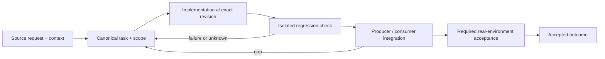

# Fleet admission, memory safety and service lifecycle

Status: recovery specification / proposed contract; not a claim of completed implementation.

Owner and acceptance coordinator: https://github.com/alex-mextner/rig-cli/issues/521

## Original requests and editorial provenance

> На машине не хватает памяти.

Source **Q128**; compiled-fragment-attribution; rig-zerobug/rig-fable session 2026-09-04..07; agent=нет; PDF page(s) 33. Cross-ticket thematic requirement; check context before applying to a narrower issue.

Original wording (before editorial correction)

> на машине не хватает памяти

> Нужно что-то придумать с памятью.

Source **Q132**; compiled-fragment-attribution; rig-zerobug/rig-fable session 2026-09-04..07; agent=нет; PDF page(s) 33. Cross-ticket thematic requirement; check context before applying to a narrower issue.

Original wording (before editorial correction)

> чтото придемать с памятью

> Сказал «остановлен», но PID 29636 всё ещё жив.

Source **Q135**; compiled-fragment-attribution; rig-zerobug/rig-fable session 2026-09-04..07; agent=нет; PDF page(s) 64. Cross-ticket thematic requirement; check context before applying to a narrower issue.

Original wording (before editorial correction)

> сказал "остановлен", но PID 29636 всё ещё жив

> Системно, чтобы такое не повторялось.

Source **Q138**; compiled-fragment-attribution; rig-zerobug/rig-fable session 2026-09-04..07; agent=нет; PDF page(s) 65. Cross-ticket thematic requirement; check context before applying to a narrower issue.

**Context fragment:** do not interpret as a standalone approval.

Original wording (before editorial correction)

> системно чтобы такое не повторялось

> Закрыт superseded PR #321. Перед любым удалением нужно проверить, нет ли там полезной работы, которую нужно сохранить, и отчитаться об этой проверке.

Source **Q238**; compiled-memory-attribution; MEMORY.md standing lesson: Before deleting/closing anything, verify nothing salvageable is lost, and report the check; PDF page(s) 89. Cross-ticket thematic requirement; check context before applying to a narrower issue.

Original wording (before editorial correction)

> закрыт 1 superseded PR (#321).--всегда когда чтото удаляется надо
> делать перед удалением проверку точно ли оттуда нечего спасать полезного и отчитывать
> об этом

## Boundary and intended behavior

Enforce resource policy at the actual admission/lifecycle boundary, not only in MEMORY.md. Bound caches and logs; verify recovery and disabled-state behavior. Reused PIDs and untracked legacy services cannot justify killing arbitrary processes or declaring a machine safe.

## Realistic worked example

Two launchers simultaneously request the final available fleet slot. Exactly one reservation succeeds; the other gets a visible queue/refusal. A crashed owner releases its reservation using generation-aware evidence. A service reporting stopped is checked against its actual owned process, not only a missing plist.

## Acceptance procedure

1. Reproduce the exact operation in an isolated checkout at a named revision.
2. Capture actual and expected behavior; distinguish a product failure from a missing dependency or unsupported platform.
3. Exercise the corresponding producer/consumer boundary, failure/restart case and a negative case.
4. Attach durable output and separately record any real-machine/provider/UI acceptance.
5. Close only the accepted outcome; a merged slice does not close a larger parent.

## State-transition diagram

## Complete linked backlog

| Ticket | Scope | Provider state | Verification |
|---|---|---|---|
| [agent-tools#154](https://github.com/alex-mextner/agent-tools/issues/154) | fix: sverklo CLI not found causes rig apply to exit non-zero in cleanroom CI | closed | historical-closure-not-reaccepted |
| [agent-tools#320](https://github.com/alex-mextner/agent-tools/issues/320) | ci/ship: failed-rollup CI-down path is missing the foreign-repo-target guard the empty-rollup path already has | open | open-outcome-requires-acceptance |
| [agent-tools#468](https://github.com/alex-mextner/agent-tools/issues/468) | Wire vscode-orphan-reaper (and future periodic jobs) into rig apply's machine-wide provisioning | open | open-outcome-requires-acceptance |
| [agent-tools#481](https://github.com/alex-mextner/agent-tools/issues/481) | vscode-orphan-reaper's hvsc- naming convention is hardcoded, not safely configurable yet | open | open-outcome-requires-acceptance |
| [agent-tools#487](https://github.com/alex-mextner/agent-tools/issues/487) | vscode-orphan-reaper is coupled to hyperide's e2e-harness convention but lives in the shared agent-tools catalog | open | open-outcome-requires-acceptance |
| [agent-tools#488](https://github.com/alex-mextner/agent-tools/issues/488) | heavy_op_memory_gate: shell operators (;, &&, etc.) can hide a heavy command from classification | open | open-outcome-requires-acceptance |
| [agent-tools#490](https://github.com/alex-mextner/agent-tools/issues/490) | heavy_op_memory_gate: doesn't recognize namespaced npm scripts (test:unit) or Gradle/Maven wrappers | open | open-outcome-requires-acceptance |
| [agent-tools#579](https://github.com/alex-mextner/agent-tools/issues/579) | The memory gate blocks --help probes and file reads as "test-suite runners" | open | open-outcome-requires-acceptance |
| [agent-tools#683](https://github.com/alex-mextner/agent-tools/issues/683) | zombie-reaper: two narrower PID-reuse races beyond the reviewed P1 scope | open | open-outcome-requires-acceptance |
| [dev-cli#3](https://github.com/alex-mextner/dev-cli/issues/3) | Cleanup: dead status.* config branch, dev start orphaning, has-script/run e2e mismatch, docker scan early-return | open | open-outcome-requires-acceptance |
| [review-cli#91](https://github.com/alex-mextner/review-cli/issues/91) | Fix review --visual image delivery and empty-vision success | closed | historical-closure-not-reaccepted |
| [review-cli#147](https://github.com/alex-mextner/review-cli/issues/147) | Align smoke service-lib detection with child CLI env | open | open-outcome-requires-acceptance |
| [review-cli#292](https://github.com/alex-mextner/review-cli/issues/292) | Review reentrancy guard service argv diff | closed | historical-closure-not-reaccepted |
| [review-cli#294](https://github.com/alex-mextner/review-cli/issues/294) | Avoid non-portable env -u service wrapper | open | open-outcome-requires-acceptance |
| [review-cli#466](https://github.com/alex-mextner/review-cli/issues/466) | ~/Library/Logs/review-cli/.call-log-cache.pkl is 6.4GB of orphaned dead weight | open | open-outcome-requires-acceptance |
| [rig-cli#10](https://github.com/alex-mextner/rig-cli/issues/10) | Clean-room / Docker e2e: prove rig init provisions a brand-new user end-to-end | open | open-outcome-requires-acceptance |
| [rig-cli#98](https://github.com/alex-mextner/rig-cli/issues/98) | fix: sverklo CLI not found causes rig apply to exit non-zero in cleanroom CI | closed | historical-closure-not-reaccepted |
| [rig-cli#116](https://github.com/alex-mextner/rig-cli/issues/116) | rig apply: launchctl-based actions (tg_ctl/boot) ignore HOME override, can hit the live launchd session | open | open-outcome-requires-acceptance |
| [rig-cli#136](https://github.com/alex-mextner/rig-cli/issues/136) | tmux boot agent: continuum-restore silently skipped on reboot (minimal launchd PATH) + no logging | closed | historical-closure-not-reaccepted |
| [rig-cli#137](https://github.com/alex-mextner/rig-cli/issues/137) | rig: universal Spotlight-exclude provisioning + post-apply verify framework | closed | historical-closure-not-reaccepted |
| [rig-cli#138](https://github.com/alex-mextner/rig-cli/issues/138) | tmux: provision an INDEPENDENT launchd autosave agent (decouple resurrect save from continuum status-right) | closed | historical-closure-not-reaccepted |
| [rig-cli#176](https://github.com/alex-mextner/rig-cli/issues/176) | Design: rig-provisioned scheduling dispatcher (cron/launchd) to eliminate per-project TCC/classifier friction | open | open-outcome-requires-acceptance |
| [rig-cli#191](https://github.com/alex-mextner/rig-cli/issues/191) | rig-cli: dev-server script/job validation accepts empty commands that dev-cli always rejects | open | open-outcome-requires-acceptance |
| [rig-cli#207](https://github.com/alex-mextner/rig-cli/issues/207) | GLOBAL-labeled rig.yaml blocks (env, tmux, gitignore, spotlight) have no repo-layer enforcement | open | open-outcome-requires-acceptance |
| [rig-cli#208](https://github.com/alex-mextner/rig-cli/issues/208) | feat(internal-dev): per-repo daemon auto-reload post-commit hook | open | open-outcome-requires-acceptance |
| [rig-cli#222](https://github.com/alex-mextner/rig-cli/issues/222) | Fleet reconcile: apply one policy across many repositories with stack/path selectors | open | open-outcome-requires-acceptance |
| [rig-cli#233](https://github.com/alex-mextner/rig-cli/issues/233) | Repository registry with stack/tag metadata as the shared substrate for fleet operations | open | open-outcome-requires-acceptance |
| [rig-cli#354](https://github.com/alex-mextner/rig-cli/issues/354) | Cross-harness clean-room parity matrix on Apple container CLI | open | open-outcome-requires-acceptance |
| [rig-cli#362](https://github.com/alex-mextner/rig-cli/issues/362) | Apple-container cross-harness clean-room e2e matrix for rig init (claude-code, codex, opencode, omp) | open | open-outcome-requires-acceptance |
| [rig-cli#375](https://github.com/alex-mextner/rig-cli/issues/375) | rig apply says the machine is converged while rig status says it isn't (Spotlight exclude sweep) | closed | historical-closure-not-reaccepted |
| [rig-cli#381](https://github.com/alex-mextner/rig-cli/issues/381) | Review Spotlight status parity diff | closed | historical-closure-not-reaccepted |
| [rig-cli#388](https://github.com/alex-mextner/rig-cli/issues/388) | spotlight: harden the last-sweep record — CLI-path parity test, strict field types, concurrent-sweep race | open | open-outcome-requires-acceptance |
| [rig-cli#390](https://github.com/alex-mextner/rig-cli/issues/390) | Fix Spotlight sweep record migration and identity capture race | open | open-outcome-requires-acceptance |
| [rig-cli#466](https://github.com/alex-mextner/rig-cli/issues/466) | tmux session-restore for codex, opencode, and commandcode, not only Claude Code | open | open-outcome-requires-acceptance |
| [rig-cli#496](https://github.com/alex-mextner/rig-cli/issues/496) | tmux omp/codex restore: cwd-scoping, day-ordering, and drift bugs found in post-merge review of #487 | open | open-outcome-requires-acceptance |
| [rig-cli#502](https://github.com/alex-mextner/rig-cli/issues/502) | task-cli ticket hygiene gap: ticket 489 shipped with empty required Why, Impact, and Cost-of-inaction sections | open | open-outcome-requires-acceptance |
| [rig-cli#508](https://github.com/alex-mextner/rig-cli/issues/508) | OOM and memory-pressure incidents: root cause is agent-fleet size, already addressed by MEMORY.md broadcast-discipline plus the 10-agent cap | open | open-outcome-requires-acceptance |
| [stt-cli#21](https://github.com/alex-mextner/stt-cli/issues/21) | stt mic: managed-service subcommands and a configurable hotkey | open | open-outcome-requires-acceptance |
| [tg-cli#82](https://github.com/alex-mextner/tg-cli/issues/82) | integration tests leak daemon processes → flaky no-agent; guarantee teardown | closed | historical-closure-not-reaccepted |
| [tg-cli#151](https://github.com/alex-mextner/tg-cli/issues/151) | Empty-watermark heuristic never detects a real empty VS Code screenshot | closed | historical-closure-not-reaccepted |
| [tg-cli#207](https://github.com/alex-mextner/tg-cli/issues/207) | auto-attach fails the whole send when the body mentions a nonexistent or empty file path | open | open-outcome-requires-acceptance |
