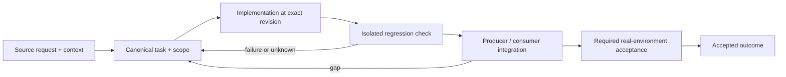

# Shipping policy, local CI parity and release consistency

Status: recovery specification / proposed contract; not a claim of completed implementation.

Owner and acceptance coordinator: https://github.com/alex-mextner/rig-cli/issues/521

## Original requests and editorial provenance

> gh ship должен уметь сам запускать проверки локально. Если что-то не получается, разберись, как это должно работать, и почини.

Source **Q261**; telegram-export; Telegram tg#16230 2026-09-09T09:07:14+00:00; PDF page(s) 100. Cross-ticket thematic requirement; check context before applying to a narrower issue.

Original wording (before editorial correction)

> Gh ship должен уметь сам запускать проверки локально, если что-то не выходит резберись как должно работать и почини

> Какого биллинга ты ждёшь и зачем? Я же сказал: если с CI проблемы, gh ship должен сам прогнать всё локально и разрешить merge, несмотря на CI.

Source **Q263**; telegram-export; Telegram tg#16245 2026-09-09T09:27:57+00:00; PDF page(s) 101. Cross-ticket thematic requirement; check context before applying to a narrower issue.

Original wording (before editorial correction)

> Какой биллинг ты ждешь и зачем?! Я ж сказал gh ship должен если с ci проблемы сам локально все прогонять и разрешить мержить несмотря на си ай

> gh ship умеет сам запускать CI локально. На CI вообще не нужно обращать внимания. Запомни и разберись, почему мне приходится это повторять. Если проблема в gh ship — просто почини.

Source **Q266**; telegram-export; Telegram tg#16416 2026-09-09T12:58:15+00:00; PDF page(s) 102. Cross-ticket thematic requirement; check context before applying to a narrower issue.

Original wording (before editorial correction)

> Не неси пургу. Запомни 
> gh ship умеет сам запускать ci локально. На ci вообще не нужно обращать внимание 
> ЗАПОМНИ! И подумай как так вышло что мне приходится это повторять 
> 
> Если же у gh ship проблемы просто почини

> Повышение версии при merge, а не в каждом PR.

Source **Q103**; compiled-fragment-attribution; rig-zerobug/rig-fable session 2026-09-04..07; agent=нет; PDF page(s) 58. Cross-ticket thematic requirement; check context before applying to a narrower issue.

Original wording (before editorial correction)

> бамп версии при merge вместо PR

## Boundary and intended behavior

Separate hosted-CI availability from test correctness. Bind local verification, review roles, release metadata and approved exceptions to the target repository and revision. Do not disable unrelated protection gates or infer a human decision from missing data.

## Realistic worked example

Hosted CI cannot start because its infrastructure is unavailable. The declared equivalent checks run locally at the exact PR head revision and their results are recorded. A genuine failed test is not reclassified as an infrastructure outage. Two parallel PRs must not both reuse a stale version bump from an unrelated checkout.

## Acceptance procedure

1. Reproduce the exact operation in an isolated checkout at a named revision.
2. Capture actual and expected behavior; distinguish a product failure from a missing dependency or unsupported platform.
3. Exercise the corresponding producer/consumer boundary, failure/restart case and a negative case.
4. Attach durable output and separately record any real-machine/provider/UI acceptance.
5. Close only the accepted outcome; a merged slice does not close a larger parent.

## State-transition diagram

## Complete linked backlog

| Ticket | Scope | Provider state | Verification |

|---|---|---|---|

| [agent-tools#98](https://github.com/alex-mextner/agent-tools/issues/98) | Require + enforce version bump on every tool release | closed | historical-closure-not-reaccepted |

| [agent-tools#113](https://github.com/alex-mextner/agent-tools/issues/113) | block-no-verify: fail-closed message on an unbalanced-quote git commit is misleading (reads as 'hook broken'), causing friction | closed | historical-closure-not-reaccepted |

| [agent-tools#165](https://github.com/alex-mextner/agent-tools/issues/165) | gh ship --repo <owner/repo> cross-repo support lost from ci/ship/ship.sh | closed | historical-closure-not-reaccepted |

| [agent-tools#169](https://github.com/alex-mextner/agent-tools/issues/169) | ship.sh: version-bump gate false-negatives on pyproject dynamic version | open | open-outcome-requires-acceptance |

| [agent-tools#224](https://github.com/alex-mextner/agent-tools/issues/224) | ship.sh: review-quorum preflight gate (Guard-B, self-merge-authority) | closed | historical-closure-not-reaccepted |

| [agent-tools#236](https://github.com/alex-mextner/agent-tools/issues/236) | block-raw-pr-merge: multiline commands (bare newline / comment / heredoc) evade or over-block segment detection | closed | historical-closure-not-reaccepted |

| [agent-tools#246](https://github.com/alex-mextner/agent-tools/issues/246) | ship.sh: dead --quorum-check fallback always refuses under the strict parser (post-hardening cleanup) | open | open-outcome-requires-acceptance |

| [agent-tools#248](https://github.com/alex-mextner/agent-tools/issues/248) | block-raw-pr-merge: backtick command-substitution merge bypass (pre-existing) | open | open-outcome-requires-acceptance |

| [agent-tools#260](https://github.com/alex-mextner/agent-tools/issues/260) | ship.sh CI gate: dedup statusCheckRollup to latest-run-per-check (stale PR Checklist FAILURE wrongly blocks) | open | open-outcome-requires-acceptance |

| [agent-tools#262](https://github.com/alex-mextner/agent-tools/issues/262) | ship.sh CI gate: statusCheckRollup is capped at contexts(first:100), no pagination (fail-open on >100 checks) | open | open-outcome-requires-acceptance |

| [agent-tools#268](https://github.com/alex-mextner/agent-tools/issues/268) | block-raw-pr-merge hook false-positives on resolveReviewThread/addPullRequestReviewThreadReply GraphQL mutations | closed | historical-closure-not-reaccepted |

| [agent-tools#284](https://github.com/alex-mextner/agent-tools/issues/284) | block-raw-pr-merge: bare/expandable gh api field args bypass the graphql merge check | closed | historical-closure-not-reaccepted |

| [agent-tools#285](https://github.com/alex-mextner/agent-tools/issues/285) | gh ship --resolve-addressed-threads: add severity-aware guard (never auto-close P0/P1/security bot threads) | closed | historical-closure-not-reaccepted |

| [agent-tools#289](https://github.com/alex-mextner/agent-tools/issues/289) | block-raw-pr-merge false-positives on non-gh commands containing merge-like substrings | closed | historical-closure-not-reaccepted |

| [agent-tools#298](https://github.com/alex-mextner/agent-tools/issues/298) | ship.sh: resolve-addressed-threads severity vocabulary only covers a fixed set of English tokens | open | open-outcome-requires-acceptance |

| [agent-tools#299](https://github.com/alex-mextner/agent-tools/issues/299) | ship.sh: RESOLVE_ELIGIBLE_JQ has outgrown its single-quoted shell-string home | open | open-outcome-requires-acceptance |

| [agent-tools#300](https://github.com/alex-mextner/agent-tools/issues/300) | ship.sh: resolve-addressed-threads severity filter untested on the CI-down fallback path | open | open-outcome-requires-acceptance |

| [agent-tools#309](https://github.com/alex-mextner/agent-tools/issues/309) | ship.sh: local test-runner auto-detection only checks repo root, fails for monorepo/subdirectory test layouts | open | open-outcome-requires-acceptance |

| [agent-tools#316](https://github.com/alex-mextner/agent-tools/issues/316) | ship.sh leftover-marker gate false-positives on mktemp XXXXXX templates | closed | historical-closure-not-reaccepted |

| [agent-tools#318](https://github.com/alex-mextner/agent-tools/issues/318) | ship.sh leftover-check diff-header filter can false-negative on lines starting with ++ | closed | historical-closure-not-reaccepted |

| [agent-tools#327](https://github.com/alex-mextner/agent-tools/issues/327) | ci/ship: SHIP_LOCAL_TEST_CMD env override outranks the audited .ship-config file | open | open-outcome-requires-acceptance |

| [agent-tools#333](https://github.com/alex-mextner/agent-tools/issues/333) | Harden block-raw-pr-merge flag-parsing (defense-in-depth) | closed | historical-closure-not-reaccepted |

| [agent-tools#337](https://github.com/alex-mextner/agent-tools/issues/337) | block-raw-pr-merge: consolidate clustered short-flag classification into one shared state machine | open | open-outcome-requires-acceptance |

| [agent-tools#341](https://github.com/alex-mextner/agent-tools/issues/341) | ship.sh checklist gate has no override for a billing-block-unsatisfiable CI-passes checkbox | open | open-outcome-requires-acceptance |

| [agent-tools#384](https://github.com/alex-mextner/agent-tools/issues/384) | gh ship: task-code regex rejects descriptive/non-numeric review-quorum codes | closed | historical-closure-not-reaccepted |

| [agent-tools#385](https://github.com/alex-mextner/agent-tools/issues/385) | ship.sh: descriptive task-code arm widens review-quorum authority-borrowing surface | open | open-outcome-requires-acceptance |

| [agent-tools#389](https://github.com/alex-mextner/agent-tools/issues/389) | ship.sh upload_png: {FILE} placeholder not recognized inside a larger quoted word (e.g. curl -F file=@{FILE}) | open | open-outcome-requires-acceptance |

| [agent-tools#392](https://github.com/alex-mextner/agent-tools/issues/392) | ship.sh: notify task-cli after a successful merge (post-merge hook) | closed | historical-closure-not-reaccepted |

| [agent-tools#395](https://github.com/alex-mextner/agent-tools/issues/395) | gh ship runs hyper-saas's local test fallback against unrelated repos with no ship script (hyper-ext#1) | open | open-outcome-requires-acceptance |

| [agent-tools#397](https://github.com/alex-mextner/agent-tools/issues/397) | ship.sh: mark-shipped notify hook passes -C before the subcommand - task-cli rejects it | closed | historical-closure-not-reaccepted |

| [agent-tools#399](https://github.com/alex-mextner/agent-tools/issues/399) | ship.sh's _review_quorum_extract_ticket grabs an incidentally-mentioned ticket ID from PR body prose instead of the PR's own ticket | open | open-outcome-requires-acceptance |

| [agent-tools#400](https://github.com/alex-mextner/agent-tools/issues/400) | ship: version-bump gate does not handle multiple parallel PRs sharing one version file | open | open-outcome-requires-acceptance |

| [agent-tools#410](https://github.com/alex-mextner/agent-tools/issues/410) | ship.sh's unpushed-commit check compares against a stale LOCAL branch ref instead of the actual remote/GitHub state | open | open-outcome-requires-acceptance |

| [agent-tools#414](https://github.com/alex-mextner/agent-tools/issues/414) | ship.sh review-quorum: bypass:approved audit lines lack the new roles/min_roles/min_models fields | open | open-outcome-requires-acceptance |

| [agent-tools#415](https://github.com/alex-mextner/agent-tools/issues/415) | ship.sh review-quorum: two robustness follow-ups on the 3-tier review-cli query and its audit function | open | open-outcome-requires-acceptance |

| [agent-tools#421](https://github.com/alex-mextner/agent-tools/issues/421) | block-rg-pre: add eval to the shared wrapper table (both block-no-verify and block-rg-pre) | open | open-outcome-requires-acceptance |

| [agent-tools#449](https://github.com/alex-mextner/agent-tools/issues/449) | ship.sh: refuse to merge when the PR body magic-closes a ticket with unmet acceptance criteria | open | open-outcome-requires-acceptance |

| [agent-tools#450](https://github.com/alex-mextner/agent-tools/issues/450) | gh ship review-quorum gate picks wrong ticket when body mentions another ticket before the real one | open | open-outcome-requires-acceptance |

| [agent-tools#485](https://github.com/alex-mextner/agent-tools/issues/485) | ship.sh task-cli notify: wrong-ticket derivation can mark an unrelated open ticket as shipped | open | open-outcome-requires-acceptance |

| [agent-tools#505](https://github.com/alex-mextner/agent-tools/issues/505) | block-no-verify fails to detect heredocs opened inside an unclosed outer quote, so its whole-blob quote-balance fallback blocks legitimate prose | open | open-outcome-requires-acceptance |

| [agent-tools#516](https://github.com/alex-mextner/agent-tools/issues/516) | ship external-review gate cannot tell a clean bot review from no review at all | open | open-outcome-requires-acceptance |

| [agent-tools#517](https://github.com/alex-mextner/agent-tools/issues/517) | gh ship: every PR is blocked by unresolved Codex review threads and nobody triages them — make ship list the threads and give agents a triage loop | open | open-outcome-requires-acceptance |

| [agent-tools#518](https://github.com/alex-mextner/agent-tools/issues/518) | gh ship: the version-bump gate makes parallel PRs conflict on pyproject.toml — bump the version at merge time instead of inside each PR | open | open-outcome-requires-acceptance |

| [agent-tools#521](https://github.com/alex-mextner/agent-tools/issues/521) | gh ship: refuse to merge a PR whose ticket has unaccepted criteria, and refuse magic-close keywords that would close the ticket behind task-cli | closed | historical-closure-not-reaccepted |

| [agent-tools#535](https://github.com/alex-mextner/agent-tools/issues/535) | the ship.sh test suite leaks GH_REPO, GH_SHIP_REPO, and REVIEW_TASK_CODE from the ambient shell, the same bug class just fixed for the SHIP_ variables | open | open-outcome-requires-acceptance |

| [agent-tools#565](https://github.com/alex-mextner/agent-tools/issues/565) | ship.sh: acceptance gate asks task-cli about non-ticket codes (review check codes / PR numbers) | closed | historical-closure-not-reaccepted |

| [agent-tools#571](https://github.com/alex-mextner/agent-tools/issues/571) | ship.sh: a rejected task-code candidate shadows the real ticket in the SAME source (PR #560: incidental GH-560 hides Refs #541) | open | open-outcome-requires-acceptance |

| [agent-tools#572](https://github.com/alex-mextner/agent-tools/issues/572) | ship.sh review-quorum gate: a '#<n>' ticket and its 'GH-<n>' review key never meet — 3 recorded iterations are invisible to the gate | open | open-outcome-requires-acceptance |

| [agent-tools#581](https://github.com/alex-mextner/agent-tools/issues/581) | gh ship --help exits 1 as if the flag were a mistake | open | open-outcome-requires-acceptance |

| [agent-tools#600](https://github.com/alex-mextner/agent-tools/issues/600) | ci/ship: no per-repo declarative way to disable the external-review gate (SHIP_EXTERNAL_REVIEW) | closed | historical-closure-not-reaccepted |

| [agent-tools#604](https://github.com/alex-mextner/agent-tools/issues/604) | Review review-threads trigger tamper fix | open | open-outcome-requires-acceptance |

| [agent-tools#606](https://github.com/alex-mextner/agent-tools/issues/606) | adversarial re-audit of block-raw-pr-merge for the historical unmerge bypass ROADMAP flagged | open | open-outcome-requires-acceptance |

| [agent-tools#624](https://github.com/alex-mextner/agent-tools/issues/624) | ship.sh: kill the SHIP_EXTERNAL_REVIEW env-var bypass now that .ship-config exists (#609 follow-up) | closed | historical-closure-not-reaccepted |

| [agent-tools#628](https://github.com/alex-mextner/agent-tools/issues/628) | Spell out that all gh except gh ship is delegated | open | open-outcome-requires-acceptance |

| [agent-tools#639](https://github.com/alex-mextner/agent-tools/issues/639) | gh ship: refuse merge when the PR has no acceptance criteria | closed | historical-closure-not-reaccepted |

| [agent-tools#654](https://github.com/alex-mextner/agent-tools/issues/654) | Audit autonomous-mode ruleset-field rename | open | open-outcome-requires-acceptance |

| [agent-tools#675](https://github.com/alex-mextner/agent-tools/issues/675) | agent-tools origin/main has no SHIP_EXTERNAL_REVIEW=0 so gh ship still demands a GitHub review | closed | historical-closure-not-reaccepted |

| [agent-tools#684](https://github.com/alex-mextner/agent-tools/issues/684) | ship.sh: task-cli identity heuristic (_acceptance_gate_is_task_cli) is a spoofable phrase-match, not a stable check | open | open-outcome-requires-acceptance |

| [dev-cli#25](https://github.com/alex-mextner/dev-cli/issues/25) | Disable forced GitHub review on gh ship via .ship-config | closed | historical-closure-not-reaccepted |

| [draw-cli#17](https://github.com/alex-mextner/draw-cli/issues/17) | Disable leftover SHIP_EXTERNAL_REVIEW via committed .ship-config | closed | historical-closure-not-reaccepted |

| [pm-cli#7](https://github.com/alex-mextner/pm-cli/issues/7) | pm-cli: provision CI (tests + secret-scan) — repo had zero CI, blocking gh ship | closed | historical-closure-not-reaccepted |

| [pm-cli#25](https://github.com/alex-mextner/pm-cli/issues/25) | Disable leftover SHIP_EXTERNAL_REVIEW via committed .ship-config | closed | historical-closure-not-reaccepted |

| [qa-cli#8](https://github.com/alex-mextner/qa-cli/issues/8) | Commit SHIP_EXTERNAL_REVIEW=0 in .ship-config | closed | historical-closure-not-reaccepted |

| [research-cli#14](https://github.com/alex-mextner/research-cli/issues/14) | Disable leftover SHIP_EXTERNAL_REVIEW via committed .ship-config | closed | historical-closure-not-reaccepted |

| [review-cli#389](https://github.com/alex-mextner/review-cli/issues/389) | Task-code key is sensitive to a leading "#": iterations recorded under 105 are invisible to gh ship, which reads "#105" | closed | historical-closure-not-reaccepted |

| [review-cli#433](https://github.com/alex-mextner/review-cli/issues/433) | review diff --pool 0 with an all-same-role config roster silently skips role padding, breaking gh ship's quorum floor | closed | historical-closure-not-reaccepted |

| [review-cli#443](https://github.com/alex-mextner/review-cli/issues/443) | Disable leftover SHIP_EXTERNAL_REVIEW via committed .ship-config | closed | historical-closure-not-reaccepted |

| [rig-cli#96](https://github.com/alex-mextner/rig-cli/issues/96) | ship_delegator bakes machine-specific absolute path to ship.sh | closed | historical-closure-not-reaccepted |

| [rig-cli#108](https://github.com/alex-mextner/rig-cli/issues/108) | ship_delegator template drifts from agent-tools#151 committed delegator — rig apply dirties the tree on every run | closed | historical-closure-not-reaccepted |

| [rig-cli#110](https://github.com/alex-mextner/rig-cli/issues/110) | status in a non-git dir never reports ship_env (machine env file) drift, while apply reconciles it | open | open-outcome-requires-acceptance |

| [rig-cli#111](https://github.com/alex-mextner/rig-cli/issues/111) | disabled ship_delegator leaves a rig-owned agent-tools/env invisible as disk→config drift | open | open-outcome-requires-acceptance |

| [rig-cli#123](https://github.com/alex-mextner/rig-cli/issues/123) | self-merge-authority Guard A — auto-mode grant provisioning + ship_delegator review-quorum env knobs | open | open-outcome-requires-acceptance |

| [rig-cli#150](https://github.com/alex-mextner/rig-cli/issues/150) | rig: ship_delegator drift should check the delegator's exec bit | open | open-outcome-requires-acceptance |

| [rig-cli#153](https://github.com/alex-mextner/rig-cli/issues/153) | gh ship env file: self-hosting repo + delegator enabled provisions no machine env file | open | open-outcome-requires-acceptance |

| [rig-cli#158](https://github.com/alex-mextner/rig-cli/issues/158) | Harden self_merge ship allow: tighten globs + guarantee gh-pr-merge deny co-provisioning | open | open-outcome-requires-acceptance |

| [rig-cli#304](https://github.com/alex-mextner/rig-cli/issues/304) | smoke.sh: rig status reports gh_ship_alias drift right after a fresh RIG_GH_ALIAS_DRY_RUN apply | open | open-outcome-requires-acceptance |

| [rig-cli#400](https://github.com/alex-mextner/rig-cli/issues/400) | Review GitHub ruleset unattributed approval diff | closed | historical-closure-not-reaccepted |

| [rig-cli#475](https://github.com/alex-mextner/rig-cli/issues/475) | Disable leftover SHIP_EXTERNAL_REVIEW via committed .ship-config | closed | historical-closure-not-reaccepted |

| [rig-cli#477](https://github.com/alex-mextner/rig-cli/issues/477) | Audit external-review shipping configuration | closed | historical-closure-not-reaccepted |

| [rig-cli#493](https://github.com/alex-mextner/rig-cli/issues/493) | Machine-wide default for ship.sh's external-review gate (rig apply provisions .ship-config) | open | open-outcome-requires-acceptance |

| [stt-cli#37](https://github.com/alex-mextner/stt-cli/issues/37) | Disable leftover SHIP_EXTERNAL_REVIEW via committed .ship-config | closed | historical-closure-not-reaccepted |

| [stt-cli#38](https://github.com/alex-mextner/stt-cli/issues/38) | Audit ship external review configuration | open | open-outcome-requires-acceptance |

| [task-cli#143](https://github.com/alex-mextner/task-cli/issues/143) | review-threads.yml's pull_request_review/pull_request_review_comment triggers are PR-tamperable, defeating the stale-green protection they claim to add | open | open-outcome-requires-acceptance |

| [task-cli#178](https://github.com/alex-mextner/task-cli/issues/178) | Disable leftover SHIP_EXTERNAL_REVIEW via committed .ship-config | open | open-outcome-requires-acceptance |

| [tg-cli#329](https://github.com/alex-mextner/tg-cli/issues/329) | Commit SHIP_EXTERNAL_REVIEW=0 in .ship-config | open | open-outcome-requires-acceptance |

| [tg-cli#331](https://github.com/alex-mextner/tg-cli/issues/331) | Review .ship-config external review toggle | open | open-outcome-requires-acceptance |
