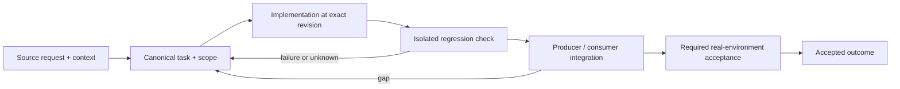

# Versioned specification review and discoverable documentation

Status: recovery specification / proposed contract; not a claim of completed implementation.

Owner and acceptance coordinator: https://github.com/alex-mextner/rig-cli/issues/521

## Original requests and editorial provenance

> Исследование spec-web и review dashboard.

Source **Q114**; compiled-fragment-attribution; rig-zerobug/rig-fable session 2026-09-04..07; agent=нет; PDF page(s) 12. Cross-ticket thematic requirement; check context before applying to a narrower issue.

Original wording (before editorial correction)

> исследование spec-web и review dashboard

> Все доказательства должны быть проверяемыми.

Source **Q028**; compiled-fragment-attribution; rig-zerobug/rig-fable session 2026-09-04..07; agent=Full175Report, ResultReport; PDF page(s) 39. Cross-ticket thematic requirement; check context before applying to a narrower issue.

Original wording (before editorial correction)

> все пруфы должны быть проверяемы

> Если вопрос вырван из контекста, нужно прикладывать выдержки из предыдущих сообщений.

Source **Q214**; compiled-memory-attribution; MEMORY.md standing lesson: Don't quote a question without the lines before it; PDF page(s) 79. Cross-ticket thematic requirement; check context before applying to a narrower issue.

Original wording (before editorial correction)

> нужно прикладывать выдержки из дополнительных сообщений которые были до если вопрос вырван из контекста

> Это дублирование: все цитаты об одном и том же нужно группировать и отвечать на них вместе.

Source **Q215**; compiled-memory-attribution; MEMORY.md standing lesson: Group quotes on the same topic; answer once; PDF page(s) 80. Cross-ticket thematic requirement; check context before applying to a narrower issue.

Original wording (before editorial correction)

> это дублирование, все цитаты про одно и тоже надо группировать и отвечать разом

## Boundary and intended behavior

Separate captured history from unobserved edits. Persist anchor transitions and preserve comments on restart/concurrent writes. Publish source-linked examples and editable diagrams. Historical/draft/skipped specifications retain their status instead of becoming implementation claims.

## Realistic worked example

A document changes twice with the same mtime and repeats the same quoted phrase in two sections. Content hashes distinguish captured revisions. A comment keeps its original quote and revision; a fuzzy successor is shown as suggested or ambiguous, never silently confirmed. Compare chosen revisions without replacing the live file.

## Acceptance procedure

1. Reproduce the exact operation in an isolated checkout at a named revision.
2. Capture actual and expected behavior; distinguish a product failure from a missing dependency or unsupported platform.
3. Exercise the corresponding producer/consumer boundary, failure/restart case and a negative case.
4. Attach durable output and separately record any real-machine/provider/UI acceptance.
5. Close only the accepted outcome; a merged slice does not close a larger parent.

## State-transition diagram

## Complete linked backlog

| Ticket | Scope | Provider state | Verification |
|---|---|---|---|
| [agent-tools#19](https://github.com/alex-mextner/agent-tools/issues/19) | Third-party skill/tool ecosystem: enable · harmonize · delineate (research) | open | open-outcome-requires-acceptance |
| [agent-tools#84](https://github.com/alex-mextner/agent-tools/issues/84) | research-cli: adopt shared agenttools_errors (what/why/how-to-fix + structured exit codes) | closed | historical-closure-not-reaccepted |
| [agent-tools#87](https://github.com/alex-mextner/agent-tools/issues/87) | research-cli test test_ask_no_seat_answered_is_network_class_with_fix is red in the yaml-less CI gate (exit 2 not 7) | closed | historical-closure-not-reaccepted |
| [agent-tools#91](https://github.com/alex-mextner/agent-tools/issues/91) | research-cli: machine-readable JSON output for `research ask` (--json) | closed | historical-closure-not-reaccepted |
| [agent-tools#121](https://github.com/alex-mextner/agent-tools/issues/121) | docs(roadmap): refresh shipped block through 2026-06-25 + resolve stale PR #77 | closed | historical-closure-not-reaccepted |
| [agent-tools#125](https://github.com/alex-mextner/agent-tools/issues/125) | Remove tools/research-cli (moved to alex-mextner/research-cli) | closed | historical-closure-not-reaccepted |
| [agent-tools#126](https://github.com/alex-mextner/agent-tools/issues/126) | docs(roadmap): refresh shipped block with the 2026-06-26 do-everything batch | closed | historical-closure-not-reaccepted |
| [agent-tools#180](https://github.com/alex-mextner/agent-tools/issues/180) | agent-hooks README inventory count is stale (says 8, actual is 20+) | open | open-outcome-requires-acceptance |
| [agent-tools#191](https://github.com/alex-mextner/agent-tools/issues/191) | README.md Inventory section counts are stale (agent-hooks, CI slots) | open | open-outcome-requires-acceptance |
| [agent-tools#256](https://github.com/alex-mextner/agent-tools/issues/256) | Research unified thin AST LSP tool layer across agent harnesses | closed | historical-closure-not-reaccepted |
| [agent-tools#266](https://github.com/alex-mextner/agent-tools/issues/266) | Normalize research report conventions and codeintel API details | open | open-outcome-requires-acceptance |
| [agent-tools#323](https://github.com/alex-mextner/agent-tools/issues/323) | docs(roadmap): record 2026-07-18 to 07-23 marathon outcomes | closed | historical-closure-not-reaccepted |
| [agent-tools#338](https://github.com/alex-mextner/agent-tools/issues/338) | ROADMAP.md: backfill or disclaim inconsistent status markers (52% of bullets unmarked) | closed | historical-closure-not-reaccepted |
| [agent-tools#339](https://github.com/alex-mextner/agent-tools/issues/339) | ROADMAP.md: define pending/blocked boundary, enforce marker invariant via CI lint, resolve cross-block status axis | open | open-outcome-requires-acceptance |
| [agent-tools#404](https://github.com/alex-mextner/agent-tools/issues/404) | README.md agent-hooks inventory badly stale — lists 8, actually 23 hooks | open | open-outcome-requires-acceptance |
| [agent-tools#489](https://github.com/alex-mextner/agent-tools/issues/489) | vscode-orphan-reaper: ps args= is a space-flattened display string, not real argv -- fundamental limit on marker-boundary anchoring | open | open-outcome-requires-acceptance |
| [agent-tools#498](https://github.com/alex-mextner/agent-tools/issues/498) | Ecosystem-wide: unpinned ruff in CI workflows causes false-red on unrelated PRs (dev-cli, research-cli confirmed) | open | open-outcome-requires-acceptance |
| [agent-tools#550](https://github.com/alex-mextner/agent-tools/issues/550) | Review chat dictionary gate documentation diff | closed | historical-closure-not-reaccepted |
| [agent-tools#680](https://github.com/alex-mextner/agent-tools/issues/680) | ROADMAP.md has no dated session block since 2026-08-15 despite a full month of shipped work | open | open-outcome-requires-acceptance |
| [dev-cli#15](https://github.com/alex-mextner/dev-cli/issues/15) | dev-cli: add ecosystem tools section to README | closed | historical-closure-not-reaccepted |
| [research-cli#1](https://github.com/alex-mextner/research-cli/issues/1) | Spin out research-cli into its own repo (strategy B: vendor + drift-guard) | closed | historical-closure-not-reaccepted |
| [research-cli#9](https://github.com/alex-mextner/research-cli/issues/9) | docs: replace ad-hoc Ecosystem note with the shared machine-generated block | closed | historical-closure-not-reaccepted |
| [review-cli#30](https://github.com/alex-mextner/review-cli/issues/30) | spec-web: draft autosave race — server-side ordering token/tombstone | closed | historical-closure-not-reaccepted |
| [review-cli#103](https://github.com/alex-mextner/review-cli/issues/103) | spec-web: persistent single daemon, multi-spec navigator + name-based URLs + SSE live-reload | open | open-outcome-requires-acceptance |
| [review-cli#143](https://github.com/alex-mextner/review-cli/issues/143) | review-cli spec-web app shell support | closed | historical-closure-not-reaccepted |
| [review-cli#144](https://github.com/alex-mextner/review-cli/issues/144) | review-cli spec-web public domain write origin | open | open-outcome-requires-acceptance |
| [review-cli#289](https://github.com/alex-mextner/review-cli/issues/289) | dashboard/spec-web autostart hardcodes /usr/bin/env, absent on NixOS | open | open-outcome-requires-acceptance |
| [review-cli#308](https://github.com/alex-mextner/review-cli/issues/308) | Align light default resolver and brainstorm documentation | open | open-outcome-requires-acceptance |
| [review-cli#363](https://github.com/alex-mextner/review-cli/issues/363) | spec-web review UI uses blocking native alert()/confirm() instead of its own modal system | open | open-outcome-requires-acceptance |
| [review-cli#446](https://github.com/alex-mextner/review-cli/issues/446) | Audit spec-web and review dashboard remaining user-visible gaps | open | open-outcome-requires-acceptance |
| [review-cli#484](https://github.com/alex-mextner/review-cli/issues/484) | [EPIC] Versioned spec review: history, audited anchor changes and usable comment workflow | open | open-outcome-requires-acceptance |
| [review-cli#493](https://github.com/alex-mextner/review-cli/issues/493) | spec-web: persist document revisions and compare any two captured versions | open | open-outcome-requires-acceptance |
| [review-cli#494](https://github.com/alex-mextner/review-cli/issues/494) | spec-web: persist anchor-change events with old/new revision, position and diff | open | open-outcome-requires-acceptance |
| [rig-cli#86](https://github.com/alex-mextner/rig-cli/issues/86) | Build project evolve React portal | open | open-outcome-requires-acceptance |
| [rig-cli#87](https://github.com/alex-mextner/rig-cli/issues/87) | Provision Haft, Sverklo, Serena through rig | closed | historical-closure-not-reaccepted |
| [rig-cli#90](https://github.com/alex-mextner/rig-cli/issues/90) | Move evolve relationship indexing off request path | open | open-outcome-requires-acceptance |
| [rig-cli#91](https://github.com/alex-mextner/rig-cli/issues/91) | Polish evolve selection UX and relationship arcs | open | open-outcome-requires-acceptance |
| [rig-cli#92](https://github.com/alex-mextner/rig-cli/issues/92) | Fix evolve visual screenshot capture pipeline | open | open-outcome-requires-acceptance |
| [rig-cli#93](https://github.com/alex-mextner/rig-cli/issues/93) | Add browser interaction regression tests for rig evolve | open | open-outcome-requires-acceptance |
| [rig-cli#172](https://github.com/alex-mextner/rig-cli/issues/172) | Add pm and research CLIs to rig default permission allowlist | closed | historical-closure-not-reaccepted |
| [rig-cli#251](https://github.com/alex-mextner/rig-cli/issues/251) | Policy documentation links should be validated in CI across generated/carried artifacts | open | open-outcome-requires-acceptance |
| [rig-cli#323](https://github.com/alex-mextner/rig-cli/issues/323) | Review ecosystem README reconciler diff | closed | historical-closure-not-reaccepted |
| [rig-cli#468](https://github.com/alex-mextner/rig-cli/issues/468) | Bind Haft Codex MCP to the absolute repo root | closed | historical-closure-not-reaccepted |
| [task-cli#111](https://github.com/alex-mextner/task-cli/issues/111) | Review ecosystem README configuration diff | closed | historical-closure-not-reaccepted |
| [task-cli#112](https://github.com/alex-mextner/task-cli/issues/112) | task-cli: add ecosystem tools section to README | closed | historical-closure-not-reaccepted |
| [tg-cli#123](https://github.com/alex-mextner/tg-cli/issues/123) | docs(replies): document --since/--until/--all-sessions (and new --session window support) in README/AGENTS | closed | historical-closure-not-reaccepted |
| [tg-cli#130](https://github.com/alex-mextner/tg-cli/issues/130) | Reply quote-anchor should carry the original message's tg#<id> | closed | historical-closure-not-reaccepted |
| [tg-cli#271](https://github.com/alex-mextner/tg-cli/issues/271) | tg-ctl: no-reply anchor uses the CTO's own last message, not any agent's last outbound send | closed | historical-closure-not-reaccepted |
| [tg-cli#272](https://github.com/alex-mextner/tg-cli/issues/272) | tg-ctl anchor: centralize recordLastAlexTarget at a delivery chokepoint + close remaining gaps | open | open-outcome-requires-acceptance |
| [tg-cli#273](https://github.com/alex-mextner/tg-cli/issues/273) | tg-ctl: last-alex-target anchor edge cases deferred from tg-cli#78 follow-up review | closed | historical-closure-not-reaccepted |
| [tg-cli#281](https://github.com/alex-mextner/tg-cli/issues/281) | Rename Alex-specific identifiers to generic User in tg-ctl routing anchor | closed | historical-closure-not-reaccepted |
| [tg-cli#369](https://github.com/alex-mextner/tg-cli/issues/369) | tg-ctl: non-reply auto-bind (tg-cli#78 anchor) never applies with 2+ out-of-tmux omp candidates — regression | closed | historical-closure-not-reaccepted |
