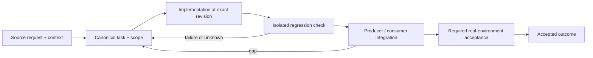

# Telegram routing, durable decisions and concurrent delivery

Status: recovery specification / proposed contract; not a claim of completed implementation.

Owner and acceptance coordinator: https://github.com/alex-mextner/rig-cli/issues/521

## Original requests and editorial provenance

> Ответы в Telegram всё ещё не работают для OMP-сессий вне tmux. Я же сказал: нужно проработать все сценарии.

Source **Q201**; compiled-memory-attribution; MEMORY.md standing lesson: Telegram must see every live agent; every reply route must land; PDF page(s) 74. Cross-ticket thematic requirement; check context before applying to a narrower issue.

Original wording (before editorial correction)

> и реплаи в телеге все еще не работают для omp сессий вне tmux, я ж сказал надо все сценарии проработать

> В Telegram само отправилось «/agent 44897 PING-339-LIVE-PROOF». Это явно какие-то тесты.

Source **Q233**; compiled-memory-attribution; MEMORY.md standing lesson: Telegram tests: headless Web + QR, never the real chat; PDF page(s) 87. Cross-ticket thematic requirement; check context before applying to a narrower issue.

Original wording (before editorial correction)

> /agent 44897 PING-339-LIVE-PROOF вот такое сейчас само написалось в телегу)) это точно какие-то тесты

> Все ответы — в Telegram. Запомни.

Source **Q236**; compiled-memory-attribution; MEMORY.md standing lesson: ALL responses go to Telegram, not just key reports (broadened 2026-09-09); PDF page(s) 89. Cross-ticket thematic requirement; check context before applying to a narrower issue.

Original wording (before editorial correction)

> все ответы в тг! запомни

> У бота есть таймер безопасного перезапуска на восемь секунд? Никаких таких таймеров быть не должно. Объясни, что это, и проводи brainstorm заранее, чтобы не добавлять такие обходные решения. Таймеры почти всегда являются обходным решением, кроме случаев, когда пользователь сам просит таймер.

Source **Q239**; compiled-memory-attribution; MEMORY.md standing lesson: Timers are almost always a kludge - find the event-driven fix instead; PDF page(s) 90. Cross-ticket thematic requirement; check context before applying to a narrower issue.

Original wording (before editorial correction)

> у бота есть таймер безопасного перезапуска (tg-ctl:4940, 8
> секунд).--опять какая-то хуйня, никаких сука таймеров не должно быть! и
> объясни что это за хрень и делай брейншторм в будущем чтобы не затягивать
> такие костыли, запомни, и таймеры это 99% костыль всегда кроме случаев когда
> пользователь просит таймер

## Boundary and intended behavior

Persist intent before acknowledging updates; preserve per-target ordering and bounded cross-target concurrency. Route by native generation, not reused pane/PID. Keep posted, dropped, unanswered, denied, approved, consumed and actually executed outcomes distinct. Test against a mock/test chat, never the operator's real conversation.

## Realistic worked example

The user replies to landing while rig-fable is busy. Delivery to landing and the next Telegram update continue without waiting for rig-fable's full turn. A late Approve is retained for the same scoped action after reconnect, but a changed command, repository, commit or native session cannot reuse it.

## Acceptance procedure

1. Reproduce the exact operation in an isolated checkout at a named revision.
2. Capture actual and expected behavior; distinguish a product failure from a missing dependency or unsupported platform.
3. Exercise the corresponding producer/consumer boundary, failure/restart case and a negative case.
4. Attach durable output and separately record any real-machine/provider/UI acceptance.
5. Close only the accepted outcome; a merged slice does not close a larger parent.

## State-transition diagram

## Complete linked backlog

| Ticket | Scope | Provider state | Verification |
|---|---|---|---|
| [agent-tools#13](https://github.com/alex-mextner/agent-tools/issues/13) | research-cli — new Python CLI on the shared providers panel engine | closed | historical-closure-not-reaccepted |
| [agent-tools#39](https://github.com/alex-mextner/agent-tools/issues/39) | bridge: surface advisory (exit-0) v1 hook messages as CC additionalContext | closed | historical-closure-not-reaccepted |
| [agent-tools#109](https://github.com/alex-mextner/agent-tools/issues/109) | require-ticket hook: clustered short flag `git commit -am "...msg..."` loses the message → false BLOCK + lost exemption | closed | historical-closure-not-reaccepted |
| [agent-tools#149](https://github.com/alex-mextner/agent-tools/issues/149) | tg-cli: route daemon /status /agent /new responses back to source forum topic | open | open-outcome-requires-acceptance |
| [agent-tools#170](https://github.com/alex-mextner/agent-tools/issues/170) | require-ticket hook: ticket ref inside heredoc commit message not detected | open | open-outcome-requires-acceptance |
| [agent-tools#188](https://github.com/alex-mextner/agent-tools/issues/188) | Replace self-service escape hatches in pin-primary-worktree & block-reset-hard with a deny-by-default external-approval gate (tg#6554) | closed | historical-closure-not-reaccepted |
| [agent-tools#190](https://github.com/alex-mextner/agent-tools/issues/190) | New universal skill: message-scope-verification | closed | historical-closure-not-reaccepted |
| [agent-tools#193](https://github.com/alex-mextner/agent-tools/issues/193) | Add generic agent-hook Telegram escalation | open | open-outcome-requires-acceptance |
| [agent-tools#194](https://github.com/alex-mextner/agent-tools/issues/194) | Add Telegram-backed hook hatch escalation | open | open-outcome-requires-acceptance |
| [agent-tools#195](https://github.com/alex-mextner/agent-tools/issues/195) | Add Telegram approval escalation for safety hooks | open | open-outcome-requires-acceptance |
| [agent-tools#196](https://github.com/alex-mextner/agent-tools/issues/196) | Fix chained approval bypass in hook gates | open | open-outcome-requires-acceptance |
| [agent-tools#199](https://github.com/alex-mextner/agent-tools/issues/199) | agent-hooks: RIG_HATCH_REQUEST_* live Telegram escalation for pin-primary-worktree and block-reset-hard | closed | historical-closure-not-reaccepted |
| [agent-tools#204](https://github.com/alex-mextner/agent-tools/issues/204) | agent-hooks: bound TOTAL wall-clock (git probes + approval) per chained-command invocation, hook-family-wide | open | open-outcome-requires-acceptance |
| [agent-tools#213](https://github.com/alex-mextner/agent-tools/issues/213) | Convert all remaining self-graded ALLOW_X/_SKIP hatches to RIG_HATCH_REQUEST_* live-approval (worst-first) | open | open-outcome-requires-acceptance |
| [agent-tools#214](https://github.com/alex-mextner/agent-tools/issues/214) | Harden hatch escalation: self-sufficient timeout below CC 600s default + multi-segment single-ask cap | open | open-outcome-requires-acceptance |
| [agent-tools#215](https://github.com/alex-mextner/agent-tools/issues/215) | tg-cli: warn on long unstructured messages | closed | historical-closure-not-reaccepted |
| [agent-tools#228](https://github.com/alex-mextner/agent-tools/issues/228) | ship.sh hatch helper audit+tg not guarded under --dry-run | closed | historical-closure-not-reaccepted |
| [agent-tools#229](https://github.com/alex-mextner/agent-tools/issues/229) | Rewrite dirty-pane routing warning | closed | historical-closure-not-reaccepted |
| [agent-tools#235](https://github.com/alex-mextner/agent-tools/issues/235) | Fix inline hatch env visibility in pre-bash hooks | closed | historical-closure-not-reaccepted |
| [agent-tools#237](https://github.com/alex-mextner/agent-tools/issues/237) | Harden agent-hook hatch-lib import: unify all 5 hooks on spec_from_file_location + isolated interpreter | closed | historical-closure-not-reaccepted |
| [agent-tools#253](https://github.com/alex-mextner/agent-tools/issues/253) | Fix Homebrew Codex cask hang on this machine | closed | historical-closure-not-reaccepted |
| [agent-tools#255](https://github.com/alex-mextner/agent-tools/issues/255) | Research autonomous project-manager agent for task ecosystem | closed | historical-closure-not-reaccepted |
| [agent-tools#274](https://github.com/alex-mextner/agent-tools/issues/274) | pm-cli: Milestone 3 — Telegram intake with a dead-letter queue | open | open-outcome-requires-acceptance |
| [agent-tools#279](https://github.com/alex-mextner/agent-tools/issues/279) | ship: gate --skip-ci behind a one-time Telegram HATCH approval (deny-by-default) | closed | historical-closure-not-reaccepted |
| [agent-tools#322](https://github.com/alex-mextner/agent-tools/issues/322) | agent-tools: pin-primary-worktree README still documents the removed RIG_ALLOW_MAIN_EDIT escape hatch | open | open-outcome-requires-acceptance |
| [agent-tools#336](https://github.com/alex-mextner/agent-tools/issues/336) | Auto-mode classifier blocks invocation of RIG_HATCH_REQUEST_* sanctioned escalation hatches | open | open-outcome-requires-acceptance |
| [agent-tools#357](https://github.com/alex-mextner/agent-tools/issues/357) | block-reset-hard/pin-primary-worktree refusal messages omit the working hatch-escalation env var | open | open-outcome-requires-acceptance |
| [agent-tools#388](https://github.com/alex-mextner/agent-tools/issues/388) | gh ship review-quorum gate can't derive task code from fix/<issue-number>-slug branches | open | open-outcome-requires-acceptance |
| [agent-tools#391](https://github.com/alex-mextner/agent-tools/issues/391) | hatch audit sink (G-8): follow-up hardening from PR #390 review | open | open-outcome-requires-acceptance |
| [agent-tools#406](https://github.com/alex-mextner/agent-tools/issues/406) | require-ticket-before-commit: heredoc commit -m garbles message, false-blocks tickets with embedded quotes | closed | historical-closure-not-reaccepted |
| [agent-tools#411](https://github.com/alex-mextner/agent-tools/issues/411) | ship.sh's auto-extracted task code garbles non-standard branch names (e.g. produces "UTF-8" for fix/187-google-doc-stub) | closed | historical-closure-not-reaccepted |
| [agent-tools#418](https://github.com/alex-mextner/agent-tools/issues/418) | visual-proof-gate hatch: tighten repeated near-identical Telegram approvals in one session | open | open-outcome-requires-acceptance |
| [agent-tools#430](https://github.com/alex-mextner/agent-tools/issues/430) | require-ticket-before-commit hook fails to parse a heredoc-based commit message, silently blocking a commit that DOES have a ticket reference | closed | historical-closure-not-reaccepted |
| [agent-tools#464](https://github.com/alex-mextner/agent-tools/issues/464) | visual-proof-gate: RIG_HATCH_REQUEST approval succeeds with no overrides.log entry | open | open-outcome-requires-acceptance |
| [agent-tools#471](https://github.com/alex-mextner/agent-tools/issues/471) | ci/ship: extract shared hatch-helper + audit-log logic (3rd/4th copy drift, found by review-cli across GH-459) | open | open-outcome-requires-acceptance |
| [agent-tools#503](https://github.com/alex-mextner/agent-tools/issues/503) | require-ticket-before-commit fails to find ticket refs in heredoc-sourced commit messages | open | open-outcome-requires-acceptance |
| [agent-tools#512](https://github.com/alex-mextner/agent-tools/issues/512) | hatch escalation gate silently self-approves (stdin/stdout protocol mismatch with tg-ctl ask) | closed | historical-closure-not-reaccepted |
| [agent-tools#524](https://github.com/alex-mextner/agent-tools/issues/524) | decision-request-format hook and decision-request-discipline skill: drop the question tag, decision is the only way to ask Alex something | closed | historical-closure-not-reaccepted |
| [agent-tools#525](https://github.com/alex-mextner/agent-tools/issues/525) | hatch helper: derive the tg-ctl ask requestId from content (gate + PR + commit), not uuid4, so a re-run gets the stored approval | open | open-outcome-requires-acceptance |
| [agent-tools#547](https://github.com/alex-mextner/agent-tools/issues/547) | Every hatch-using agent-hook fails OPEN on its own broken hatch-helper import, defeating fail-closed hooks and denial-class hooks alike | open | open-outcome-requires-acceptance |
| [agent-tools#548](https://github.com/alex-mextner/agent-tools/issues/548) | New Stop hook: block a Claude Code reply that contains a banned word from DICT.json | closed | historical-closure-not-reaccepted |
| [agent-tools#558](https://github.com/alex-mextner/agent-tools/issues/558) | omp hook bridge: dispatcher spawnSync freezes the whole omp TUI while a hook waits for approval | open | open-outcome-requires-acceptance |
| [agent-tools#564](https://github.com/alex-mextner/agent-tools/issues/564) | gh ship: derive the task code from a full GitHub issue URL (and a Linear URL) in the PR body | closed | historical-closure-not-reaccepted |
| [agent-tools#569](https://github.com/alex-mextner/agent-tools/issues/569) | ship.sh: acceptance gate fails OPEN when task gate exits 2 for a derived, well-formed code | open | open-outcome-requires-acceptance |
| [agent-tools#570](https://github.com/alex-mextner/agent-tools/issues/570) | require-ticket-before-commit: false BLOCK on a message-file commit when the file is written in the same command (heredoc/redirect); read-failure is silent | open | open-outcome-requires-acceptance |
| [agent-tools#591](https://github.com/alex-mextner/agent-tools/issues/591) | harness auto-mode for codex (approvals_reviewer=auto_review) silently lifts the sandbox for non-interactive codex exec callers | closed | historical-closure-not-reaccepted |
| [agent-tools#607](https://github.com/alex-mextner/agent-tools/issues/607) | shared, backend-aware task-code validation library for review-cli and every other --task CODE consumer | open | open-outcome-requires-acceptance |
| [agent-tools#635](https://github.com/alex-mextner/agent-tools/issues/635) | no-long-inline-process blocks omp Task subagent review | closed | historical-closure-not-reaccepted |
| [agent-tools#656](https://github.com/alex-mextner/agent-tools/issues/656) | omp yield must consume the tg-ctl inbox so omp works without tmux | closed | historical-closure-not-reaccepted |
| [agent-tools#674](https://github.com/alex-mextner/agent-tools/issues/674) | ship auto-bump leaves required approvals dismissed when dismiss_stale_reviews is true | open | open-outcome-requires-acceptance |
| [agent-tools#679](https://github.com/alex-mextner/agent-tools/issues/679) | orchestrator-stays-thin still gates a single-level omp Task child as the orchestrator after PR merge | open | open-outcome-requires-acceptance |
| [agent-tools#697](https://github.com/alex-mextner/agent-tools/issues/697) | Add tgctl-omp-acp orphan reaper for leaked ACP-wedge test helper processes | open | open-outcome-requires-acceptance |
| [agent-tools#702](https://github.com/alex-mextner/agent-tools/issues/702) | agenttools_hatch_escalation: 'no reply' deny reason conflates deny/timeout/transport-error (lib/agenttools_hatch_escalation/__init__.py:400) | open | open-outcome-requires-acceptance |
| [agent-tools#712](https://github.com/alex-mextner/agent-tools/issues/712) | OMP native task children: use proven per-call identity and preserve concurrent sibling isolation | open | open-outcome-requires-acceptance |
| [agent-tools#713](https://github.com/alex-mextner/agent-tools/issues/713) | Hatch audit: record every requested exception without executing hooks after the first block | open | open-outcome-requires-acceptance |
| [agent-tools#718](https://github.com/alex-mextner/agent-tools/issues/718) | [EPIC] Trustworthy cross-harness guards: native identity, execution coverage and approval audit | open | open-outcome-requires-acceptance |
| [pm-cli#2](https://github.com/alex-mextner/pm-cli/issues/2) | pm-cli: cron wrapper to push stuck-task reminder digests to Telegram | closed | historical-closure-not-reaccepted |
| [pm-cli#11](https://github.com/alex-mextner/pm-cli/issues/11) | fix(reconcile): PR-url discovery via task read (pr_url_for always empty, scanned:0 forever) | closed | historical-closure-not-reaccepted |
| [qa-cli#1](https://github.com/alex-mextner/qa-cli/issues/1) | Headless Telegram Web testing mode (QR login via agent-browser) | closed | historical-closure-not-reaccepted |
| [qa-cli#6](https://github.com/alex-mextner/qa-cli/issues/6) | Live-prove qa-cli Telegram Web QR via agent-browser | closed | historical-closure-not-reaccepted |
| [qa-cli#11](https://github.com/alex-mextner/qa-cli/issues/11) | qa telegram login times out waiting for QR canvas even though QR renders successfully | closed | historical-closure-not-reaccepted |
| [research-cli#2](https://github.com/alex-mextner/research-cli/issues/2) | SubprocessTransport.ask does not pass env= to subprocess.run (reachability/call desync) | closed | historical-closure-not-reaccepted |
| [research-cli#16](https://github.com/alex-mextner/research-cli/issues/16) | transport: stale os.environ canonical key can mask fresh alias/.env value in subprocess env | closed | historical-closure-not-reaccepted |
| [review-cli#67](https://github.com/alex-mextner/review-cli/issues/67) | review qa: bot Tier-1 hermetic harness (fake Telegram + inject/capture driver) | closed | historical-closure-not-reaccepted |
| [review-cli#71](https://github.com/alex-mextner/review-cli/issues/71) | review diff/just-ask --staged -C <repo> mis-resolves the diff to the process cwd's repo, not the -C repo | closed | historical-closure-not-reaccepted |
| [review-cli#86](https://github.com/alex-mextner/review-cli/issues/86) | review-qa bot AGENT-SIDE tier: drive a BRIDGE bot (tg-ctl) agent→card→tap→answer to catch the tg-cli#98 duplicate-card class | closed | historical-closure-not-reaccepted |
| [review-cli#108](https://github.com/alex-mextner/review-cli/issues/108) | Require review task code and expose iteration history | open | open-outcome-requires-acceptance |
| [review-cli#275](https://github.com/alex-mextner/review-cli/issues/275) | review task --check gives false diff_mismatch when run post-merge (branch deleted) | open | open-outcome-requires-acceptance |
| [review-cli#410](https://github.com/alex-mextner/review-cli/issues/410) | review diff --task refuses when the branch doesn't match the issue's PR | open | open-outcome-requires-acceptance |
| [review-cli#427](https://github.com/alex-mextner/review-cli/issues/427) | Wire review-cli --task CODE / REVIEW_TASK_CODE through agenttools_taskref validation | open | open-outcome-requires-acceptance |
| [review-cli#440](https://github.com/alex-mextner/review-cli/issues/440) | Review brainstorm empty-panel guard | open | open-outcome-requires-acceptance |
| [review-cli#444](https://github.com/alex-mextner/review-cli/issues/444) | Pad default panel --task when only one live engine is reachable | open | open-outcome-requires-acceptance |
| [rig-cli#166](https://github.com/alex-mextner/rig-cli/issues/166) | Harness permission parity: opencode deny/ask + codex execpolicy | closed | historical-closure-not-reaccepted |
| [rig-cli#178](https://github.com/alex-mextner/rig-cli/issues/178) | tmux: pane titles at top by default, strip date/time | closed | historical-closure-not-reaccepted |
| [rig-cli#218](https://github.com/alex-mextner/rig-cli/issues/218) | Design question: should rig.yaml support declaring an explicit issue-tracker backend? | open | open-outcome-requires-acceptance |
| [rig-cli#271](https://github.com/alex-mextner/rig-cli/issues/271) | Evaluate rig-cli performance gate and task configuration provisioning | open | open-outcome-requires-acceptance |
| [rig-cli#273](https://github.com/alex-mextner/rig-cli/issues/273) | Security review: performance gate and task overlay roadmap | open | open-outcome-requires-acceptance |
| [rig-cli#277](https://github.com/alex-mextner/rig-cli/issues/277) | Audit non-task config blocks for accepted-null-but-schema-strict gaps | open | open-outcome-requires-acceptance |
| [rig-cli#292](https://github.com/alex-mextner/rig-cli/issues/292) | rig init: no .git / package-manager / stack scaffolding capability (product scope question) | closed | historical-closure-not-reaccepted |
| [rig-cli#294](https://github.com/alex-mextner/rig-cli/issues/294) | rig init TUI: no escape hatch from a hung Apply (cooperative cancellation needed) | open | open-outcome-requires-acceptance |
| [rig-cli#299](https://github.com/alex-mextner/rig-cli/issues/299) | rig init TUI: invisible apply progress, empty right panel, unclear buttons | open | open-outcome-requires-acceptance |
| [rig-cli#310](https://github.com/alex-mextner/rig-cli/issues/310) | config-web: machine-wide scope, drift panel, interactive apply with action-type tags | closed | historical-closure-not-reaccepted |
| [rig-cli#330](https://github.com/alex-mextner/rig-cli/issues/330) | tmux resume must put each harness back on its own session and pane, not a random one | open | open-outcome-requires-acceptance |
| [rig-cli#335](https://github.com/alex-mextner/rig-cli/issues/335) | task gate: require a written verification plan before a ticket enters In Review, not just checked proofs | closed | historical-closure-not-reaccepted |
| [rig-cli#379](https://github.com/alex-mextner/rig-cli/issues/379) | approval receipt: a recorded backup path must win over a hand-emptied managed map in _restore_point | open | open-outcome-requires-acceptance |
| [rig-cli#389](https://github.com/alex-mextner/rig-cli/issues/389) | harness auto-mode for codex (approvals_reviewer=auto_review) silently lifts the sandbox for non-interactive codex exec callers | open | open-outcome-requires-acceptance |
| [rig-cli#494](https://github.com/alex-mextner/rig-cli/issues/494) | tmux resurrect: omp/codex panes lose their coding-agent session entirely after a reboot (no cc-restore equivalent) | closed | historical-closure-not-reaccepted |
| [rig-cli#497](https://github.com/alex-mextner/rig-cli/issues/497) | classify_hatch() undercounts broken-gate hatch events (~100 misclassified as lazy in production overrides.log) | closed | historical-closure-not-reaccepted |
| [rig-cli#514](https://github.com/alex-mextner/rig-cli/issues/514) | [EPIC] Rig ecosystem: trustworthy agent control, review, approvals and runtime safety | open | open-outcome-requires-acceptance |
| [stt-cli#15](https://github.com/alex-mextner/stt-cli/issues/15) | stt mic: keep a dictation session in the archive, if you ask for it | open | open-outcome-requires-acceptance |
| [tg-cli#26](https://github.com/alex-mextner/tg-cli/issues/26) | /tasks command — session task table + Gantt + agent summary (HD inline) | open | open-outcome-requires-acceptance |
| [tg-cli#28](https://github.com/alex-mextner/tg-cli/issues/28) | tg#<id> message-ref convention + autolink (before #N PR/issue detection) | closed | historical-closure-not-reaccepted |
| [tg-cli#30](https://github.com/alex-mextner/tg-cli/issues/30) | Decisions-as-buttons + hanging-question inject-collision (no-expiration; DEFER inbound) | closed | historical-closure-not-reaccepted |
| [tg-cli#52](https://github.com/alex-mextner/tg-cli/issues/52) | tg-ctl forum-topics: wire the routing half (increment 3 minus spawn) — topic→pane map + inbound route + outbound message_thread_id | closed | historical-closure-not-reaccepted |
| [tg-cli#53](https://github.com/alex-mextner/tg-cli/issues/53) | reply to agent-B mis-delivered to agent-A: recognized route loses to the single global registration | closed | historical-closure-not-reaccepted |
| [tg-cli#56](https://github.com/alex-mextner/tg-cli/issues/56) | forum-topics incr2: tg --topic <id> — agent replies thread into their own topic | closed | historical-closure-not-reaccepted |
| [tg-cli#57](https://github.com/alex-mextner/tg-cli/issues/57) | forwarded question must wait indefinitely for its Telegram answer, not expire to terminal | closed | historical-closure-not-reaccepted |
| [tg-cli#58](https://github.com/alex-mextner/tg-cli/issues/58) | unscoped question expiry silently strands its deferred backlog (no dead-letter notice) | closed | historical-closure-not-reaccepted |
| [tg-cli#63](https://github.com/alex-mextner/tg-cli/issues/63) | /agent picker: drop the redundant text list + ▸window header — buttons only | closed | historical-closure-not-reaccepted |
| [tg-cli#65](https://github.com/alex-mextner/tg-cli/issues/65) | ask-forward silently drops a question when the registration doesn't match (no log line) | closed | historical-closure-not-reaccepted |
| [tg-cli#67](https://github.com/alex-mextner/tg-cli/issues/67) | per-pane registration set: every live session's questions forward (kill the single-registration limit) | closed | historical-closure-not-reaccepted |
| [tg-cli#72](https://github.com/alex-mextner/tg-cli/issues/72) | tg --tag answer must require --reply-to; hidden terminal-only bypass, not in help | closed | historical-closure-not-reaccepted |
| [tg-cli#74](https://github.com/alex-mextner/tg-cli/issues/74) | tg-ctl: ambiguous/gone target dumps plain text instead of the tappable agent picker | closed | historical-closure-not-reaccepted |
| [tg-cli#75](https://github.com/alex-mextner/tg-cli/issues/75) | no-reply auto-bind to last-active agent + /agent picker uses tmux window names not cwd | closed | historical-closure-not-reaccepted |
| [tg-cli#78](https://github.com/alex-mextner/tg-cli/issues/78) | no-reply inbound binds to the last-message agent (simplify the MRU machinery); fix the regression | closed | historical-closure-not-reaccepted |
| [tg-cli#84](https://github.com/alex-mextner/tg-cli/issues/84) | forum-topics: spawn an agent on forum_topic_created (the /new flow trigger — spec increment 2) | closed | historical-closure-not-reaccepted |
| [tg-cli#88](https://github.com/alex-mextner/tg-cli/issues/88) | tg-ctl status: autostart shows 'NOT enabled' when daemon is supervised by an external launchd job | closed | historical-closure-not-reaccepted |
| [tg-cli#93](https://github.com/alex-mextner/tg-cli/issues/93) | tg-ctl: cleanExit unlinks the pidfile unconditionally — a departing/loser daemon deletes the live winner's pidfile (false 'not running') | closed | historical-closure-not-reaccepted |
| [tg-cli#97](https://github.com/alex-mextner/tg-cli/issues/97) | AskUserQuestion forwards a duplicate Telegram card; second tap reads as 'expired' | closed | historical-closure-not-reaccepted |
| [tg-cli#99](https://github.com/alex-mextner/tg-cli/issues/99) | tg-ctl: question-answer state must survive socket-close + daemon restart (late-deliver + lossless reconnect) | closed | historical-closure-not-reaccepted |
| [tg-cli#100](https://github.com/alex-mextner/tg-cli/issues/100) | tg-ctl late-delivery: verify pane IDENTITY (not just liveness) before injecting a late answer | open | open-outcome-requires-acceptance |
| [tg-cli#115](https://github.com/alex-mextner/tg-cli/issues/115) | /tasks [<agent>] [<status>] bot command: task table with lifecycle status (tickets + PR/CI state) | open | open-outcome-requires-acceptance |
| [tg-cli#116](https://github.com/alex-mextner/tg-cli/issues/116) | autolink-msgrefs: replace literal tg#<id> with a quoted preview of the referenced message («начало сообщения…»), hyperlinked where possible | open | open-outcome-requires-acceptance |
| [tg-cli#118](https://github.com/alex-mextner/tg-cli/issues/118) | question buttons: tapped answer never reaches the agent (CC >=2.1.198 requires hookEventName); multi-question ends on an extra manual Enter | closed | historical-closure-not-reaccepted |
| [tg-cli#121](https://github.com/alex-mextner/tg-cli/issues/121) | tg replies --session accepts a tmux window name, not only a pane id | closed | historical-closure-not-reaccepted |
| [tg-cli#143](https://github.com/alex-mextner/tg-cli/issues/143) | Flaky CI: tests/ctl-topic-spawn-integration.test.ts VANISHED-dir re-spawn cases fail intermittently in full suite | open | open-outcome-requires-acceptance |
| [tg-cli#149](https://github.com/alex-mextner/tg-cli/issues/149) | tg-ctl: synchronous unforgeable 'ask & wait for a real Telegram reply' primitive for external approval callers (tg#6554) | open | open-outcome-requires-acceptance |
| [tg-cli#150](https://github.com/alex-mextner/tg-cli/issues/150) | Persistent codex/agent tmux panes have no task-lock — new inbound message silently drops in-flight work | open | open-outcome-requires-acceptance |
| [tg-cli#152](https://github.com/alex-mextner/tg-cli/issues/152) | git-state-check banner: warn before a message lands in an occupied pane | closed | historical-closure-not-reaccepted |
| [tg-cli#161](https://github.com/alex-mextner/tg-cli/issues/161) | Inspect tg voice reply reaction semantics | open | open-outcome-requires-acceptance |
| [tg-cli#164](https://github.com/alex-mextner/tg-cli/issues/164) | Escalation-format gate: pre-send-text hook + question tag (tg-cli core) | closed | historical-closure-not-reaccepted |
| [tg-cli#167](https://github.com/alex-mextner/tg-cli/issues/167) | tg-cli: print tg# message refs on send | closed | historical-closure-not-reaccepted |
| [tg-cli#173](https://github.com/alex-mextner/tg-cli/issues/173) | Rewrite dirty-pane routing warning | closed | historical-closure-not-reaccepted |
| [tg-cli#178](https://github.com/alex-mextner/tg-cli/issues/178) | Improve Telegram tasks view with status groups and filters | closed | historical-closure-not-reaccepted |
| [tg-cli#181](https://github.com/alex-mextner/tg-cli/issues/181) | tg-ctl: ask once before falling back from private topics | open | open-outcome-requires-acceptance |
| [tg-cli#183](https://github.com/alex-mextner/tg-cli/issues/183) | tg-cli: stop dropping stale inbound messages | closed | historical-closure-not-reaccepted |
| [tg-cli#186](https://github.com/alex-mextner/tg-cli/issues/186) | tg-ctl /new is broken: tmux index collision, ignored inline dir, fixed arg order, and a re-ask loop on spawn failure | closed | historical-closure-not-reaccepted |
| [tg-cli#190](https://github.com/alex-mextner/tg-cli/issues/190) | tg-ctl: inject !shell messages verbatim for harness passthrough | closed | historical-closure-not-reaccepted |
| [tg-cli#194](https://github.com/alex-mextner/tg-cli/issues/194) | tg-ctl: graceful reload — no dropped channel across restart | closed | historical-closure-not-reaccepted |
| [tg-cli#197](https://github.com/alex-mextner/tg-cli/issues/197) | tg-ctl: graceful reload preserves queued inbound messages | closed | historical-closure-not-reaccepted |
| [tg-cli#201](https://github.com/alex-mextner/tg-cli/issues/201) | /tasks: a failing 'task list' renders as an empty board (log-only, not surfaced to the user) | open | open-outcome-requires-acceptance |
| [tg-cli#203](https://github.com/alex-mextner/tg-cli/issues/203) | tg-ctl: self-heal Claude hooks on daemon start (question + token-limit states silently break) | closed | historical-closure-not-reaccepted |
| [tg-cli#208](https://github.com/alex-mextner/tg-cli/issues/208) | tg silently fragments an oversized message into dozens of separate Telegram sends instead of warning or refusing | open | open-outcome-requires-acceptance |
| [tg-cli#209](https://github.com/alex-mextner/tg-cli/issues/209) | tg-cli: decode text escapes before enforcing escalation format on --tag decision/question | open | open-outcome-requires-acceptance |
| [tg-cli#212](https://github.com/alex-mextner/tg-cli/issues/212) | tg-ctl: preserve a symlinked ~/.claude/settings.json during hook self-heal write | open | open-outcome-requires-acceptance |
| [tg-cli#213](https://github.com/alex-mextner/tg-cli/issues/213) | tg-ctl: strengthen test coverage for the /tasks Review column and title-guard feature flag wiring | open | open-outcome-requires-acceptance |
| [tg-cli#218](https://github.com/alex-mextner/tg-cli/issues/218) | tg: convert every markdown pipe table in a message, not just the first | open | open-outcome-requires-acceptance |
| [tg-cli#219](https://github.com/alex-mextner/tg-cli/issues/219) | tg: use the post-conversion format when checking the long-unstructured-message warning | open | open-outcome-requires-acceptance |
| [tg-cli#222](https://github.com/alex-mextner/tg-cli/issues/222) | tg: document how to compose a compliant decision or question escalation via tg --table | open | open-outcome-requires-acceptance |
| [tg-cli#231](https://github.com/alex-mextner/tg-cli/issues/231) | tg-ctl: unidentifiable/overclaiming abandoned-hook text and codex-only advice shown to every harness | closed | historical-closure-not-reaccepted |
| [tg-cli#233](https://github.com/alex-mextner/tg-cli/issues/233) | tg-ctl: queued permission decision must never expire on a timer | closed | historical-closure-not-reaccepted |
| [tg-cli#235](https://github.com/alex-mextner/tg-cli/issues/235) | tg-ctl: stale abandoned question/permission entries not reaped from questions.json store | open | open-outcome-requires-acceptance |
| [tg-cli#236](https://github.com/alex-mextner/tg-cli/issues/236) | tg-ctl: no relay of agent's post-completion follow-up work back to Telegram (silent open thread despite work being done) | open | open-outcome-requires-acceptance |
| [tg-cli#238](https://github.com/alex-mextner/tg-cli/issues/238) | pre-send-text decision-gate hook inspects pre-substitution shell text, blindspot for $(cat file) message bodies | open | open-outcome-requires-acceptance |
| [tg-cli#239](https://github.com/alex-mextner/tg-cli/issues/239) | No dry-run mode: agents testing the --tag decision\|question gate leak placeholder content to the live chat | closed | historical-closure-not-reaccepted |
| [tg-cli#242](https://github.com/alex-mextner/tg-cli/issues/242) | tg --dry-run: fix attachment-detection ordering and add pre-autolink and rich-message validation | open | open-outcome-requires-acceptance |
| [tg-cli#243](https://github.com/alex-mextner/tg-cli/issues/243) | tg-ctl: recognize omp (Oh My Pi) harness — inbound discovery + outbound branding | closed | historical-closure-not-reaccepted |
| [tg-cli#264](https://github.com/alex-mextner/tg-cli/issues/264) | harness-event bare StopFailure alerts lose per-pane identity when multiple panes run the same harness | open | open-outcome-requires-acceptance |
| [tg-cli#267](https://github.com/alex-mextner/tg-cli/issues/267) | Late-deliver a Telegram permission tap by injecting the digit into the still-showing terminal menu | open | open-outcome-requires-acceptance |
| [tg-cli#268](https://github.com/alex-mextner/tg-cli/issues/268) | tg-ctl permission pane-inject: deferred hardening (verbose deny label, state-machine extraction, other prompt shapes, deny-window guard test) | open | open-outcome-requires-acceptance |
| [tg-cli#274](https://github.com/alex-mextner/tg-cli/issues/274) | tg-ctl: /agent <selector> <text> route drops the tg#<id> wrap tag | closed | historical-closure-not-reaccepted |
| [tg-cli#275](https://github.com/alex-mextner/tg-cli/issues/275) | tg-ctl: /agent-routed messages lose the tg#<id> wrap tag | closed | historical-closure-not-reaccepted |
| [tg-cli#279](https://github.com/alex-mextner/tg-cli/issues/279) | tg-ctl: the live daemon process never restarts after a merge, so shipped fixes silently sit inert for weeks | open | open-outcome-requires-acceptance |
| [tg-cli#280](https://github.com/alex-mextner/tg-cli/issues/280) | tg-ctl inbound Telegram albums (media_group_id) are split into separate per-photo deliveries instead of one bundled message | open | open-outcome-requires-acceptance |
| [tg-cli#283](https://github.com/alex-mextner/tg-cli/issues/283) | permission-menu.ts: multi-line Bash command matching for late-delivery pane-injection needs live-verified redesign (tg-cli#182 leg-2 follow-up) | open | open-outcome-requires-acceptance |
| [tg-cli#298](https://github.com/alex-mextner/tg-cli/issues/298) | tg-ctl: isLikelySlashCommand rejects Telegram's @botname group-chat suffix, breaking verbatim passthrough in bound topics | open | open-outcome-requires-acceptance |
| [tg-cli#299](https://github.com/alex-mextner/tg-cli/issues/299) | Audit lost inbound Telegram messages across all agents and close the delivery gap | open | open-outcome-requires-acceptance |
| [tg-cli#300](https://github.com/alex-mextner/tg-cli/issues/300) | tg: a file path mentioned in a rich HTML message is auto-attached, which silently downgrades the send to the basic tier and fails with a misleading 'only those HTML tags are supported' error | open | open-outcome-requires-acceptance |
| [tg-cli#301](https://github.com/alex-mextner/tg-cli/issues/301) | tg: drop the question tag — only the standard tags stay (answer, decision, problem, report); a question is a decision request | closed | historical-closure-not-reaccepted |
| [tg-cli#302](https://github.com/alex-mextner/tg-cli/issues/302) | tg: refuse to send a message containing a banned word from the shared dictionary (DICT.json next to the global CLAUDE.md), printing the replacement | closed | historical-closure-not-reaccepted |
| [tg-cli#304](https://github.com/alex-mextner/tg-cli/issues/304) | Empirical study of Claude Code prompts inside tmux: how to tell whether a permission or question is still pending, and wire the findings into tg-ctl | open | open-outcome-requires-acceptance |
| [tg-cli#306](https://github.com/alex-mextner/tg-cli/issues/306) | tg-ctl: agents running outside tmux are invisible — show them as unreachable with the reason, and deliver to them through the Stop-hook inbox | closed | historical-closure-not-reaccepted |
| [tg-cli#309](https://github.com/alex-mextner/tg-cli/issues/309) | Permission pane-inject: truncated-identity prefix match and TOCTOU can approve the wrong command | open | open-outcome-requires-acceptance |
| [tg-cli#316](https://github.com/alex-mextner/tg-cli/issues/316) | tg-ctl: migrate the legacy Codex hooks.json Stop entry away, detect the telemetry hook in config.toml, and recognize the launchd-owned daemon in status | open | open-outcome-requires-acceptance |
| [tg-cli#317](https://github.com/alex-mextner/tg-cli/issues/317) | Approval requests report "not posted" for messages Telegram actually received | open | open-outcome-requires-acceptance |
| [tg-cli#323](https://github.com/alex-mextner/tg-cli/issues/323) | tg-ctl: control live omp via ACP, not tmux send-keys | closed | historical-closure-not-reaccepted |
| [tg-cli#327](https://github.com/alex-mextner/tg-cli/issues/327) | pre-send-photo consumes a live Telegram hatch approval without weakening the default block | open | open-outcome-requires-acceptance |
| [tg-cli#333](https://github.com/alex-mextner/tg-cli/issues/333) | Hatch permission asks from non-tmux omp are dropped not-registered | open | open-outcome-requires-acceptance |
| [tg-cli#334](https://github.com/alex-mextner/tg-cli/issues/334) | tg-ctl status lies not-running while launchd pid lives | closed | historical-closure-not-reaccepted |
| [tg-cli#339](https://github.com/alex-mextner/tg-cli/issues/339) | Telegram replies still miss live omp sessions outside tmux | open | open-outcome-requires-acceptance |
| [tg-cli#341](https://github.com/alex-mextner/tg-cli/issues/341) | tg-ctl ACP initialize times out: omp 18.1.14 speaks NDJSON, not Content-Length | closed | historical-closure-not-reaccepted |
| [tg-cli#343](https://github.com/alex-mextner/tg-cli/issues/343) | ACP initialize timed out: tg-ctl speaks Content-Length, omp acp speaks NDJSON | open | open-outcome-requires-acceptance |
| [tg-cli#344](https://github.com/alex-mextner/tg-cli/issues/344) | tg-ctl must self-register OS autostart on first run | open | open-outcome-requires-acceptance |
| [tg-cli#349](https://github.com/alex-mextner/tg-cli/issues/349) | tg-ctl drops RIG_HATCH_REQUEST_* Telegram approvals when the human taps after the requesting process exits | closed | historical-closure-not-reaccepted |
| [tg-cli#354](https://github.com/alex-mextner/tg-cli/issues/354) | tg-ctl: stale pane registrations survive a tmux server restart (pane_id reuse) | open | open-outcome-requires-acceptance |
| [tg-cli#356](https://github.com/alex-mextner/tg-cli/issues/356) | tg hatches: list/show hatch-approval history in a durable local store | open | open-outcome-requires-acceptance |
| [tg-cli#358](https://github.com/alex-mextner/tg-cli/issues/358) | Fix omp session title in outbound header and /agent picker | closed | historical-closure-not-reaccepted |
| [tg-cli#360](https://github.com/alex-mextner/tg-cli/issues/360) | tg-ctl: rescope omp delivery to fire-and-forget, fix offset-advance-before-persistence ordering (supersedes PR 322) | open | open-outcome-requires-acceptance |
| [tg-cli#372](https://github.com/alex-mextner/tg-cli/issues/372) | tg-ctl ask: report the daemon's real posted/dropped/expired outcome instead of a generic not-posted | closed | historical-closure-not-reaccepted |
| [tg-cli#374](https://github.com/alex-mextner/tg-cli/issues/374) | tg-ctl: 3 generic-ask hardening findings from PR #368 review round 3 (not yet fixed) | open | open-outcome-requires-acceptance |
| [tg-cli#377](https://github.com/alex-mextner/tg-cli/issues/377) | Generic interactive agent control: migrate all message and permission routes to harness-cli | open | open-outcome-requires-acceptance |
| [tg-cli#379](https://github.com/alex-mextner/tg-cli/issues/379) | tg-ctl: awareness-nudge sweep repeatedly fails with 'Internal error' for stale /private/tmp omp ACP sessions | open | open-outcome-requires-acceptance |
| [tg-cli#380](https://github.com/alex-mextner/tg-cli/issues/380) | [EPIC] Reliable Telegram agent control: durable delivery, generic harness API and scoped approvals | open | open-outcome-requires-acceptance |
