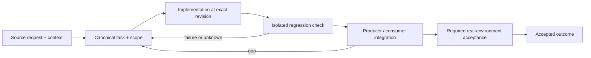

# Truthful telemetry, scalable dashboards and historical accounting

Status: recovery specification / proposed contract; not a claim of completed implementation.

Owner and acceptance coordinator: https://github.com/alex-mextner/rig-cli/issues/521

## Original requests and editorial provenance

> Dashboard всё ещё очень медленный.

Source **Q064**; compiled-fragment-attribution; rig-zerobug/rig-fable session 2026-09-04..07; agent=нет; PDF page(s) 50. Cross-ticket thematic requirement; check context before applying to a narrower issue.

Original wording (before editorial correction)

> dashboard все еще очень медленный

> Все вызовы наших инструментов.

Source **Q069**; compiled-fragment-attribution; rig-zerobug/rig-fable session 2026-09-04..07; agent=нет; PDF page(s) 51. Cross-ticket thematic requirement; check context before applying to a narrower issue.

**Context fragment:** do not interpret as a standalone approval.

Original wording (before editorial correction)

> все тулколы наших инструментов

> rig stats больше про agent-tools.

Source **Q071**; compiled-fragment-attribution; rig-zerobug/rig-fable session 2026-09-04..07; agent=нет; PDF page(s) 51. Cross-ticket thematic requirement; check context before applying to a narrower issue.

**Context fragment:** do not interpret as a standalone approval.

Original wording (before editorial correction)

> rig stats больше про agent-tools

> Добавь в rig stats анализ escape hatches. Сегодня их очень много приходит в Telegram. Нужно собирать статистику и разбираться, что сломано в экосистеме rig и почему агенты используют hatches; в некоторых случаях они, возможно, просто ленятся.

Source **Q230**; compiled-memory-attribution; MEMORY.md standing lesson: rig stats must analyze escape hatches; PDF page(s) 86. Cross-ticket thematic requirement; check context before applying to a narrower issue.

Original wording (before editorial correction)

> добавь в rig stats анализ escape hatches, у меня сегодня очень много их в телегу летит, надо собирать статистики и разбираться что в rig экосистеме сломано изза чего агенты пользуются хетчами или в каких то случаях они ленятся просто

## Boundary and intended behavior

Use stable run/attempt/account identifiers, explicit classification and bounded indexed reads. Preserve every retry/skip/failure record and distinguish missing data. Migrate archives with count/content verification and rollback before retiring old storage.

## Realistic worked example

A dashboard reads a synthetic 154,000-record corpus. Its initial cold-cache state says loading, not zero usage; later source updates do not rewrite earlier account/role attribution. A review invocation is not counted once as a CLI call and again as unrelated agent-tools adoption.

## Acceptance procedure

1. Reproduce the exact operation in an isolated checkout at a named revision.
2. Capture actual and expected behavior; distinguish a product failure from a missing dependency or unsupported platform.
3. Exercise the corresponding producer/consumer boundary, failure/restart case and a negative case.
4. Attach durable output and separately record any real-machine/provider/UI acceptance.
5. Close only the accepted outcome; a merged slice does not close a larger parent.

## State-transition diagram

## Complete linked backlog

| Ticket | Scope | Provider state | Verification |

|---|---|---|---|

| [agent-tools#160](https://github.com/alex-mextner/agent-tools/issues/160) | lint-on-write: rig-provisioned post-write lint hook is dead — wire PostToolUse + add linter feedback | closed | historical-closure-not-reaccepted |

| [agent-tools#184](https://github.com/alex-mextner/agent-tools/issues/184) | bug(catalog): one-descriptor-per-hook-dir scan silently drops a hook's second point | open | open-outcome-requires-acceptance |

| [agent-tools#208](https://github.com/alex-mextner/agent-tools/issues/208) | Mine Hyperide Claude permission logs for dev CLI coverage | closed | historical-closure-not-reaccepted |

| [agent-tools#222](https://github.com/alex-mextner/agent-tools/issues/222) | Drain Alex backlog queue and roadmap | open | open-outcome-requires-acceptance |

| [agent-tools#278](https://github.com/alex-mextner/agent-tools/issues/278) | pm-cli: Milestone 7 — reports and retrospectives (queue, stuck, retro, monthly), every number traceable to the log | open | open-outcome-requires-acceptance |

| [agent-tools#306](https://github.com/alex-mextner/agent-tools/issues/306) | Stock CI catalog templates: secret-scan.yml missing concurrency guard, baseline wiring gap, arch-blind fallback | open | open-outcome-requires-acceptance |

| [agent-tools#382](https://github.com/alex-mextner/agent-tools/issues/382) | docs(roadmap): scope a flow-metrics system for pm-cli | open | open-outcome-requires-acceptance |

| [agent-tools#537](https://github.com/alex-mextner/agent-tools/issues/537) | Build a usefulness report over stop-completion-selfcheck's firings.jsonl (agent-tools and/or rig hook-stats) | open | open-outcome-requires-acceptance |

| [pm-cli#8](https://github.com/alex-mextner/pm-cli/issues/8) | pm report metrics: cycle time / time-in-status per work item | closed | historical-closure-not-reaccepted |

| [pm-cli#10](https://github.com/alex-mextner/pm-cli/issues/10) | Weekly metrics digest via tg, built on pm report metrics | open | open-outcome-requires-acceptance |

| [pm-cli#28](https://github.com/alex-mextner/pm-cli/issues/28) | Weekly metrics digest counts ship-ready as shipped, inflating throughput | open | open-outcome-requires-acceptance |

| [review-cli#115](https://github.com/alex-mextner/review-cli/issues/115) | test_run_stats.py: standalone-visual test fails on CI (no ImageMagick v7 magick binary) | closed | historical-closure-not-reaccepted |

| [review-cli#169](https://github.com/alex-mextner/review-cli/issues/169) | test: leaked backend_available monkeypatch in test_run_stats.py corrupts later tests under non-default ordering | open | open-outcome-requires-acceptance |

| [review-cli#172](https://github.com/alex-mextner/review-cli/issues/172) | review-cli: last-working-provider cache eligibility should use the unfiltered chain, not the availability-filtered one | open | open-outcome-requires-acceptance |

| [review-cli#186](https://github.com/alex-mextner/review-cli/issues/186) | review-cli: wire real token/cost capture for the 4 agentic CLI backends (codex/opencode/omp/claude) via their --json modes | open | open-outcome-requires-acceptance |

| [review-cli#195](https://github.com/alex-mextner/review-cli/issues/195) | record_run(): thread real token counts into run-stats.jsonl | closed | historical-closure-not-reaccepted |

| [review-cli#281](https://github.com/alex-mextner/review-cli/issues/281) | Flaky: test_run_stats.py failover/reserve-promotion pair fails intermittently | open | open-outcome-requires-acceptance |

| [review-cli#318](https://github.com/alex-mextner/review-cli/issues/318) | Review persistent call-log cache diff | closed | historical-closure-not-reaccepted |

| [review-cli#320](https://github.com/alex-mextner/review-cli/issues/320) | call_log_cache: low-severity quality follow-ups from review-cli#317 review | open | open-outcome-requires-acceptance |

| [review-cli#325](https://github.com/alex-mextner/review-cli/issues/325) | Review fresh-process call-log cache pruning diff | closed | historical-closure-not-reaccepted |

| [review-cli#333](https://github.com/alex-mextner/review-cli/issues/333) | Review lazy call-log body retention diff | closed | historical-closure-not-reaccepted |

| [review-cli#346](https://github.com/alex-mextner/review-cli/issues/346) | Real log dir (~/Library/Logs/review-cli) is polluted with fake-backend test artifacts | open | open-outcome-requires-acceptance |

| [review-cli#355](https://github.com/alex-mextner/review-cli/issues/355) | feat(stats,feedback): close token overspend visibility gaps and 0 percent feedback fill rate | open | open-outcome-requires-acceptance |

| [review-cli#468](https://github.com/alex-mextner/review-cli/issues/468) | Per-call logs can be left with no closing EXIT footer when review's process is killed externally | open | open-outcome-requires-acceptance |

| [review-cli#480](https://github.com/alex-mextner/review-cli/issues/480) | SQLite-backed durable call/brainstorm log archive | open | open-outcome-requires-acceptance |

| [rig-cli#61](https://github.com/alex-mextner/rig-cli/issues/61) | Test fake-catalog fabricates a removed slot (mcp/review), masking dead-slot bugs | closed | historical-closure-not-reaccepted |

| [rig-cli#73](https://github.com/alex-mextner/rig-cli/issues/73) | real-catalog pytest tests never run in CI — the regression guards don't gate | closed | historical-closure-not-reaccepted |

| [rig-cli#156](https://github.com/alex-mextner/rig-cli/issues/156) | catalog scanner drops all but first *.json per agent-hook dir | closed | historical-closure-not-reaccepted |

| [rig-cli#174](https://github.com/alex-mextner/rig-cli/issues/174) | Provision the gh-graphql alias skill (ghq wrapper) via the catalog | closed | historical-closure-not-reaccepted |

| [rig-cli#194](https://github.com/alex-mextner/rig-cli/issues/194) | rig-cli: rig apply reports success even when the pi permission-guard catalog carrier is missing | open | open-outcome-requires-acceptance |

| [rig-cli#197](https://github.com/alex-mextner/rig-cli/issues/197) | rig-cli: extend the real-catalog smoke gate to actually exercise pi permission-guard provisioning | open | open-outcome-requires-acceptance |

| [rig-cli#270](https://github.com/alex-mextner/rig-cli/issues/270) | roadmap: performance-check provisioning + task-cli template/logic config via rig | open | open-outcome-requires-acceptance |

| [rig-cli#308](https://github.com/alex-mextner/rig-cli/issues/308) | rig: README ecosystem-block catalog item, offered by rig init | open | open-outcome-requires-acceptance |

| [rig-cli#316](https://github.com/alex-mextner/rig-cli/issues/316) | rig stats undercounts tool invocations inside delegated-agent transcripts | open | open-outcome-requires-acceptance |

| [rig-cli#337](https://github.com/alex-mextner/rig-cli/issues/337) | Codex/opencode/omp are second-class harnesses: gap catalog + Apple-container cross-harness parity test matrix | open | open-outcome-requires-acceptance |

| [rig-cli#421](https://github.com/alex-mextner/rig-cli/issues/421) | Commit the leftover-grep catalog resync that rig apply already wrote | closed | historical-closure-not-reaccepted |

| [rig-cli#433](https://github.com/alex-mextner/rig-cli/issues/433) | lint_preview skips anti-slop stats when nested oxlint config exists | closed | historical-closure-not-reaccepted |

| [rig-cli#465](https://github.com/alex-mextner/rig-cli/issues/465) | rig stats show counts review CLI/MCP/skill as ours, inflating agent-tools adoption | closed | historical-closure-not-reaccepted |

| [rig-cli#480](https://github.com/alex-mextner/rig-cli/issues/480) | rig stats: OUR_CLIS missing harness/qa/stt; no subcommand-level breakdown | open | open-outcome-requires-acceptance |

| [rig-cli#499](https://github.com/alex-mextner/rig-cli/issues/499) | rig stats show: no cache means every run fully re-parses+re-categorizes the entire machine-wide session corpus | closed | historical-closure-not-reaccepted |

| [rig-cli#505](https://github.com/alex-mextner/rig-cli/issues/505) | rig stats session-file cache never prunes entries for deleted/moved session files (unbounded growth) | open | open-outcome-requires-acceptance |

| [stt-cli#22](https://github.com/alex-mextner/stt-cli/issues/22) | stt dict learn: build the terminology dictionary from what Alex already writes | open | open-outcome-requires-acceptance |

| [tg-cli#127](https://github.com/alex-mextner/tg-cli/issues/127) | Answered unscoped blocker never flushes deferred backlog; ✍️ never flips to 👀 (tg#5855) | open | open-outcome-requires-acceptance |
