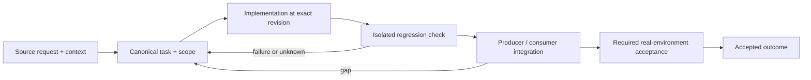

# Hermetic integration and real-platform acceptance

Status: recovery specification / proposed contract; not a claim of completed implementation.

Owner and acceptance coordinator: https://github.com/alex-mextner/rig-cli/issues/521

## Original requests and editorial provenance

> Должно быть протестировано в контейнере.

Source **Q005**; compiled-fragment-attribution; rig-zerobug/rig-fable session 2026-09-04..07; agent=нет; PDF page(s) 34. Cross-ticket thematic requirement; check context before applying to a narrower issue.

Original wording (before editorial correction)

> быть протестированными в контейнере

> Полноценное исследование и контейнеризированные тесты.

Source **Q152**; compiled-fragment-attribution; rig-zerobug/rig-fable session 2026-09-04..07; agent=ThinNotSub; PDF page(s) 35. Cross-ticket thematic requirement; check context before applying to a narrower issue.

Original wording (before editorial correction)

> полноенное исследование и контейнеризированные тесты

> Нужно использовать контейнерные тесты.

Source **Q177**; compiled-fragment-attribution; rig-zerobug/rig-fable session 2026-09-04..07; agent=нет; PDF page(s) 36. Cross-ticket thematic requirement; check context before applying to a narrower issue.

Original wording (before editorial correction)

> нужно использовать контейнерный тесты

> Нужно ещё проверить, что это работает на машине, и приложить к отчёту проверяемые доказательства.

Source **Q202**; compiled-memory-attribution; MEMORY.md standing lesson: Merge is not this machine; on disk is not PATH; PDF page(s) 74. Cross-ticket thematic requirement; check context before applying to a narrower issue.

Original wording (before editorial correction)

> надо еще проверить что это на машине работает и в отчете приложить пруфы проверяемые

> В Telegram само отправилось «/agent 44897 PING-339-LIVE-PROOF». Это явно какие-то тесты.

Source **Q233**; compiled-memory-attribution; MEMORY.md standing lesson: Telegram tests: headless Web + QR, never the real chat; PDF page(s) 87. Cross-ticket thematic requirement; check context before applying to a narrower issue.

Original wording (before editorial correction)

> /agent 44897 PING-339-LIVE-PROOF вот такое сейчас само написалось в телегу)) это точно какие-то тесты

## Boundary and intended behavior

Pin source revisions, isolate HOME/accounts/network side effects, report actual runner/dependency versions and preserve failed/skipped cases. Green unit tests do not certify unexecuted live/UI flows. Reproduce flaky ordering with barriers and observable completion, not larger sleeps.

## Realistic worked example

A Linux fixture proves hook dispatch for a mocked OMP event. That is not evidence that a real OMP child on macOS emits the fixture, or that an installed LaunchAgent works. Record those as separate matrix cells and use a real supported test environment only for the corresponding acceptance.

## Acceptance procedure

1. Reproduce the exact operation in an isolated checkout at a named revision.
2. Capture actual and expected behavior; distinguish a product failure from a missing dependency or unsupported platform.
3. Exercise the corresponding producer/consumer boundary, failure/restart case and a negative case.
4. Attach durable output and separately record any real-machine/provider/UI acceptance.
5. Close only the accepted outcome; a merged slice does not close a larger parent.

## State-transition diagram

## Complete linked backlog

| Ticket | Scope | Provider state | Verification |

|---|---|---|---|

| [agent-tools#24](https://github.com/alex-mextner/agent-tools/issues/24) | Add a Trivy (filesystem/dep vuln) CI gate to agent-tools + rig-provision it | closed | historical-closure-not-reaccepted |

| [agent-tools#129](https://github.com/alex-mextner/agent-tools/issues/129) | CI gate scripts: leftover-grep shallow-fetch silent no-op, codeql suppression seam, dependency-review tamper model, conflict-marker false-positive | closed | historical-closure-not-reaccepted |

| [agent-tools#130](https://github.com/alex-mextner/agent-tools/issues/130) | Fix 3 bugs in shipped CI-gate workflows (dep-review self-weakening + no toolchain, leftover-grep shallow-fetch no-op, codeql SIGPIPE self-disable) | closed | historical-closure-not-reaccepted |

| [agent-tools#139](https://github.com/alex-mextner/agent-tools/issues/139) | docs(ci): document client-vs-server gate enforcement (the #543 bypass gap) | open | open-outcome-requires-acceptance |

| [agent-tools#234](https://github.com/alex-mextner/agent-tools/issues/234) | Decide handling of shell-layer bypasses: GLOBAL_HOOKS_SKIP + review-gate $REVIEW_SKIP (follow-up to #213) | open | open-outcome-requires-acceptance |

| [agent-tools#276](https://github.com/alex-mextner/agent-tools/issues/276) | pm-cli: Milestone 5 — evidence reconcilers for PR and CI plus rig health, stopping before the deploy and ship-audit forks | open | open-outcome-requires-acceptance |

| [agent-tools#302](https://github.com/alex-mextner/agent-tools/issues/302) | Precise merge-mutation guard + provision a gh api graphql alias (ghq) | closed | historical-closure-not-reaccepted |

| [agent-tools#305](https://github.com/alex-mextner/agent-tools/issues/305) | decision-request-format hook: enforce verbatim spec quotes | open | open-outcome-requires-acceptance |

| [agent-tools#308](https://github.com/alex-mextner/agent-tools/issues/308) | decision-request-format hook can't see content injected via command substitution ($(cat file)/heredoc) | open | open-outcome-requires-acceptance |

| [agent-tools#326](https://github.com/alex-mextner/agent-tools/issues/326) | ci/ship: invalid committed .ship-config fails OPEN instead of fails CLOSED | open | open-outcome-requires-acceptance |

| [agent-tools#328](https://github.com/alex-mextner/agent-tools/issues/328) | chore(ci): wire the pi permission-guard extension's tests into agent-tools CI gate | open | open-outcome-requires-acceptance |

| [agent-tools#343](https://github.com/alex-mextner/agent-tools/issues/343) | model-freshness: bump proposal rewrites only id:, leaves :latest alias + fallback_chain dangling | open | open-outcome-requires-acceptance |

| [agent-tools#345](https://github.com/alex-mextner/agent-tools/issues/345) | ci templates: CodeQL suppression markers emitted in a form the self-gate cannot recognize | open | open-outcome-requires-acceptance |

| [agent-tools#351](https://github.com/alex-mextner/agent-tools/issues/351) | test_rig_cli_generates_if_importable crashes on SyntaxError instead of skipping | open | open-outcome-requires-acceptance |

| [agent-tools#359](https://github.com/alex-mextner/agent-tools/issues/359) | test_global_review_gate.py: fixed .test-repos scratch path causes FileExistsError across runs | open | open-outcome-requires-acceptance |

| [agent-tools#376](https://github.com/alex-mextner/agent-tools/issues/376) | docs(decision-request-discipline): stale/dangling PRs and branches are never an escalation | open | open-outcome-requires-acceptance |

| [agent-tools#402](https://github.com/alex-mextner/agent-tools/issues/402) | test_global_review_gate.py: .test-repos fixture dirs not cleaned up, fail on repeat run | open | open-outcome-requires-acceptance |

| [agent-tools#408](https://github.com/alex-mextner/agent-tools/issues/408) | ship: known-flake gate follow-ups (N+1 gh calls, required-check dead-end, StatusContext doc, lookback test) | open | open-outcome-requires-acceptance |

| [agent-tools#409](https://github.com/alex-mextner/agent-tools/issues/409) | ship: add --known-flake gate for confirmed pre-existing CI flakes | closed | historical-closure-not-reaccepted |

| [agent-tools#413](https://github.com/alex-mextner/agent-tools/issues/413) | tests/test_global_review_gate.py leaves .test-repos/<name>/repo dirs behind, crashing a second local run | open | open-outcome-requires-acceptance |

| [agent-tools#419](https://github.com/alex-mextner/agent-tools/issues/419) | block-rg-pre: argv-precise hook to block ripgrep --pre (arbitrary command execution) | open | open-outcome-requires-acceptance |

| [agent-tools#437](https://github.com/alex-mextner/agent-tools/issues/437) | Review marker guard recipe diff | closed | historical-closure-not-reaccepted |

| [agent-tools#446](https://github.com/alex-mextner/agent-tools/issues/446) | Relocate gh-attach-image.sh from hyperide into agent-tools' own ci/ship/ directory | open | open-outcome-requires-acceptance |

| [agent-tools#466](https://github.com/alex-mextner/agent-tools/issues/466) | hmr-root: add a real HMR-boundary integration test (not just the extracted unit) | closed | historical-closure-not-reaccepted |

| [agent-tools#578](https://github.com/alex-mextner/agent-tools/issues/578) | Read-only greps are refused as "build/test work" by the skills gate | closed | historical-closure-not-reaccepted |

| [dev-cli#13](https://github.com/alex-mextner/dev-cli/issues/13) | Review pinned Ruff CI diff | closed | historical-closure-not-reaccepted |

| [pm-cli#13](https://github.com/alex-mextner/pm-cli/issues/13) | test_monthly_report_groups_product_and_process is a time-bomb test (hardcoded 2026-07 month) | closed | historical-closure-not-reaccepted |

| [review-cli#54](https://github.com/alex-mextner/review-cli/issues/54) | review-qa Phase 1: mode skeleton + no-suites gate | closed | historical-closure-not-reaccepted |

| [review-cli#56](https://github.com/alex-mextner/review-cli/issues/56) | review-qa Phase 2: write/exec agentic executor + judge + 2-fixture DoD | closed | historical-closure-not-reaccepted |

| [review-cli#58](https://github.com/alex-mextner/review-cli/issues/58) | review qa: --visual is built (paid) by cli.py then dropped — thread it or reject it pre-pipeline | closed | historical-closure-not-reaccepted |

| [review-cli#61](https://github.com/alex-mextner/review-cli/issues/61) | review qa: --kind auto bot-detection misses Python projects; help config omits qa | closed | historical-closure-not-reaccepted |

| [review-cli#63](https://github.com/alex-mextner/review-cli/issues/63) | review-qa Phase 3: SUT env bring-up — detect/reuse/health-gate/guaranteed-teardown | closed | historical-closure-not-reaccepted |

| [review-cli#69](https://github.com/alex-mextner/review-cli/issues/69) | review qa: web (Playwright) Tier-1 deterministic harness | closed | historical-closure-not-reaccepted |

| [review-cli#73](https://github.com/alex-mextner/review-cli/issues/73) | review qa: VS Code extension Tier-1 deterministic harness (ext kind) | closed | historical-closure-not-reaccepted |

| [review-cli#84](https://github.com/alex-mextner/review-cli/issues/84) | review-qa Tier-2 SCAFFOLDING: gated live-driver seams + creds-doc (no live run) | closed | historical-closure-not-reaccepted |

| [review-cli#92](https://github.com/alex-mextner/review-cli/issues/92) | Fix review-cli smoke failures surfaced during visual review fix | closed | historical-closure-not-reaccepted |

| [review-cli#122](https://github.com/alex-mextner/review-cli/issues/122) | test_preclassifier: test_pipeline_check_run_does_not_reuse_plain_keep fails on any machine with the selection-highlight module globally registered | open | open-outcome-requires-acceptance |

| [review-cli#130](https://github.com/alex-mextner/review-cli/issues/130) | visual pipeline: emit exhaustive module verdicts (or a completeness marker) so downstream can't misread a short-circuited veto list | open | open-outcome-requires-acceptance |

| [review-cli#168](https://github.com/alex-mextner/review-cli/issues/168) | Test-ordering flakes: 4 tests fail under full pytest suite but pass in isolation (pre-existing on main) | open | open-outcome-requires-acceptance |

| [review-cli#208](https://github.com/alex-mextner/review-cli/issues/208) | review-before-commit gate: exact staged-diff hash has zero tolerance for trivial follow-up edits, forcing a full multi-model re-review on every restage | closed | historical-closure-not-reaccepted |

| [review-cli#212](https://github.com/alex-mextner/review-cli/issues/212) | test_review_commit_checkpoint.py: 3 tests fail under a global git commit hook (pre-existing, env-specific) | open | open-outcome-requires-acceptance |

| [review-cli#219](https://github.com/alex-mextner/review-cli/issues/219) | tests/smoke.py::test_reviewlib_unit_files fails: bare python3 subprocess can't import pytest (pre-existing, env-specific) | open | open-outcome-requires-acceptance |

| [review-cli#260](https://github.com/alex-mextner/review-cli/issues/260) | Preserve explicit opencode model identity in flat diff results | open | open-outcome-requires-acceptance |

| [review-cli#352](https://github.com/alex-mextner/review-cli/issues/352) | test_cli_failover_backfill_records_actual_models_not_planned fails on clean main | open | open-outcome-requires-acceptance |

| [review-cli#401](https://github.com/alex-mextner/review-cli/issues/401) | Isolate review gate tests from recursion marker | open | open-outcome-requires-acceptance |

| [rig-cli#68](https://github.com/alex-mextner/rig-cli/issues/68) | status: #67 'tools' reconcile category absent from area/layer registries → rig status silently under-reports the CLI ecosystem | closed | historical-closure-not-reaccepted |

| [rig-cli#107](https://github.com/alex-mextner/rig-cli/issues/107) | AGENTS.md template: guardrail against invented abbreviations in user-facing reports (tg#5802) | closed | historical-closure-not-reaccepted |

| [rig-cli#135](https://github.com/alex-mextner/rig-cli/issues/135) | dev-cli should cover scoped extension test process cleanup | open | open-outcome-requires-acceptance |

| [rig-cli#160](https://github.com/alex-mextner/rig-cli/issues/160) | rig apply: preview-by-default with explicit commit step | closed | historical-closure-not-reaccepted |

| [rig-cli#167](https://github.com/alex-mextner/rig-cli/issues/167) | rig apply overwrites rig-cli's Python dependency-review CI with the generic bun template, breaking its own gate | open | open-outcome-requires-acceptance |

| [rig-cli#170](https://github.com/alex-mextner/rig-cli/issues/170) | rig: provision the pi permission-guard extension (pi permission parity) | open | open-outcome-requires-acceptance |

| [rig-cli#190](https://github.com/alex-mextner/rig-cli/issues/190) | rig-cli: JSON Schema and runtime validation disagree on explicit null for dev/scripts fields | open | open-outcome-requires-acceptance |

| [rig-cli#202](https://github.com/alex-mextner/rig-cli/issues/202) | omp permissions provisioning: managed guard hook + config.yml policy (functional parity) | closed | historical-closure-not-reaccepted |

| [rig-cli#231](https://github.com/alex-mextner/rig-cli/issues/231) | Per-stack default policy profiles with explicit applicability and inheritance | open | open-outcome-requires-acceptance |

| [rig-cli#242](https://github.com/alex-mextner/rig-cli/issues/242) | Policy test/verification contract: prove configured culture actually takes effect | open | open-outcome-requires-acceptance |

| [rig-cli#286](https://github.com/alex-mextner/rig-cli/issues/286) | rig: auto-reminder/nudge system to prevent agent from deferring resolved decisions back to human | open | open-outcome-requires-acceptance |

| [rig-cli#342](https://github.com/alex-mextner/rig-cli/issues/342) | Give omp a real agents-hooks/v1 bridge (parity with codex/opencode) | closed | historical-closure-not-reaccepted |

| [rig-cli#364](https://github.com/alex-mextner/rig-cli/issues/364) | dev machine: stray cryptography tests/ package in /opt/homebrew/lib/python3.14/site-packages shadows every repo's tests/ (import tests.* resolves to it) | closed | historical-closure-not-reaccepted |

| [rig-cli#461](https://github.com/alex-mextner/rig-cli/issues/461) | Apple-container matrix: remaining kinds pi and commandcode | closed | historical-closure-not-reaccepted |

| [rig-cli#518](https://github.com/alex-mextner/rig-cli/issues/518) | TCC attribution: correlate incidents to the correct native agent/session generation | open | open-outcome-requires-acceptance |

| [rig-cli#519](https://github.com/alex-mextner/rig-cli/issues/519) | TCC notifications: deliver the actual incident outcome to the attributed agent without duplicates | open | open-outcome-requires-acceptance |

| [stt-cli#2](https://github.com/alex-mextner/stt-cli/issues/2) | stt: reconcile rig.yaml GitHub settings with the CI workflows it ships | open | open-outcome-requires-acceptance |

| [task-cli#9](https://github.com/alex-mextner/task-cli/issues/9) | [smoke] verify task new/done verbs against live backend | closed | historical-closure-not-reaccepted |

| [task-cli#15](https://github.com/alex-mextner/task-cli/issues/15) | Docker integration test: real cheap LLM agent verifies task-cli is advertised + usable (CI test-cli job) | closed | historical-closure-not-reaccepted |

| [task-cli#69](https://github.com/alex-mextner/task-cli/issues/69) | task-cli: tag each links-url rejection with its specific reason instead of one merged message | open | open-outcome-requires-acceptance |

| [task-cli#153](https://github.com/alex-mextner/task-cli/issues/153) | rig stats: too coarse (ours-vs-baseline only), undercounts (task-cli#316), no per-subcommand/hook/git-hook detail, no web UI, no test-data exclusion | open | open-outcome-requires-acceptance |

| [tg-cli#32](https://github.com/alex-mextner/tg-cli/issues/32) | AGENTS.md stale test count: ~578 tests → 997 | closed | historical-closure-not-reaccepted |

| [tg-cli#104](https://github.com/alex-mextner/tg-cli/issues/104) | convertMdToPdf does not sanitize pandoc raw-HTML output — a hostile .md with <iframe src=file://>/<script> reaches Chrome (md path not at .html sanitization parity) | open | open-outcome-requires-acceptance |

| [tg-cli#126](https://github.com/alex-mextner/tg-cli/issues/126) | test: ctl-new-spawn-integration flakes under full-suite load | open | open-outcome-requires-acceptance |

| [tg-cli#154](https://github.com/alex-mextner/tg-cli/issues/154) | CI flakiness: 2 integration tests intermittently fail on ubuntu runner | open | open-outcome-requires-acceptance |

| [tg-cli#168](https://github.com/alex-mextner/tg-cli/issues/168) | Escalation gate follow-ups: e2e block test, Tier-2 reachability note, minor edge cases | open | open-outcome-requires-acceptance |

| [tg-cli#220](https://github.com/alex-mextner/tg-cli/issues/220) | tg: reconcile the pre-send escalation-format hook with the new deny-by-default gate contract | open | open-outcome-requires-acceptance |

| [tg-cli#224](https://github.com/alex-mextner/tg-cli/issues/224) | tg: reconcile mixed-script-guard docs with its actual bidirectional detection | open | open-outcome-requires-acceptance |

| [tg-cli#240](https://github.com/alex-mextner/tg-cli/issues/240) | tg: dry-run/send guard parity is enforced by code position, not structure | open | open-outcome-requires-acceptance |

| [tg-cli#261](https://github.com/alex-mextner/tg-cli/issues/261) | Verify escalation-format gate Readability check against real decision-request content (reported false-rejects) | closed | historical-closure-not-reaccepted |

| [tg-cli#277](https://github.com/alex-mextner/tg-cli/issues/277) | tg-cli: stale bare-hash id-wrap references across several files and one test | open | open-outcome-requires-acceptance |

| [tg-cli#287](https://github.com/alex-mextner/tg-cli/issues/287) | escalation-format gate rejects its own documented --tag decision example | open | open-outcome-requires-acceptance |

| [tg-cli#326](https://github.com/alex-mextner/tg-cli/issues/326) | CI gates fail closed and audit PR lockfiles as data | open | open-outcome-requires-acceptance |
