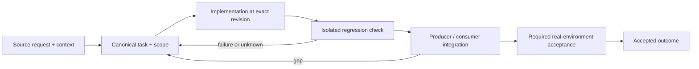

# Worktree isolation and preservation of unfinished work

Status: recovery specification / proposed contract; not a claim of completed implementation.

Owner and acceptance coordinator: https://github.com/alex-mextner/rig-cli/issues/521

## Original requests and editorial provenance

> А что с другими харнесами? Изучи, какие у них есть инструменты и настройки для работы с worktree: OpenCode, OMP, Codex.

Source **Q216**; compiled-memory-attribution; MEMORY.md standing lesson: EnterWorktree is one harness; ban the equivalent on all; PDF page(s) 80. Cross-ticket thematic requirement; check context before applying to a narrower issue.

Original wording (before editorial correction)

> а что с другими харнесами? изучи какие там есть тулы и настройки для работы с ворктри, oc, omp, codex

> Основная директория — только для main.

Source **Q043**; compiled-fragment-attribution; rig-zerobug/rig-fable session 2026-09-04..07; agent=нет; PDF page(s) 47. Cross-ticket thematic requirement; check context before applying to a narrower issue.

Original wording (before editorial correction)

> основная директория только для main

> Не трогать грязные основные директории.

Source **Q049**; compiled-fragment-attribution; rig-zerobug/rig-fable session 2026-09-04..07; agent=нет; PDF page(s) 47. Cross-ticket thematic requirement; check context before applying to a narrower issue.

Original wording (before editorial correction)

> не трогать грязные основные директории

> Требовать использовать rig worktree.

Source **Q082**; compiled-fragment-attribution; rig-zerobug/rig-fable session 2026-09-04..07; agent=нет; PDF page(s) 4. Cross-ticket thematic requirement; check context before applying to a narrower issue.

Original wording (before editorial correction)

> требовать испоьзвоать rig worktree

## Boundary and intended behavior

One canonical worktree creation path; trusted per-operation target resolution; clear alternatives in refusal messages. Inspect dirty branches and unique commits before consolidation. Do not delete, reset or force-push another agent's work to make a dashboard green.

## Realistic worked example

Two agents work on the same repository in different .worktrees directories. One edits a relative src/app.py after its execution kernel restarts. The edit must still address its own checkout, not main or the other agent. A file outside any Git repository is a separate case, not automatically a forbidden main-checkout write.

## Acceptance procedure

1. Reproduce the exact operation in an isolated checkout at a named revision.
2. Capture actual and expected behavior; distinguish a product failure from a missing dependency or unsupported platform.
3. Exercise the corresponding producer/consumer boundary, failure/restart case and a negative case.
4. Attach durable output and separately record any real-machine/provider/UI acceptance.
5. Close only the accepted outcome; a merged slice does not close a larger parent.

## State-transition diagram

## Complete linked backlog

| Ticket | Scope | Provider state | Verification |

|---|---|---|---|

| [agent-tools#106](https://github.com/alex-mextner/agent-tools/issues/106) | docs(spec): rig-agents-provisioning.md is an UNCOMMITTED orphan in the primary checkout (corrected in place; needs landing) | closed | historical-closure-not-reaccepted |

| [agent-tools#163](https://github.com/alex-mextner/agent-tools/issues/163) | Harness workflow guards: worktree-only writes + orchestrator-only enforcement (tg#5742/5743) | closed | historical-closure-not-reaccepted |

| [agent-tools#166](https://github.com/alex-mextner/agent-tools/issues/166) | gh ship --repo: make local gates (version-bump, CI-down runner, worktree/branch cleanup) target-aware | open | open-outcome-requires-acceptance |

| [agent-tools#178](https://github.com/alex-mextner/agent-tools/issues/178) | feat(agent-hooks): block-reset-hard — guard git reset --hard / clean -f | closed | historical-closure-not-reaccepted |

| [agent-tools#181](https://github.com/alex-mextner/agent-tools/issues/181) | Sibling pre-bash hooks missing 'if' in leading-shell-noise stripping (same gap fixed in block-reset-hard) | open | open-outcome-requires-acceptance |

| [agent-tools#182](https://github.com/alex-mextner/agent-tools/issues/182) | feat(agent-hooks): pin the primary worktree to its default branch (pre-bash) | closed | historical-closure-not-reaccepted |

| [agent-tools#187](https://github.com/alex-mextner/agent-tools/issues/187) | block-reset-hard: fail-closed bailout blocks prose mentions of the command, contradicting README's 'mentions are safe' claim | open | open-outcome-requires-acceptance |

| [agent-tools#198](https://github.com/alex-mextner/agent-tools/issues/198) | fix(agent-hooks): block-reset-hard unparseable fallback over-triggers on prose naming the guard | open | open-outcome-requires-acceptance |

| [agent-tools#315](https://github.com/alex-mextner/agent-tools/issues/315) | Live-checkout personal CLIs (tg-cli, task-cli, pm-cli, etc.) go stale between sessions, causing phantom 'uncommitted work' false alarms | open | open-outcome-requires-acceptance |

| [agent-tools#319](https://github.com/alex-mextner/agent-tools/issues/319) | ci/ship: ROOT in the CI-down local-fallback gate may point at the launcher's checkout, not the PR's head commit | open | open-outcome-requires-acceptance |

| [agent-tools#321](https://github.com/alex-mextner/agent-tools/issues/321) | ci/ship: local-fallback gate's test-runner detection executes before the pre-existing dirty-worktree check | open | open-outcome-requires-acceptance |

| [agent-tools#331](https://github.com/alex-mextner/agent-tools/issues/331) | ship.sh local-fallback gate should warn when running from a worktree for repos with known sibling-path test dependencies | open | open-outcome-requires-acceptance |

| [agent-tools#361](https://github.com/alex-mextner/agent-tools/issues/361) | Deny-by-default PreToolUse guard for git worktree remove --force / git branch -D | open | open-outcome-requires-acceptance |

| [agent-tools#381](https://github.com/alex-mextner/agent-tools/issues/381) | Review worktree ignore-rule diff | closed | historical-closure-not-reaccepted |

| [agent-tools#412](https://github.com/alex-mextner/agent-tools/issues/412) | ship.sh review-quorum gate: use role-based coverage as primary check, matching review-cli's own default | closed | historical-closure-not-reaccepted |

| [agent-tools#441](https://github.com/alex-mextner/agent-tools/issues/441) | Document isolation-mode cross-worktree git-op block + fork workaround | open | open-outcome-requires-acceptance |

| [agent-tools#453](https://github.com/alex-mextner/agent-tools/issues/453) | EnterWorktree into a foreign agent's worktree reports success then bricks Bash for the rest of the session | open | open-outcome-requires-acceptance |

| [agent-tools#454](https://github.com/alex-mextner/agent-tools/issues/454) | feat(agent-hooks): block-devserver-primary — block a dev server launched against the shared checkout | closed | historical-closure-not-reaccepted |

| [agent-tools#456](https://github.com/alex-mextner/agent-tools/issues/456) | Review block-devserver-primary uncommitted diff | closed | historical-closure-not-reaccepted |

| [agent-tools#457](https://github.com/alex-mextner/agent-tools/issues/457) | Review enterworktree foreign-guard diff | closed | historical-closure-not-reaccepted |

| [agent-tools#463](https://github.com/alex-mextner/agent-tools/issues/463) | feat(block-devserver-primary): unwrap command wrappers (nohup/env/sudo/bash -c) before classification | open | open-outcome-requires-acceptance |

| [agent-tools#465](https://github.com/alex-mextner/agent-tools/issues/465) | Adversarial review: checkout staleness diff | closed | historical-closure-not-reaccepted |

| [agent-tools#473](https://github.com/alex-mextner/agent-tools/issues/473) | block-devserver-primary: shell-parser fidelity gaps (escaped whitespace before #, escaped & adjacent to real &, over-cap cd base) | open | open-outcome-requires-acceptance |

| [agent-tools#486](https://github.com/alex-mextner/agent-tools/issues/486) | refresh-agent-tools-checkout.sh: recheck ship-running immediately before merge, not just before fetch | open | open-outcome-requires-acceptance |

| [agent-tools#492](https://github.com/alex-mextner/agent-tools/issues/492) | Review worktree-local Python fallback guard | open | open-outcome-requires-acceptance |

| [agent-tools#496](https://github.com/alex-mextner/agent-tools/issues/496) | gh ship <N> without --repo can misresolve the target repo when run from a linked git worktree | open | open-outcome-requires-acceptance |

| [agent-tools#514](https://github.com/alex-mextner/agent-tools/issues/514) | block-reset-hard does not fire: git reset --hard runs unguarded and destroys uncommitted work | open | open-outcome-requires-acceptance |

| [agent-tools#522](https://github.com/alex-mextner/agent-tools/issues/522) | ship: local gates (version-bump, clean-worktree) evaluate the CWD checkout, not the --repo target | open | open-outcome-requires-acceptance |

| [agent-tools#554](https://github.com/alex-mextner/agent-tools/issues/554) | worktree-isolation skill: point agents at 'rig worktree create' (one location, one naming rule) | open | open-outcome-requires-acceptance |

| [agent-tools#608](https://github.com/alex-mextner/agent-tools/issues/608) | Add block-raw-worktree-add agent-hook: enforce rig worktree create as the only door | closed | historical-closure-not-reaccepted |

| [agent-tools#615](https://github.com/alex-mextner/agent-tools/issues/615) | omp bridge + worktree-only-writes: directory checks trust the session cwd, not the write's real target directory | open | open-outcome-requires-acceptance |

| [agent-tools#616](https://github.com/alex-mextner/agent-tools/issues/616) | worktree-only-writes: relative hashline path can't be resolved to its real worktree without omp exposing the resolved absolute path | open | open-outcome-requires-acceptance |

| [agent-tools#682](https://github.com/alex-mextner/agent-tools/issues/682) | gh ship's version-bump gate reads the invoking shell's CWD checkout, not --repo's target repo — false refuse / false pass shipping cross-repo | open | open-outcome-requires-acceptance |

| [agent-tools#692](https://github.com/alex-mextner/agent-tools/issues/692) | ai-review-before-commit / worktree-only-writes / orchestrator-stays-thin hooks only wrap the Bash tool, not Eval-tool subprocess git mutations | open | open-outcome-requires-acceptance |

| [agent-tools#693](https://github.com/alex-mextner/agent-tools/issues/693) | Subagent writes intended for its own git worktree can land in the primary checkout instead (eval-kernel cwd desync) | open | open-outcome-requires-acceptance |

| [agent-tools#698](https://github.com/alex-mextner/agent-tools/issues/698) | worktree-only-writes hook blocks absolute-path edits entirely outside any git repo | closed | historical-closure-not-reaccepted |

| [agent-tools#700](https://github.com/alex-mextner/agent-tools/issues/700) | worktree-only-writes hook blocks absolute-path edits entirely outside any git repo | closed | historical-closure-not-reaccepted |

| [agent-tools#716](https://github.com/alex-mextner/agent-tools/issues/716) | docs(skills): require worktree before solo subagent first Edit/Write | open | open-outcome-requires-acceptance |

| [agent-tools#719](https://github.com/alex-mextner/agent-tools/issues/719) | chore(agent-tools): enable worktree-only guard in rig.yaml | closed | historical-closure-not-reaccepted |

| [agent-tools#720](https://github.com/alex-mextner/agent-tools/issues/720) | feat(agent-hooks): enterworktree-canonical-path-grant for CC EnterWorktree prompt | closed | historical-closure-not-reaccepted |

| [draw-cli#21](https://github.com/alex-mextner/draw-cli/issues/21) | chore(rig): enable worktree-only guard for the primary checkout | closed | historical-closure-not-reaccepted |

| [pm-cli#22](https://github.com/alex-mextner/pm-cli/issues/22) | Review pm-cli worktree-only rig diff | closed | historical-closure-not-reaccepted |

| [research-cli#18](https://github.com/alex-mextner/research-cli/issues/18) | chore(rig): enable worktree-only guard for the primary checkout | closed | historical-closure-not-reaccepted |

| [review-cli#60](https://github.com/alex-mextner/review-cli/issues/60) | review qa: forward -m model suffix to the tester + clean up ephemeral-worktree trust entries | closed | historical-closure-not-reaccepted |

| [review-cli#76](https://github.com/alex-mextner/review-cli/issues/76) | claude:claude-opus-4-8 review seat returns corrupted/unparseable verdict (TUI-scraper bleed via claude-p) — degrades primary review-gate | closed | historical-closure-not-reaccepted |

| [review-cli#119](https://github.com/alex-mextner/review-cli/issues/119) | review diff --commit: safe checkpoint for multi-round fix loops (never git reset --hard) | closed | historical-closure-not-reaccepted |

| [review-cli#366](https://github.com/alex-mextner/review-cli/issues/366) | review-cli-wt-fable-disable worktree stuck mid-rebase with unresolved conflict since 2026-08-28 | open | open-outcome-requires-acceptance |

| [review-cli#368](https://github.com/alex-mextner/review-cli/issues/368) | review-cli: six worktrees touch the same dashboard files -- sequence merges instead of shipping them in parallel | open | open-outcome-requires-acceptance |

| [review-cli#395](https://github.com/alex-mextner/review-cli/issues/395) | review diff reviews a DIFFERENT worktree than -C (codex workdir = .worktrees/honest-drift while -C = .worktrees/harness-account-dirs) | open | open-outcome-requires-acceptance |

| [review-cli#411](https://github.com/alex-mextner/review-cli/issues/411) | Enroll worktree-only guard in review-cli rig.yaml | open | open-outcome-requires-acceptance |

| [review-cli#412](https://github.com/alex-mextner/review-cli/issues/412) | Review worktree-only rig guard | open | open-outcome-requires-acceptance |

| [rig-cli#113](https://github.com/alex-mextner/rig-cli/issues/113) | No scheduled/background sync for agent-tool checkouts — only on-demand via rig apply | open | open-outcome-requires-acceptance |

| [rig-cli#128](https://github.com/alex-mextner/rig-cli/issues/128) | gh ship broken machine-wide: rig apply pins AGENT_TOOLS_ROOT at a transient temp checkout | closed | historical-closure-not-reaccepted |

| [rig-cli#181](https://github.com/alex-mextner/rig-cli/issues/181) | agent-tools checkout: opencode_hook_bridge/plugin.js corrupted into a self-referencing symlink | closed | historical-closure-not-reaccepted |

| [rig-cli#182](https://github.com/alex-mextner/rig-cli/issues/182) | rig-cli: clarify that the worktree-only-writes warn-then-block escalation is scoped per cwd and hook point, not global | open | open-outcome-requires-acceptance |

| [rig-cli#184](https://github.com/alex-mextner/rig-cli/issues/184) | rig-cli: strengthen the worktree-only-writes doc consistency tests to check specific sections, not whole-document search | open | open-outcome-requires-acceptance |

| [rig-cli#214](https://github.com/alex-mextner/rig-cli/issues/214) | block-reset-hard pre-bash hook false-blocks tg messages containing reset --hard as prose | open | open-outcome-requires-acceptance |

| [rig-cli#253](https://github.com/alex-mextner/rig-cli/issues/253) | Review worktree-create diff for cross-file consistency | closed | historical-closure-not-reaccepted |

| [rig-cli#255](https://github.com/alex-mextner/rig-cli/issues/255) | worktree: consolidate the 3rd copy-pasted git-exclude marker-splice reconciler into a shared helper | open | open-outcome-requires-acceptance |

| [rig-cli#256](https://github.com/alex-mextner/rig-cli/issues/256) | worktree: decide whether 'rig worktree create' should always resolve to the PRIMARY checkout root | open | open-outcome-requires-acceptance |

| [rig-cli#258](https://github.com/alex-mextner/rig-cli/issues/258) | Review worktree-create diff for cross-file consistency | closed | historical-closure-not-reaccepted |

| [rig-cli#261](https://github.com/alex-mextner/rig-cli/issues/261) | Standardize agent worktree creation on .worktrees/<name> + auto-register in .git/info/exclude | closed | historical-closure-not-reaccepted |

| [rig-cli#263](https://github.com/alex-mextner/rig-cli/issues/263) | Review worktree failure handling for cross-file consistency | open | open-outcome-requires-acceptance |

| [rig-cli#265](https://github.com/alex-mextner/rig-cli/issues/265) | Review worktree create failure diagnostics | closed | historical-closure-not-reaccepted |

| [rig-cli#272](https://github.com/alex-mextner/rig-cli/issues/272) | rig worktree remove — inverse of rig worktree create | closed | historical-closure-not-reaccepted |

| [rig-cli#275](https://github.com/alex-mextner/rig-cli/issues/275) | rig worktree remove: follow-up polish from final review round (non-blocking) | open | open-outcome-requires-acceptance |

| [rig-cli#297](https://github.com/alex-mextner/rig-cli/issues/297) | Register an EnterWorktree PreToolUse matcher for the CC hook bridge | open | open-outcome-requires-acceptance |

| [rig-cli#321](https://github.com/alex-mextner/rig-cli/issues/321) | rig-cli: enable agent_hooks.worktree_only + pick up leftover-grep merge-base fix | open | open-outcome-requires-acceptance |

| [rig-cli#324](https://github.com/alex-mextner/rig-cli/issues/324) | agent_hooks.worktree_only not enabled on most 'agent-ecosystem' repos despite AGENTS.md policy | open | open-outcome-requires-acceptance |

| [rig-cli#326](https://github.com/alex-mextner/rig-cli/issues/326) | Instruct agents to proactively create a worktree, not rely on reactive hook block | open | open-outcome-requires-acceptance |

| [rig-cli#327](https://github.com/alex-mextner/rig-cli/issues/327) | Agent-hook guards (worktree-only, orchestrator-only) are Claude-Code-only, not harness-agnostic | open | open-outcome-requires-acceptance |

| [rig-cli#329](https://github.com/alex-mextner/rig-cli/issues/329) | One canonical worktree location plus 'rig worktree gc': today there are five naming conventions and about 70 leftover worktrees across the ecosystem repos | closed | historical-closure-not-reaccepted |

| [rig-cli#331](https://github.com/alex-mextner/rig-cli/issues/331) | Spotlight sentinel .metadata_never_index shows up as an untracked file in every repo and worktree, so gh ship refuses them as dirty | open | open-outcome-requires-acceptance |

| [rig-cli#338](https://github.com/alex-mextner/rig-cli/issues/338) | Review worktree GC diff | closed | historical-closure-not-reaccepted |

| [rig-cli#353](https://github.com/alex-mextner/rig-cli/issues/353) | worktree gc: a process that exits mid-scan marks every worktree as live (pid race in the liveness snapshot) | closed | historical-closure-not-reaccepted |

| [rig-cli#360](https://github.com/alex-mextner/rig-cli/issues/360) | Review worktree GC PID-race diff | closed | historical-closure-not-reaccepted |

| [rig-cli#418](https://github.com/alex-mextner/rig-cli/issues/418) | rig never provisions an EnterWorktree permission entry, so every worktree entry into the canonical .worktrees/ path prompts | open | open-outcome-requires-acceptance |

| [rig-cli#422](https://github.com/alex-mextner/rig-cli/issues/422) | Deny Claude Code EnterWorktree and raw git worktree add in the baked permissions baseline | closed | historical-closure-not-reaccepted |

| [rig-cli#428](https://github.com/alex-mextner/rig-cli/issues/428) | Codex execpolicy CLI check for git worktree add | closed | historical-closure-not-reaccepted |

| [rig-cli#430](https://github.com/alex-mextner/rig-cli/issues/430) | Audit execpolicy worktree denial coverage | open | open-outcome-requires-acceptance |

| [task-cli#85](https://github.com/alex-mextner/task-cli/issues/85) | task update: record PR number and worktree path against a ticket | open | open-outcome-requires-acceptance |

| [task-cli#141](https://github.com/alex-mextner/task-cli/issues/141) | Review worktree-only rig hook configuration | closed | historical-closure-not-reaccepted |

| [task-cli#149](https://github.com/alex-mextner/task-cli/issues/149) | RIG_WORKTREE_ONLY=0 silently overrides the committed worktree_only config with no warning | open | open-outcome-requires-acceptance |

| [tg-cli#367](https://github.com/alex-mextner/tg-cli/issues/367) | chore: enable worktree-only guard on primary checkout (prevents dirty-stale-primary incidents) | open | open-outcome-requires-acceptance |
